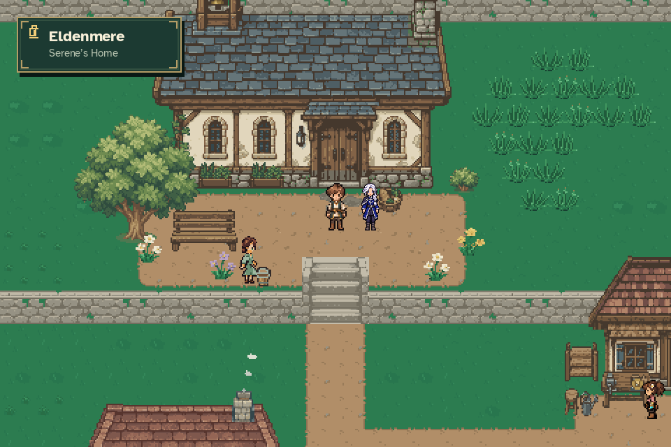

# Approved portrait and 42×72 idle

Authoring rules live in the [global sprite and animation standard](../../SPRITE_ANIMATION_STANDARD.md).
This file retains asset-specific implementation details and review history;
older construction methods and review-stage wording are historical, not current
general instructions.

The user approved Design A's dialogue portrait and the 42×72 idle at ordinary
party scale. Earlier review images and statuses are retained as historical work.
The 24×36 alternative is superseded; its artwork approval is not implied.



`dense_art.WorldCanvas` retains the logical 480×320 world, using 2× detail patches
for registered actors. Background capture and subsequent depth-ordered blits
retain roofs, foliage, transparent foregrounds and overlapping actors. Direct
primitive effects are reconciled before presentation. Ordinary frames have no
patches. The final detail is presented before HUD and dialogue.

The 42×72 frame represents a 21×36 logical footprint. Registration is
`[21,60]` in artwork pixels / `[10.5,30]` world pixels, with an unchanged 8×4
collision probe. A 21×36 fallback supports ordinary surfaces. Output below 2×
cannot retain all detail; normal 2× or larger windows retain the added pixels.

The reusable front-idle actor is `assets/characters/iselin/actor.json`.
`StoryActor` selects detail only for its registered idle direction, avoiding
moving, posed and overridden artwork. Iselin's approved portrait is registered
as `iselin` in the shared portrait/speaker catalogues and survives regeneration.
This supplies the first two assets, not the full Aldric-to-Iselin story migration:
other directions, walking, cinematic poses and dialogue rewrites remain future work.

Reproduce the production capture with the game environment's Python:

```sh
python tools/capture_iselin_idle.py
python tools/export_iselin_first_assets.py --check
```

Focused tests cover fine pixel preservation, opaque/translucent occlusion,
overlapping patches, clipped blits, direct primitives, frame reset and ordinary
rendering. Existing arrival, dialogue, overworld gameplay, MQ03 and animation
ownership regressions are also exercised. The capture uses temporary saves.
