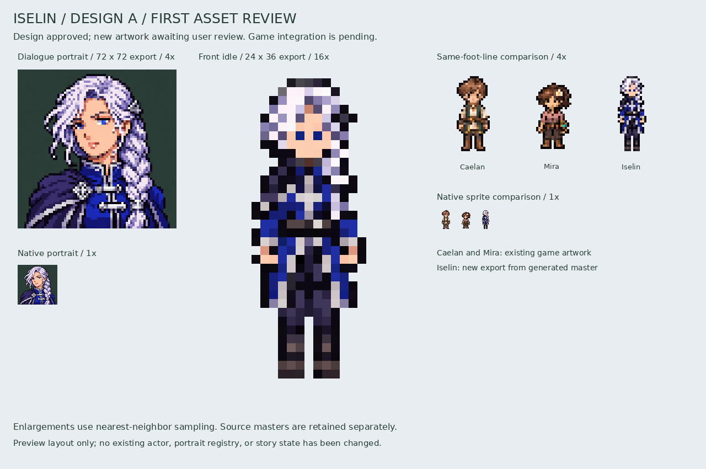
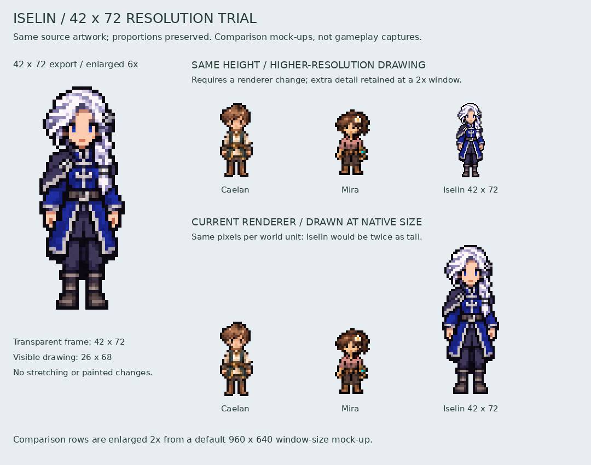

# Iselin — portrait and front idle review

The user selected **Design A / Royal Envoy** and requested these first two assets
for visual review before merging. The design is approved; this new artwork is
**awaiting user review**. The work remains on `art/iselin-portrait-front-idle`.



## Assets

- `assets/portraits/eldenmere/iselin_neutral.png`: 72×72 RGB neutral dialogue
  portrait with an opaque green-gray backdrop, matching the current portrait format.
- `assets/characters/iselin/idle_front.png`: 24×36 transparent front idle,
  foot anchor `[12, 34]`, map draw anchor `[12, 30]`.

The white anatomical-left braid (viewer right), blue eyes, royal-blue coat,
silver closures and anatomical-right navy mantle match the selected concept.
The native silhouette is slenderer than Caelan and Mira; the comparison uses
their actual current artwork at a common foot line and identical scaling.

`portrait_4x.png` and `idle_front_16x.png` show the actual native exports enlarged
with nearest-neighbor sampling. They are not substituted high-resolution masters.
`native_comparison.png` and `comparison_4x.png` retain the actual cast scale.

## Scope and verification

The new actor is not registered in gameplay yet. Existing dialogue, actors,
quest progress, save data, and other cast art are unchanged. Side/rear artwork,
walking and cinematic poses are outside this two-asset milestone.

Reproduce and verify with:

```sh
python tools/export_iselin_first_assets.py
python tools/export_iselin_first_assets.py --check
```

The scoped exporter only crops, isolates hard transparency, reduces with one
nearest-neighbor scale, registers the complete drawing and arranges previews.
Image generation supplies the artwork. Generated masters and the selected
concept are preserved unchanged; source hashes, extraction geometry and output
hashes are recorded in
`assets/source/characters/iselin/first_assets_export.json` and generation
references are in `provenance.json` beside it.

Visual review covered the portrait, native reduction, braid/mantle orientation,
full-body anatomy, outline visibility, planted feet and same-scale cast comparison.
No full gameplay or cinematic compliance is claimed for these unintegrated assets.

Verification passed: all nine generated outputs match a fresh deterministic
export; both native PNGs load in Pygame; dimensions and RGB/RGBA formats match
the existing conventions; sprite alpha is exclusively 0/255; its silhouette
is contained at `[6, 1, 19, 35]`; metadata retains the intended anchors and
separate design/artwork approval states. Both blue eye pixels survive reduction.

## Requested 42×72 trial

`assets/characters/iselin/idle_front_42x72.png` is an additional transparent
42×72 export of the same master. The drawing occupies 26×68 pixels with uniform
scaling and transparent padding; its anatomy has not been stretched to fill
the wider canvas. The earlier 24×36 asset and portrait are retained unchanged.



The upper comparison models a higher-resolution character renderer at the
default 960×640 window: Caelan and Mira's 36-pixel-high frames are doubled to
72 displayed pixels; Iselin's 72-pixel-high frame supplies those displayed pixels
directly. All three therefore have the same apparent frame height. The lower
comparison models the current renderer, which would treat Iselin's 72 image
pixels as 72 world pixels and make her approximately twice as tall. Both rows
are magnified another 2× for review. These are static comparison mock-ups, not
screenshots of a changed game renderer.

The current game first draws actors on a 480×320 world canvas, then enlarges the
completed canvas. Downscaling the new asset onto that canvas would discard the
additional detail. A later renderer change must support 2× artwork density while
preserving logical positions, collision, world depth and scenery occlusion.
The proposed 42×72 image corresponds to a 21×36 logical frame; its metadata does
not activate such support. Extra detail requires enough output pixels, available
at the default 2× window or larger.

The exporter now verifies 14 outputs, including this study. Source, geometry,
mock-up scale factors and hashes are recorded in
`assets/source/characters/iselin/resolution_42x72_export.json`.
