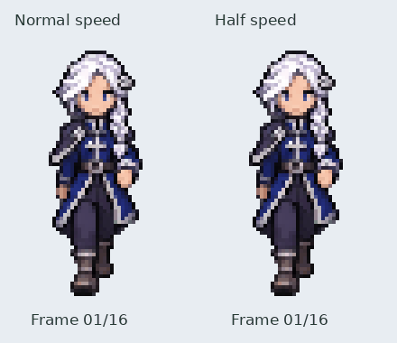

# Iselin front walk — approved

The user approved this preview for merge. Runtime walking integration and the
remaining directions are subsequent work; this milestone supplies the authored
front cycle. Earlier preview notes below preserve its review context.

Sixteen independently authored poses, exported at 42×72. Design A's anatomical
left braid and anatomical right mantle are maintained. The full two-step cycle
is 560 ms, using 35 ms per frame. The GIF shows normal playback beside half speed;
GIF centisecond timing alternates 30/40 ms to reproduce the normal cycle duration.

[Numbered frame sheet](frames.png)

This is a review asset on `art/iselin-front-walk-review`, not merged or activated
in the journey. Idle artwork, portraits, collision, quest state and walking in
other directions are unchanged. Main actor walking integration follows approval.

The generated 4×4 source is retained unchanged at
`assets/source/characters/iselin/walk_front/authored.png`, referenced to the
approved front idle master. The generation brief calls for a full alternating
two-step gait: left arm/right leg forward together, then right arm/left leg,
with passing poses, flexing knees/elbows and approximately ±45° sagittal swings.
In a direct front view these swings are foreshortened in depth; the preview does
not establish measured 45° angles from a side view.

The exporter only crops cells, isolates hard alpha, reduces with a common scale
and registers complete drawings. It does not rotate, stretch or procedurally
reconstruct limbs, nor manufacture the extra frames by interpolating pixels.
Source rectangles, bounds, scale and hash are retained in `registration.json`.

Rebuild: `python tools/export_iselin_front_walk.py`.

Verification: 16 distinct complete RGBA frames, hard transparency, 42×72 canvas,
560 ms metadata duration, 32-frame normal/slow GIF with 1120 ms combined repeat,
and successful Pygame loading. Native frame sheet inspected for anatomy, braid/
mantle consistency, swing opposition, planted support and loop endpoint poses.
The preview remains subject to the user's motion review.
