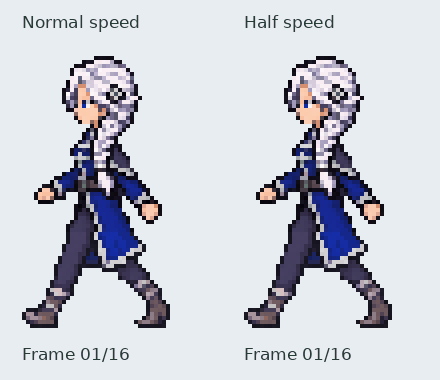

# Iselin left walk — approved

The user approved this cycle for merge. Earlier review-stage notes below are
retained as history; runtime walking integration remains subsequent work.

Sixteen complete flattened42×72 frames, 35ms each, 560ms full cycle. Review only:
not merged and not activated in the journey. The approved right cycle is untouched.

[Numbered native frame sheet enlarged4×](frames.png).

The approved right-facing walk supplies reflected pose guides with the same
frame order and cadence. Each four-frame strip was then redrawn through image
generation using the approved left idle for appearance. The braid is near-side
on anatomical left; the mantle is far-side on anatomical right. Its braided
hair tail has drawn secondary movement that lags the gait, retaining the
established hairstyle rather than changing it to an unbraided ponytail.

The image generator drifted from the approved foot positions in a few candidates.
Technical export therefore retains the reflected approved lower-image region
(rows46–71) unchanged. New left-specific upper artwork includes the face,
braid sway, costume and arms. This is a regional edit to flattened whole-frame
drawings, not separate limb construction or runtime puppetry. The final costume
is not a full flipped right sprite. Lower-body pose pixels are intentionally
reused to preserve the successful near/far leg progression.

Generated sources and pose guides are retained in
`assets/source/characters/iselin/walk_left/redrawn/`. Source hashes, extraction
rectangles, uniform scales, head registration and protected motion rows are in
`registration.json`. Rebuild with `python tools/export_iselin_left_walk.py`.

Checks cover exact retained lower-leg motion, progress through both stance
phases, sixteen distinct native drawings, changing hair-tail imagery, valid
RGBA/hard transparency, frame/cycle sizes, PNG loading and GIF timing. The
numbered sheet was visually inspected for near/far arm opposition, additional
hands, foot progression, face direction, clothing sides, hair and frame seams.
These checks support the user's motion review; they do not certify measured
joint angles or a fully integrated world-space foot-lock simulation.
