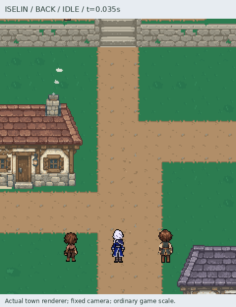

# Iselin native back-walk review

**Status: approved and integrated.** The images below retain the original
native-art approval snapshot, captured before campaign activation. Its
`capture.json` preserves the reviewed commit and original input hashes; current
manifest metadata and helper code may differ after integration. Do not repin
those historical hashes to imply the original fixture was captured again.
Current production verification is in the
[native integration review](../iselin_native_integration/README.md).

The [sprite and animation standard](../../SPRITE_ANIMATION_STANDARD.md) remains
the authoring reference. Rear-facing artwork follows the approved back idle,
including the anatomical-right mantle and anatomical-left braid root/bend.
Review covers both arm/leg chains, continuous foot recovery and contact,
stable body proportions, the loop seam and idle/walk transitions.

The retained 1263×1245 source contains 16 complete rear-facing drawings with
uneven cell margins. Each complete pose is registered by its head crown and
center into a fixed 192×288 source window, then sampled at exactly 1/8 density
to 24×36. Individual boot positions and occupied pose heights do not set its
scale. The original generated artwork remains unchanged.

After whole-pose export, the approved back idle's stationary head/hair region
(rows 0–11) is preserved at destination `[0,0]`. Braid bend, mantle, torso, arms,
coat and legs from row 12 downward remain authored pose pixels. The native
contact/passing frames, neck/braid boundary and loop joins were inspected in
the exports and renderer captures.

## Animated in-game evidence



This is **production movement and world rendering**: `RegentQuest._move` moves
a review `StoryActor` upward along a clear Eldenmere road at 74 world pixels
per second. `World.draw` and `WorldCanvas.present_detail` render the actual town
at the game's 960×640 presentation scale and normal depth order. The camera
stays fixed. The GIF includes an idle hold, four walking cycles and a stopped
hold. It crops rendered world frames and adds inspection captions. Scenery
time is held at zero to isolate the gait; HUD, input and story updates do not
run in this world-render fixture. Caelan and Mira retain their current artwork.

Separate inspection loops use the same actor and renderer with an explicitly
pinned position:

- [Normal in-place loop](in_game_loop.gif): 16×35 ms, 560 ms total.
- [Slow in-place loop](in_game_loop_slow.gif): 3× slower, 1680 ms total.
- [Full rendered world viewport](in_game_back_walk.png): lossless 960×640 PNG.
- [Enlarged rendered closeup](in_game_closeup.png).

The inspection loops enlarge real game-frame crops 3× with nearest-neighbor
sampling. GIF timings alternate 30/40 ms normally and 100/110 ms when slowed,
preserving complete-cycle durations despite GIF's 10 ms timing units. A common
palette keeps static scenery from changing color between exposures. The PNGs
retain lossless rendered pixels. The pinned loops supply phase inspection;
the separate travel GIF supplies actual movement and stopping evidence.

Rear-contact inspection retains a small asymmetry: the lowest sole pixel is
y34 in frame 1 and y32 in frame 9. The head and waist remain registered; these
are foot extents rather than changing body scale. Normal-scale travel did not
show a clear overshoot/reset, and the slow loop is retained for review of those
contacts. Do not rescale whole poses to equalize their boot bounds.

## Scope, reproduction and checks

The review manifest is `assets/characters/iselin/native_walk_back/review_actor.json`.
It uses the ordinary sheet-based loader, all four approved native idles and
explicit back-walk timings. The actor has no HD idle or walk overrides, uses
draw anchor `[12,30]` and keeps the existing 8×4 collision probe.

After exporting the staged artwork, run from the repository root:

```sh
python tools/export_iselin_native_back_walk.py --check
SDL_VIDEODRIVER=dummy SDL_AUDIODRIVER=dummy PYTHONPATH=. \
python tools/capture_iselin_native_back_walk.py --out /tmp/iselin-native-back_walk-review
```

The helper checks all 167 integer positions on its vertical route, sampled
travel clearance, back facing, idle/walk/stop transitions, all four idle
facings, 16-frame timings, native frame sizes, absence of HD overrides,
unchanged quest facts and saved GIF duration totals. `capture.json` records
positions, clocks, camera, source/output hashes and clearance evidence. Shared
rendering/GIF routines come from the front-walk capture helper, whose source
hash is also recorded.

All save/settings paths are temporary. This focused art/controller fixture
does not claim full campaign traversal, save migration or gameplay activation.
These isolated fixtures do not modify campaign bindings; current activation is covered by the integration review.
