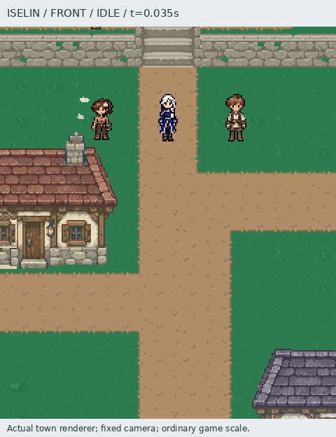

# Iselin native front-walk review

**Status: awaiting user review.** The native 24×36 front walk is staged beside
the approved native idle bank. This milestone does not activate it in the
campaign or remake the other directions, seated artwork or cinematic drawings.

The [sprite and animation standard](../../SPRITE_ANIMATION_STANDARD.md) remains
the authoring reference. This review uses complete authored frames with the
approved idle's proportions, costume sides and native pixel density.

The retained source and registration recipe are under
`assets/source/characters/iselin/native_walk_front/`. Source-strip scale uses
crown/waist landmarks rather than a lifted boot or occupied pose height.
After complete-drawing export, the approved front idle's stationary head/face
pixels in rows 0–11 are restored unchanged to eliminate batch-join head-shape
twitch. Moving anatomy below row 12 remains authored; the exporter constructs
no detached limbs. The numbered frame sheet records the complete flattened
results and their intended phases.

## Animated in-game evidence



This is **production movement and world rendering**: `RegentQuest._move` moves
a review `StoryActor` down a collision-free Eldenmere road at 74 world pixels
per second. `World.draw` and `WorldCanvas.present_detail` render the actual town
and its normal depth order at the game's 960×640 presentation scale. The camera
stays fixed. The GIF includes an idle hold, four walking cycles and a stopped
hold. It crops the rendered world viewport and adds an inspection caption;
it does not paste a source sprite onto a static screenshot. Scenery time is
held at zero so its own animations do not distract from the gait. HUD and game
input/story updates do not run in this world-render review fixture.

Normal and slow inspection loops use that same renderer and actor while
explicitly pinning the review position:

- [Normal in-place loop](in_game_loop.gif): 16×35 ms authored cycle, 560 ms total.
- [Slow in-place loop](in_game_loop_slow.gif): 3× slower, 1680 ms total.
- [Full rendered world viewport](in_game_front_walk.png): lossless 960×640 PNG.
- [Enlarged game-rendered closeup](in_game_closeup.png).

The inspection loops enlarge a real game-frame crop 3× with nearest-neighbor
sampling. They are labelled in-place fixtures rather than actual travel. GIF
durations use alternating 30/40 ms normal exposures (560 ms per loop) and
100/110 ms slow exposures (1680 ms), because GIF stores only 10 ms time units.
Every GIF uses one palette across frames to prevent static scenery color flicker;
the PNGs retain lossless rendered pixels.

## Scope, reproduction and checks

The review manifest is `assets/characters/iselin/native_walk_front/review_actor.json`.
It uses the ordinary sheet-based actor loader, approved native idles and explicit
front-walk frame durations. The review actor has no HD idle or walk bank, uses
draw anchor `[12,30]` and retains its 8×4 collision probe.

After exporting the staged artwork, run from the repository root:

```sh
python tools/export_iselin_native_front_walk.py --check
SDL_VIDEODRIVER=dummy SDL_AUDIODRIVER=dummy PYTHONPATH=. \
python tools/capture_iselin_native_front_walk.py
```

The helper checks all 167 integer route positions, sampled travel clearance,
front facing, moving/stopped transitions, the 16-frame timing contract, native
frame sizes, absence of HD overrides, unchanged quest facts and exact saved GIF
duration totals. `capture.json` records camera/positions/walk clocks, frame and
source/output hashes, clearance evidence and the base commit.

All save/settings paths are temporary. This is focused art and controller
review evidence; it does not claim a completed quest traversal, save migration
or gameplay activation. Existing approved idles and live campaign banks remain
unchanged.
