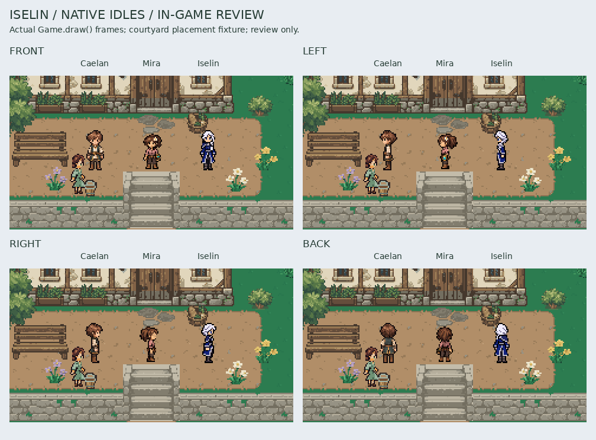

# Iselin native-resolution idle review

**Status: awaiting user review.** Four new idle facings are staged separately
from Iselin's live higher-resolution bank. This milestone does not activate the
new artwork in the campaign or remake walking, cinematic or seated drawings.

Authoring guidance remains in the
[sprite and animation standard](../../SPRITE_ANIMATION_STANDARD.md). These
review notes describe only this candidate artwork and its evidence.

The staged export directory is `assets/characters/iselin/native_idles/`.
Its four RGBA frames use a 24×36 native world-pixel canvas, draw anchor `[12,30]`
and foot anchor `[12,34]`. The review actor retains the existing 8×4 collision
probe. Caelan's current frame is 24×36; Mira's is 32×36, including horizontal
padding. All three are rendered at the same world/display pixel density.

## In-game evidence



The overview contains **unscaled crops of actual `Game.draw()` screenshots**.
Each panel shows Caelan, Mira and Iselin on a common ground line in Eldenmere's
Sanctuary courtyard, facing the indicated direction. The complete, unaltered
960×640 game windows are also available:

- [Front](in_game_front.png)
- [Left](in_game_left.png)
- [Right](in_game_right.png)
- [Back](in_game_back.png)

[Comparison closeups](in_game_closeups.png) crop the three characters from
those same game frames and enlarge the crops 2× with nearest-neighbor sampling.
This is a labelled inspection enlargement; it does not change their relative
world sizes, redraw their pixels or substitute source artwork into the scene.

The fixture stages positions/facings to compare the idle artwork; it does not
claim played quest progression or completed walking/scene integration. The
actual town layers, camera, depth sorting and ordinary actor renderer produce
the frames. Iselin's review actor has no high-resolution idle or walk override.
The helper verifies that its 24×36 frames use the native drawing path and that
all three positions pass the world's collision checks.

## Reproduction

After generating the staged native exports, run from the repository root:

```sh
python tools/export_iselin_native_idles.py --check
SDL_VIDEODRIVER=dummy SDL_AUDIODRIVER=dummy PYTHONPATH=. \
python tools/capture_iselin_native_idles.py
```

The helper uses a temporary save/settings directory and never publishes a
player save. It changes only its disposable game session; production manifests
and quest state remain unchanged. `capture.json` records source/export hashes,
the base Git commit, frame files, actor coordinates, camera and overview crop.
