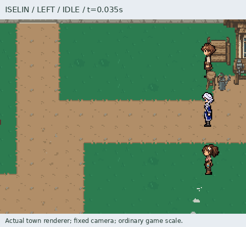

# Iselin native left-walk review

**Status: approved and integrated.** The images below retain the original
native-art approval snapshot, captured before campaign activation. Its
`capture.json` preserves the reviewed commit and original input hashes; current
manifest metadata and helper code may differ after integration. Do not repin
those historical hashes to imply the original fixture was captured again.
Current production verification is in the
[native integration review](../iselin_native_integration/README.md).

The [sprite and animation standard](../../SPRITE_ANIMATION_STANDARD.md) remains
the authoring reference, including near/far limb progression, foot continuity,
the left view's approved braid/mantle sides and inspection of batch joins.

The retained source is a single 1086×1448 sheet of 16 complete left-specific
drawings. Each source cell is padded to the same 272×362 grid, sampled to
27×36 with nearest-neighbor pixels and registered at `[-2,-1]` on the 24×36
export canvas. All poses share that grid, density and origin; lifted feet do
not change their scale or registration.

After whole-drawing export, the approved left idle's stationary head/face
region (source rows 0–11) is preserved at destination row 1. That one-pixel
walking settle is constant throughout the cycle. The braid tail, torso,
near/far arms, coat and legs from row 13 downward remain authored pose pixels.
The neck/braid boundary and loop joins were inspected after native sampling.

## Animated in-game evidence



This is **production movement and world rendering**: `RegentQuest._move` moves
a review `StoryActor` leftward on a clear Eldenmere road at 74 world pixels per
second. `World.draw` and `WorldCanvas.present_detail` render the actual town at
the game's 960×640 presentation scale and normal depth order. The fixed-camera
GIF includes an idle hold, four walking cycles and a stopped hold. It crops
rendered world frames and adds inspection captions. Scenery time is held at
zero to isolate the gait; HUD, input and story updates do not run in this
world-render fixture. Caelan and Mira use their unchanged current artwork.

Separate inspection loops use the same actor and renderer with an explicitly
pinned position:

- [Normal in-place loop](in_game_loop.gif): 16×35 ms, 560 ms total.
- [Slow in-place loop](in_game_loop_slow.gif): 3× slower, 1680 ms total.
- [Full rendered world viewport](in_game_left_walk.png): lossless 960×640 PNG.
- [Enlarged rendered closeup](in_game_closeup.png).

The inspection loops enlarge real game-frame crops 3× with nearest-neighbor
sampling. GIF timings alternate 30/40 ms normally and 100/110 ms when slowed,
preserving complete-cycle durations despite GIF's 10 ms timing units. A common
palette keeps static scenery from changing color between exposures. The PNGs
retain lossless rendered pixels. The pinned loops are visual phase inspection;
the separate travel GIF supplies actual movement and stopping evidence.

## Scope, reproduction and checks

The review manifest is `assets/characters/iselin/native_walk_left/review_actor.json`.
It uses the ordinary sheet-based loader, approved native idles and explicit
left-walk timings. The actor has no HD idle or walk overrides, uses draw anchor
`[12,30]` and keeps the existing 8×4 collision probe.

After exporting the staged artwork, run from the repository root:

```sh
python tools/export_iselin_native_left_walk.py --check
SDL_VIDEODRIVER=dummy SDL_AUDIODRIVER=dummy PYTHONPATH=. \
python tools/capture_iselin_native_left_walk.py --out /tmp/iselin-native-left_walk-review
```

The helper checks all 167 integer positions on its horizontal route, sampled
travel clearance, left facing, idle/walk/stop transitions, 16-frame timings,
native frame sizes, absence of HD overrides, unchanged quest facts and saved
GIF duration totals. `capture.json` records positions, clocks, camera, source
and output hashes and clearance evidence. Shared rendering/GIF routines come
from the front-walk capture helper, whose source hash is also recorded.

All save/settings paths are temporary. This focused art/controller fixture does
not claim full campaign traversal, save migration or gameplay activation.
These isolated fixtures do not modify campaign bindings; current activation is covered by the integration review.
