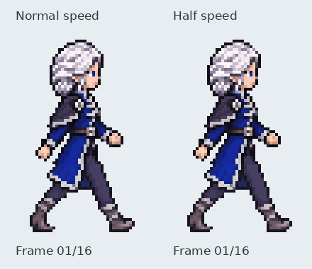

# Leg progression revision — arms preserved

The approved arm cycle remains in exactly the same frame order. All upper-body
RGBA pixels in rows0–45 are copied unchanged from retained approved snapshots;
the exporter and focused test assert that equality for all sixteen frames.
The leg changes are local image-generation edits to complete sprite drawings,
restricted to the lower image region during export. There are no detached
limb pieces or runtime rig. Upper-region restoration protects the user's
explicitly approved artwork against incidental changes from image generation.

The earlier leg sequence repeated an extended lead leg across several frames
and jumped into a passing pose. The new edit moves the supporting boot backward
as the swing foot lifts, passes, and reaches ahead. A further correction to
frames11and12 divides the second step's remaining large jump into intermediate
positions. The first five ground-contact centers now progress
36 →31.5 →27.5 →25.5 →18.5 pixels; the opposite step progresses
36 →34 →26 →19 →17. These measurements protect against the observed stall/snap,
but do not claim a complete biomechanical simulation or world-ground foot lock.

[Updated numbered frame sheet](frames_legs_v2.png).

The active recipe is `python tools/export_iselin_right_walk_redrawn.py`.
It registers complete lower-body redraws, retains the approved upper region,
and exports flattened42×72 frames with the same560ms cycle. Edited masters,
approved snapshots, reference strips, extraction geometry and hashes are in
`assets/source/characters/iselin/walk_right/redrawn/leg_revision/`.

Validation: approved upper pixels identical; contact/support positions progress
monotonically in both half-cycles; all16 RGBA exports load in Pygame; dimensions,
hard transparency and GIF timing pass. Native sheets were inspected at enlarged
scale for support/passing transitions and continuity into the next contact.
Motion review remains pending; nothing is merged or activated in the journey.
