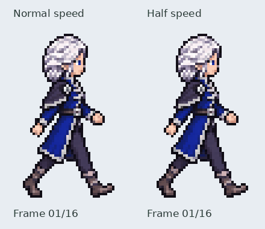

# Iselin right walk — approved whole-frame redraw

**Approval:** the user approved the leg-corrected right walk for merge.
See [the accepted leg revision](LEG_REVISION.md). Earlier review notes follow.

**Current revision:** the arms are approved and protected unchanged; see
[leg progression revision](LEG_REVISION.md) for the updated motion preview.

This replaces the rejected layered approach with sixteen complete authored
character drawings. There are no detached limb layers, reused body cores,
procedural rotations, mirroring, or limb interpolation in the exported frames.
This is the right-facing cycle first, following the agreed key-pose workflow.
The left-facing cycle and runtime integration await this motion review.

[Numbered native frame sheet enlarged 4×](frames.png).

The four-key sheet establishes alternating contacts and passing poses. Short
whole-character transition strips were generated against those keys and the
approved right-facing idle. Candidate drawings were selected and reordered
by their actual near/far arm motion rather than assuming the generated column
order was correct. Unused candidates remain in the retained source strips.

Reference/body details remain white hair, blue eye, near anatomical-right navy
mantle and silver brooch, blue/silver coat, and the far anatomical-left braid.
Visual inspection traced near/far arm and leg chains across the numbered sheet,
including opposite arm assignments at the contact poses and hidden-limb
transitions. This remains a user-review draft; a file-count check cannot certify
natural gait or exact joint angles.

Exports are 42×72, with 35ms frame duration and a 560ms full cycle. Each complete
drawing is cropped, isolated at hard alpha220, reduced at one uniform scale per
source strip, and translated to a common head position and ground baseline.
The extractions never modify anatomy inside a drawing. Near/far garment
occlusion is drawn into the original whole pose.

Source drawings, cell selection, scale, positions and hashes are retained in
`assets/source/characters/iselin/walk_right/redrawn/`. Rebuild with
`python tools/export_iselin_right_walk_redrawn.py`.

Verification checks sixteen unique RGBA frames, hard transparency, 42×72
dimensions, ground registration, successful Pygame loading, and GIF timing.
The 32-frame GIF contains two normal repeats alongside one half-speed repeat;
30/40ms GIF delays retain the intended560ms normal cycle duration.

No assets have been merged or activated in the saved journey. Earlier rejected
side-walk work is preserved on its original review branch.
