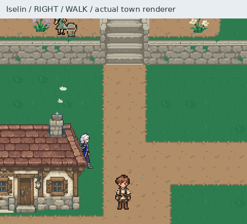

# Iselin — runtime walk integration

The four approved 16-frame cycles are registered on Iselin's reusable actor.
`StoryActor` reads each existing walk manifest, preserves its 35 ms durations,
and selects the same phase for a 21×36 fallback and 42×72 detailed image.
`WorldCanvas` uses the detailed frame and artwork anchor while preserving
normal world size and subsequent foreground depth ordering.



[Right](right.png) · [Rear](back.png) · [Left](left.png) · [Front](front.png) ·
[Overview](directions.png) · [Behind real tree foliage](tree_occlusion.png)

These use `World.draw` and `WorldCanvas.present_detail`, with movement through
`RegentQuest._move` at its existing 74 world-pixel/second default. Each side of
the collision-checked square covers two 560 ms cycles, followed by an idle hold.
The 160 sampled frames use 35 ms steps; GIF delays alternate 30/40 ms for a
5600 ms total repeat (identical held frames may be coalesced). Scenery is frozen
so actor motion is easier to inspect. Caelan stands nearby for a scale reference.
The native PNG captures are authoritative for exact colors and detail.

The fixture uses temporary save/settings paths. Iselin is an additional review
actor, and the quest state is asserted unchanged. It does not replace Aldric,
change quest progression, or exercise the full future Iselin story migration.
No approved source frames, idles or portrait pixels were changed. Cinematic and
meal poses remain separate work.

Checks cover all authored frame boundaries and loop wrap in every direction,
turning and stopping, conversation facing, authored/external pose ownership,
plain-surface fallback, native detail preservation, anchor conversion, translucent
foreground coverage, frame reset, unchanged collision size, and preservation of
walk registration during idle rebuilds. Existing Iselin art, dense rendering,
regent action and quest regressions were also run. One existing quest-save test,
`test_active_visit_cannot_load_without_its_scene_checkpoint`, fails identically
with both modified runtime modules loaded from the original main commit; it is
unrelated to walk selection/rendering and remains a separate save-test follow-up.

Reproduce from the repository root with Pygame and Pillow installed:

```sh
python tools/register_iselin_walks.py --check
python tools/export_iselin_first_assets.py --check
python tools/capture_iselin_walks.py
PYTHONPATH=.:tests python -m unittest test_iselin_walk_integration test_iselin_idles test_dense_art
```

[Evidence](evidence.json) records movement samples, camera, real tree placement,
unchanged quest state and hashes of all 64 approved frames. Authoring rules live
in the [global standard](../../SPRITE_ANIMATION_STANDARD.md).
