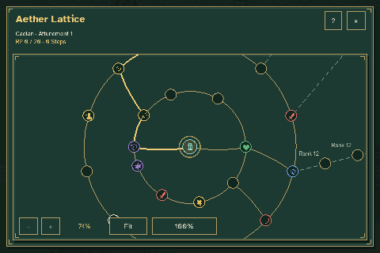
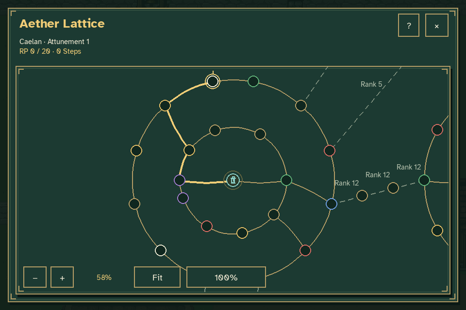
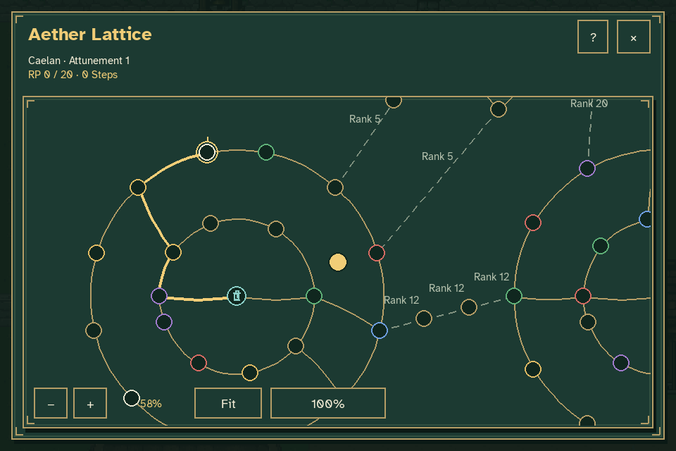
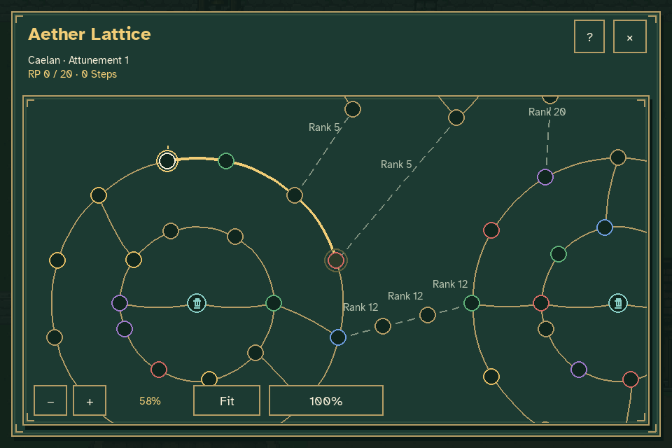
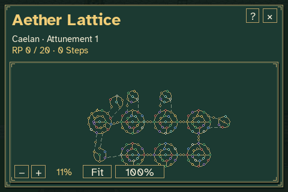

# Aether Lattice camera dragging

The map follows the mouse directly while the left button is held. The grabbed
map point stays under the pointer, and holding the pointer still leaves the
camera still. Releasing selects the node nearest the gold cursor at the center
of the view, then smoothly centers and pulses that node.



| Before dragging | While dragging | After release |
| --- | --- | --- |
|  |  |  |

A short click still selects the node nearest the pointer. A three-pixel logical
movement threshold distinguishes a drag from incidental click movement.
Beginning a grab stops any running camera or zoom transition at its visible
position; wheel and + / − inputs are ignored until the grab ends. F and 0 end
the grab and apply their camera actions. No permanent instructions
or additional panels were added to the map.

The capture checks four gestures: both directions in a 960×640 window at 58%
zoom, a 1440×810 letterboxed window at 100%, and the minimum 480×320 window with
large text. Each checks the grabbed point, a stationary hold, nearest-node
selection and release centering. The real game remains paused, and progression,
inventory, attributes, elapsed world time and the player's position remain
unchanged. The fixture starts at rank 1 with no Steps or crystals.



Reproduce with:

```sh
python tools/capture_lattice_drag.py
```

This runs the production game with temporary journey/settings files and writes
rendered frames to `work/lattice-drag`. Pillow only assembles those frames into
the GIF. Per-gesture checks and the animation timeline are recorded in
[verification.json](verification.json).
