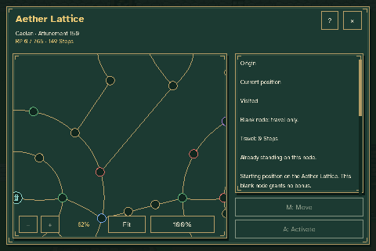
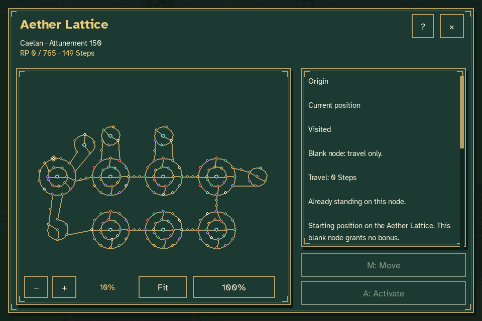
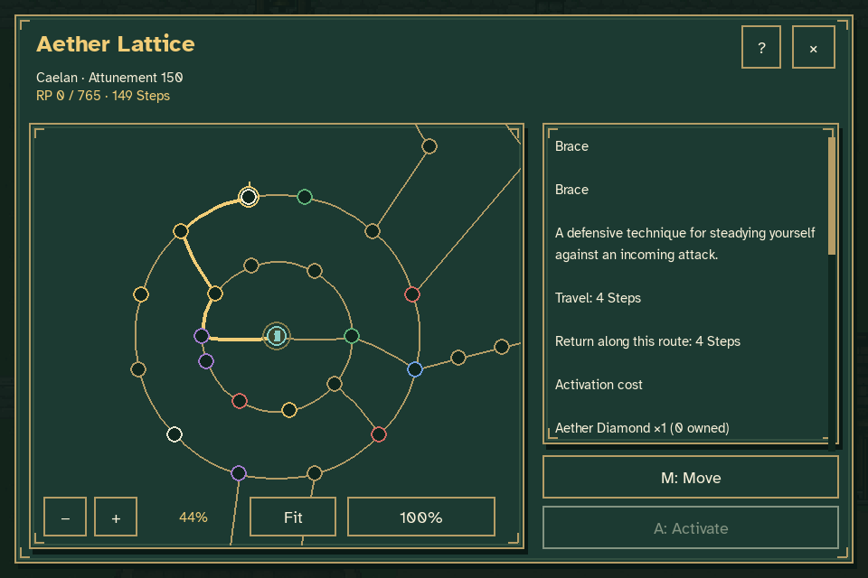
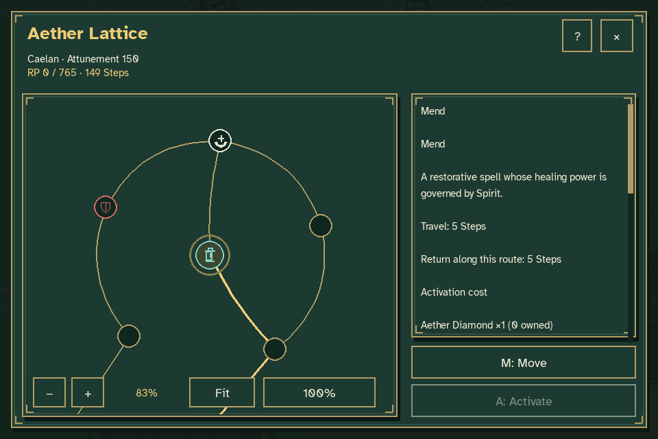
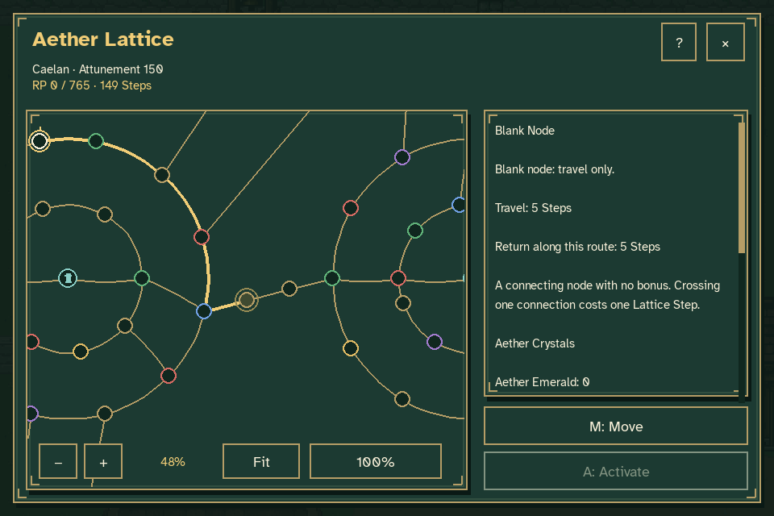
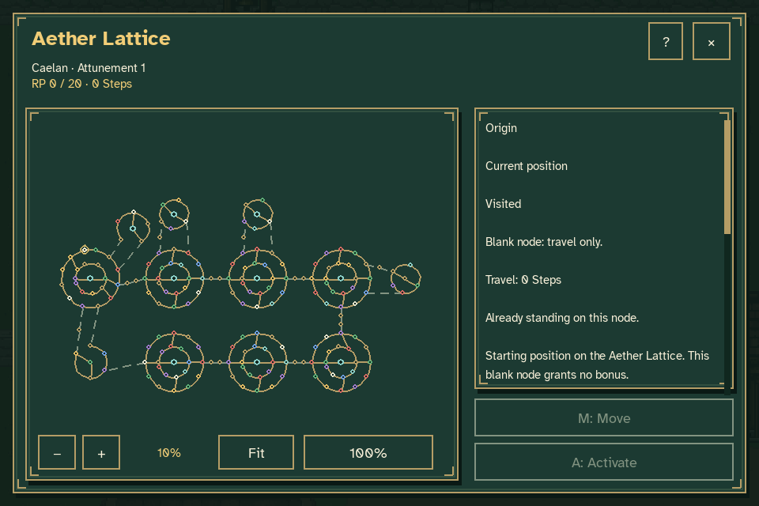
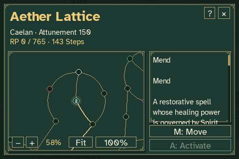

# Caelan's circular Aether Lattice review

Open **Pause → Aether Lattice**. Caelan's section contains **200 nodes**:
130 attribute nodes, 20 ability nodes and 50 empty nodes.

Seven large and five small circular formations use connected arcs and junctions. Each
center sits on a route that continues to another exit. Connections inside a
formation curve; bridges and nodes between formations use straight lines.



The animation is captured from the production game. It tours the board,
inspects both formation sizes, then uses the real Move confirmations to
follow an entry → center → exit route without retracing an edge. These are
the default routes chosen by Move, and the same check covers every formation.
Every connection costs one Step, regardless of its drawn shape. Travel does not
activate the nodes it passes.













The [verification record](verification.json) records the node mix, formation
sizes, curved and straight edge counts, the non-backtracking center route,
Step charges, unchanged inventory/attributes, paused-world state and two
Continue round trips.

Two disposable fixtures are used. Normal New Game has no RP or crystals.
The movement fixture receives the RP needed for Attunement 150 and no crystals
through the normal reward interface, allowing every rank-gated path and travel
to be reviewed.
Neither fixture reads or replaces an ordinary journey or settings file.

For interactive layout review:

```sh
python tools/preview_aether_lattice.py --rp 58110 --crystals 0
```

For the untouched starting state, use `--rp 0 --crystals 0`. The zoom wheel,
`+` / `−`, Fit / F, and 100% / 0 remain available, along with free gold-cursor
exploration and pulsing selection.

To reproduce the screenshots, animation and verification data beneath
`work/lattice-formations`:

```sh
python tools/capture_lattice_formations.py
```

The capture tool requires Pillow in addition to the game's Pygame runtime.
