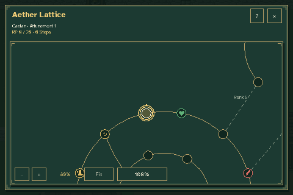
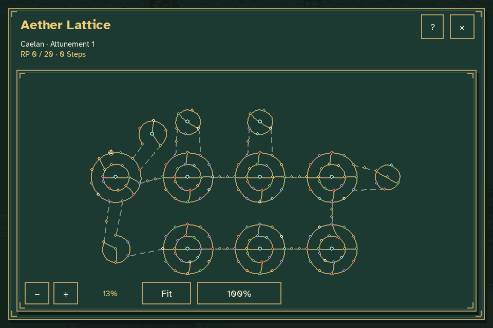
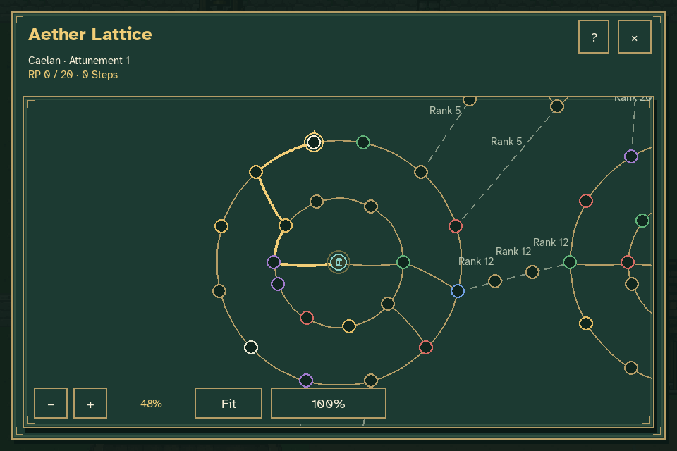
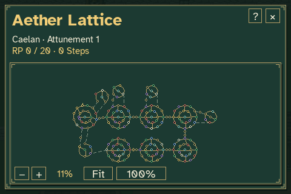

# Full-width Aether Lattice review

The lattice now occupies the full content width beneath its existing title and
character status. The permanent selected-node details panel, its scrollbar and
the Move/Activate buttons have been removed. Hovering does not cover the map
with an information banner. No replacement guidance cues have been added.









The existing zoom toolbar, header, close and help controls remain available.
Gold-cursor exploration, nearest-node selection, pulsing feedback, curved
internal paths and straight bridges continue to work across the expanded map.
Clicking or dragging where the old sidebar and action buttons stood now
navigates the map without purchasing movement or activating a node.

M and A retain the existing keyboard actions. Their explicit confirmation
dialogs appear only when requested. These captures add no instructions or
tooltips over the map; future visual guidance remains a separate design pass.

The [verification record](verification.json) includes the viewport bounds,
former-sidebar input checks, zoom and selection states, and assertions that
the world, progression, attributes and inventory stayed unchanged. The fixture
has zero RP, zero Steps and no crystals.

Review interactively without opening or replacing an ordinary journey:

```sh
python tools/preview_aether_lattice.py --rp 0 --crystals 0
```

Reproduce these captures beneath `work/lattice-fullwidth`:

```sh
python tools/capture_lattice_fullwidth.py
```

Pillow is required by the capture tool in addition to the game's Pygame runtime.
All captures use disposable journey and settings files. Historical review
artifacts are retained; the legacy capture commands now exercise keyboard
actions instead of clicking removed buttons.
