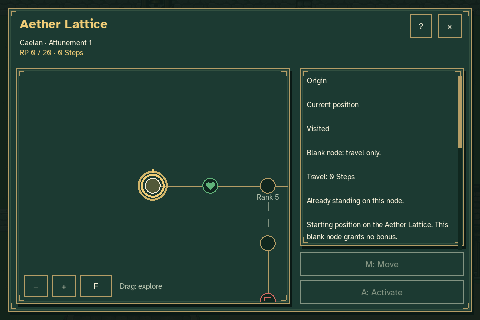
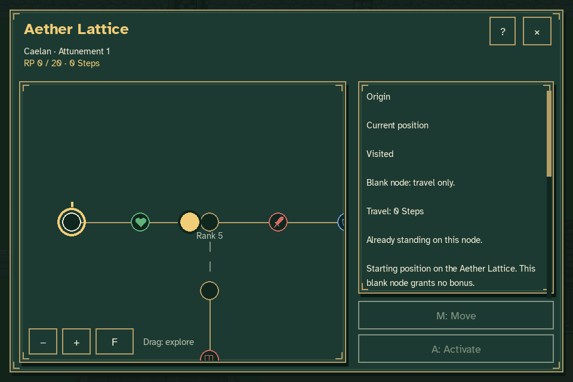
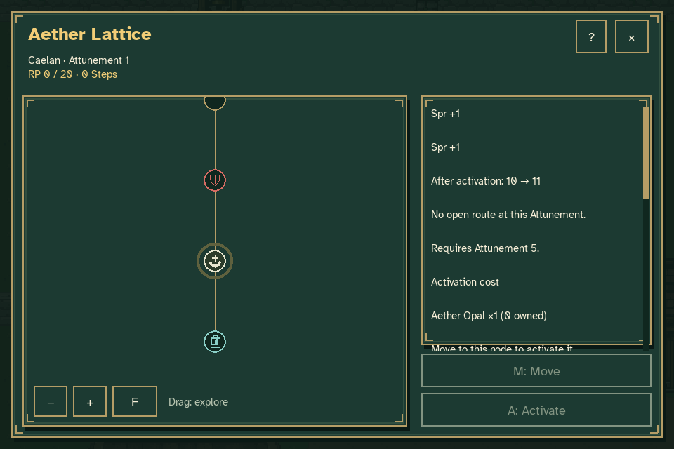
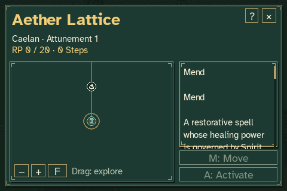

# Aether Lattice navigation review

The production menu is **Pause → Aether Lattice**. Hold an arrow key to
explore with the small gold circular cursor, or drag the map. Releasing
navigation selects the nearest node and eases the camera onto it in about
180 milliseconds. The selected node pulses with a gold halo and a subtle
change in brightness. The old white selection box has been removed.



The animation uses actual keyboard and mouse events in the production game
at a normal readable zoom. It shows arrow navigation along the main route,
inspection of the locked side branch, and a mouse drag toward Mend. The
camera follows the cursor during exploration, then settles on the selected
node when input stops. Tab and Shift+Tab also inspect individual nodes.







The fixture starts at Attunement 1, zero RP, zero Steps and no crystals.
Caelan remains on the origin node throughout. Exploration can inspect
locked paths and future rewards without spending Steps, consuming crystals
or changing progression. Move and Activate retain their explicit
confirmation dialogs. The world remains paused while the lattice animates.
With reduced motion enabled, the selection halo stays steady and the camera
centers immediately.

The [verification record](verification.json) includes free-cursor release
positions, nearest-node checks, intermediate camera positions, pulsing
frames and assertions that progression and the world stayed unchanged.

To review interactively without opening or overwriting an ordinary journey:

```sh
python tools/preview_aether_lattice.py --rp 0 --crystals 0
```

To reproduce these captures in `work/lattice-navigation`:

```sh
python tools/capture_lattice_navigation.py
```

The capture tool requires Pillow in addition to the game's Pygame runtime.
Both tools use disposable journey and settings files. Prior progression
review captures can still be reproduced with
`python tools/capture_aether_lattice.py`.
