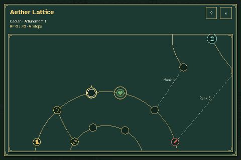
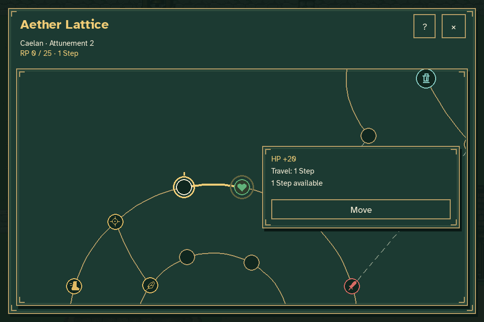
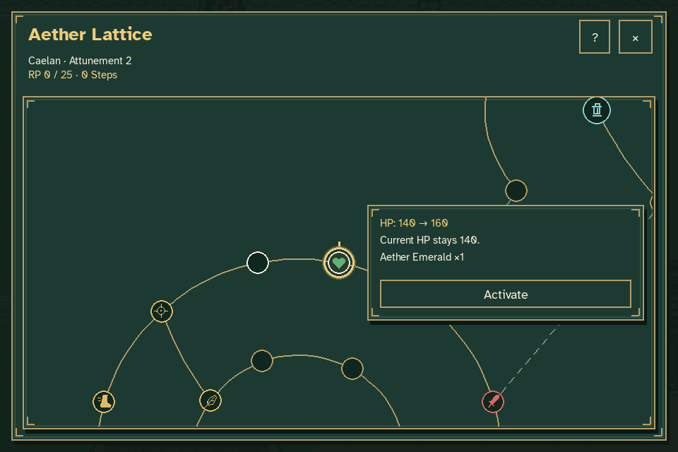
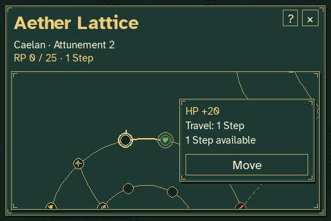

# Aether Lattice contextual controls

Click a node to select it. When travel is affordable and the route is open,
a small card beside that node shows the Step cost and a **Move** button.
Clicking Move executes that travel directly. An eligible node at the character's
current position instead shows its effect, crystal cost and **Activate** button.
There is no Enter confirmation or permanent action panel.



| No affordable travel | Affordable travel | Eligible activation |
| --- | --- | --- |
|  |  |  |

The mouse wheel is the only zoom control. Left-button dragging pans the camera;
release selects and smoothly centers the node nearest the gold cursor.
Arrow-key exploration, Escape and optional **F1 / ?** help remain. The zoom
toolbar, Tab cycling, Fit, 100% reset and M/A/Enter action shortcuts are removed.
Blank clicks do not select an arbitrary nearby node.



This capture uses the actual paused game with temporary journey/settings files.
It begins at rank 1 without Steps or crystals, where unaffordable and rank-locked
nodes remain selectable without offering a command. A disposable review reward
then grants 20 RP and one Emerald. Moving to the first HP node costs one Step;
activation consumes that Emerald and raises maximum HP from 140 to 160 while
current HP stays 140. The resulting node cannot be activated again.

The checks also cover inert removed shortcuts, pointer-anchored wheel zoom,
direct dragging, minimum-window context layout and unchanged world time/player
position. Camera framing inside the capture helper is fixture setup; node
selection and progression commands use real mouse events.

Reproduce with:

```sh
python tools/capture_lattice_simple.py
```

Rendered frames and per-stage checks are written to `work/lattice-simple`.
Pillow only assembles those rendered frames into the GIF. See
[verification.json](verification.json) for the checks and animation timeline.
