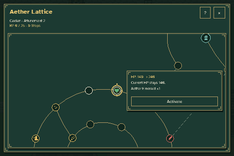
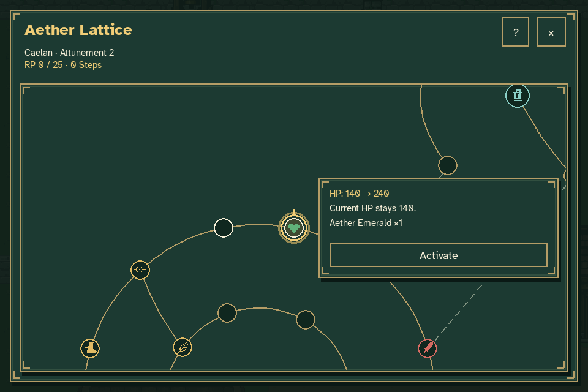
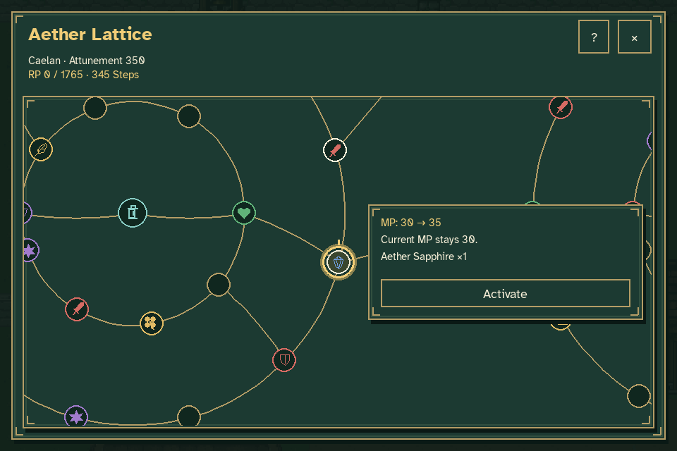
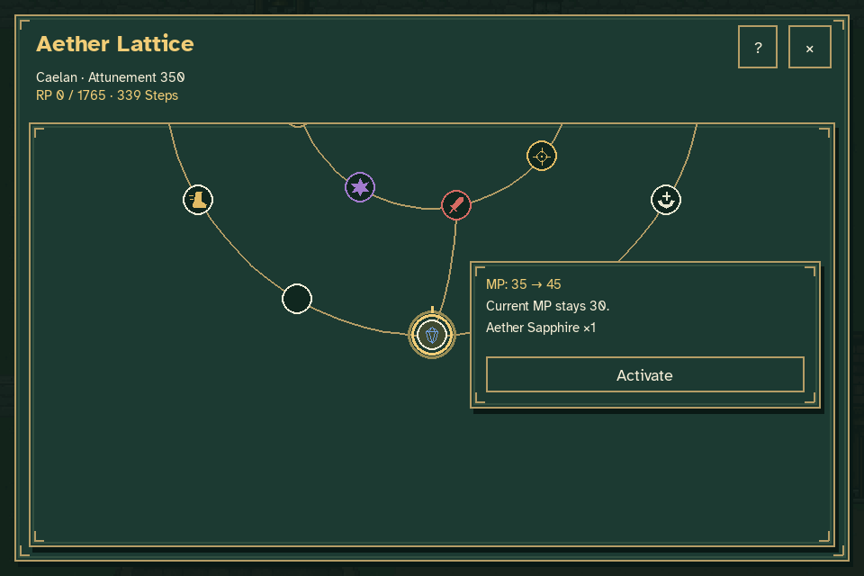
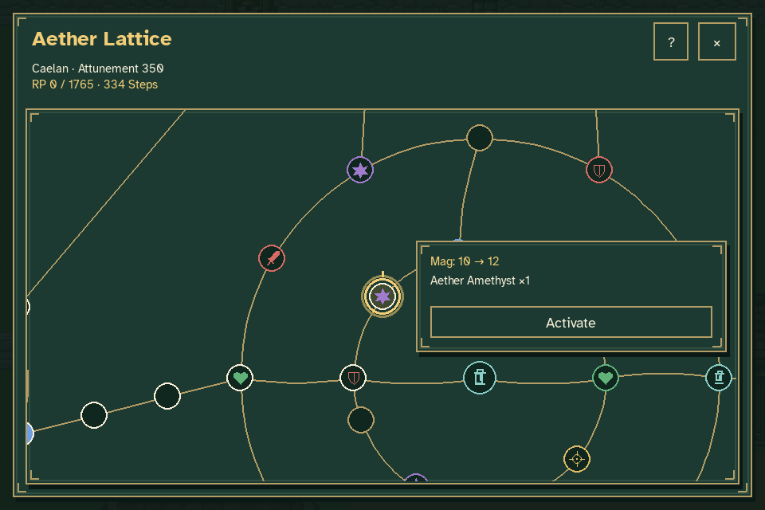
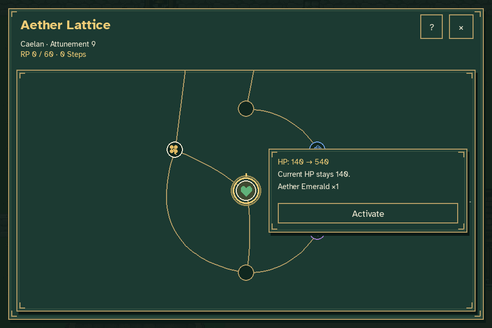
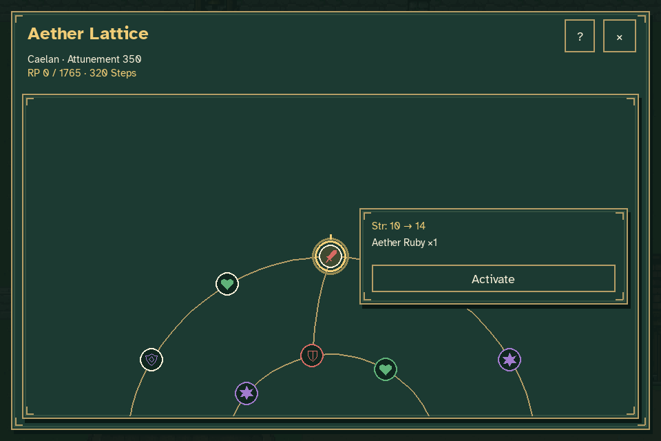
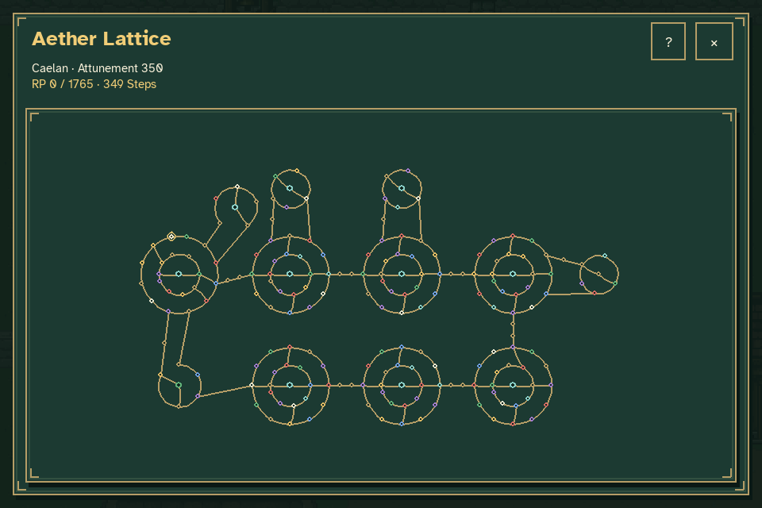
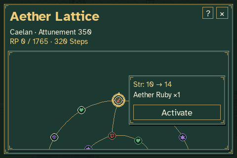

# Caelan's Aether Lattice bonus tiers

This preview renders the production lattice with the new authored attribute
rewards. Node positions, circular formations and connecting paths remain intact.



| First HP reward | First MP reward |
| --- | --- |
|  |  |

The first HP activation raises maximum HP from **140 to 240** while current HP
stays **140**. The first MP activation raises maximum MP from **30 to 35** while
current MP stays **30**. The contextual previews show each exact benefit and its
matching crystal before the player clicks Activate.

| Converted HP node → MP | Converted HP node → Mag |
| --- | --- |
|  |  |

The node IDs remain stable for saved journeys. These two examples, `hp_05` and
`hp_07`, now provide **MP +10** and **Mag +2**, with Sapphire and Amethyst costs.
They are among the ten converted HP nodes distributed through the section.

| Rare early center reward | Late maximum-tier reward |
| --- | --- |
|  |  |

Quiet Reserve's center offers the exceptional early **HP +400** reward. The
capture reaches it at its earliest attainable rank, **Attunement 9**, accounting
for both the rank gate and the Steps required to travel there. The late example
shows a rare **Str +4** attribute reward. Smaller rewards remain available
throughout the board; maximum tiers are reserved for a few authored milestones.
See the [section guide](../../CAELAN_LATTICE.md) for the complete distribution.





The capture runs real menu input with temporary journey/settings files. The
first fixture grants 20 RP and one Emerald. A second fixture reaches the early
center at rank 9, and a separate review fixture grants enough RP and crystals
to inspect later rewards. Camera framing is fixture
setup. Node selection, movement and activation use the production mouse flow.
Every activation checks its exact bonus, full crystal payment and unchanged
current HP/MP. World time and the player's position remain unchanged.

Reproduce with:

```sh
python tools/capture_lattice_tiers.py
```

Rendered frames and per-action verification are written to `work/lattice-tiers`.
Pillow only assembles those rendered frames into the GIF. The precise node IDs,
tiers, counts, fixture rewards and operations are recorded in
[verification.json](verification.json).
