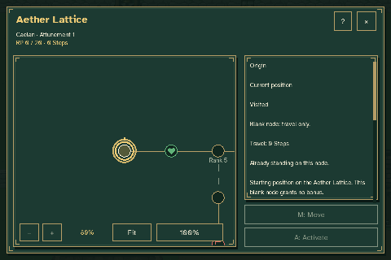
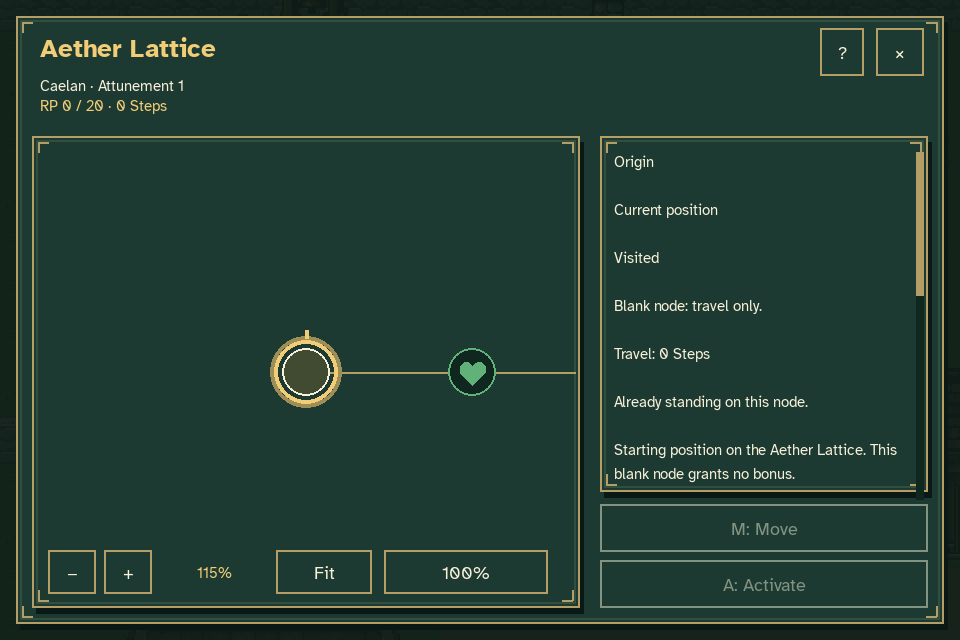
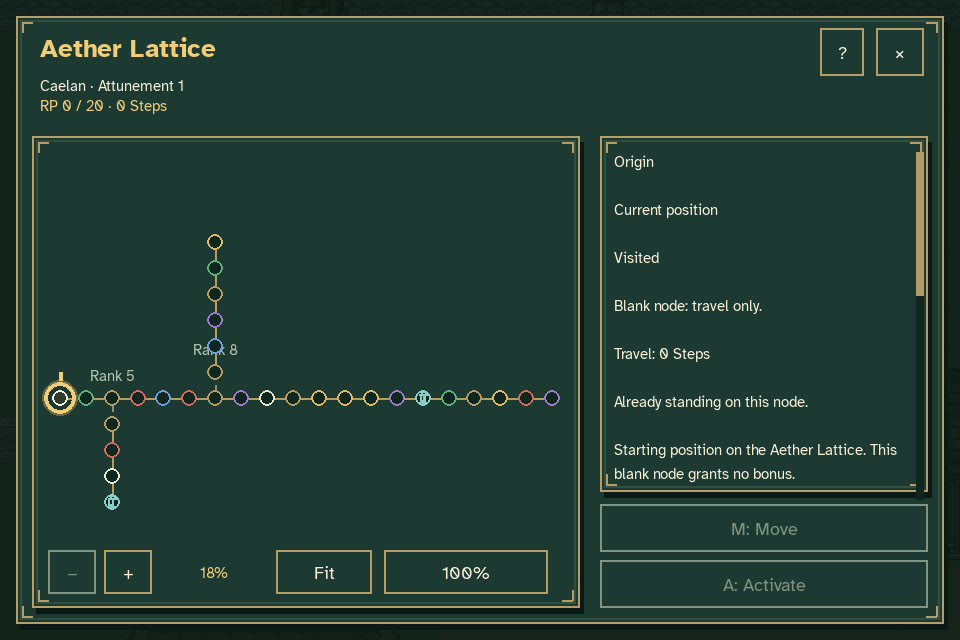
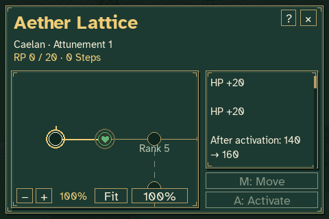

# Aether Lattice zoom review

Open **Pause → Aether Lattice**. The camera now eases between zoom levels
instead of changing scale in a single frame. Zoom can be interrupted or
reversed while it is moving.



| Input | Camera behavior |
| --- | --- |
| + / −, keypad + / −, or the toolbar buttons | Zoom toward the selected node. |
| Mouse wheel over the map | Zoom around the world point beneath the pointer. |
| F or Fit | Smoothly frame the entire lattice. |
| 0, keypad 0, or 100% | Restore a readable 100% view centered on the selected node. |

The toolbar shows the current zoom percentage. Zoom is bounded between
18% and 200%. Reduced Motion applies the requested camera view immediately.
Scrolling over node details or a dialog reads that panel instead of zooming
the board.







The animation uses actual keyboard, mouse-button and wheel input in the
production game. The fixture has zero RP, zero Steps and zero crystals.
Caelan stays at the origin; zooming and browsing leave progression and the
paused world unchanged. Free exploration with the gold cursor, nearest-node
selection and the pulsing selected-node halo remain available after zooming.

The [verification record](verification.json) includes intermediate zoom
levels, pointer-anchor error, final camera positions and unchanged-state
assertions. Captures use disposable journey and settings files.

To review interactively without opening or replacing an ordinary journey:

```sh
python tools/preview_aether_lattice.py --rp 0 --crystals 0
```

To reproduce these captures beneath `work/lattice-zoom`:

```sh
python tools/capture_lattice_zoom.py
```

The capture tool requires Pillow in addition to the game's Pygame runtime.
