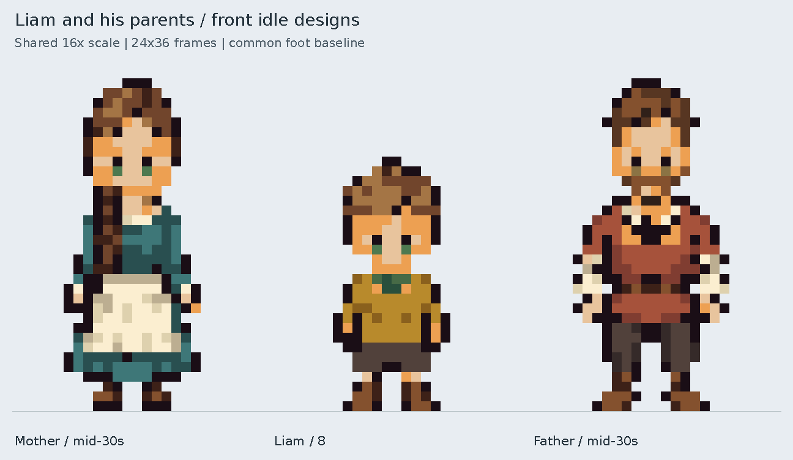

# Liam and his parents — front idle review

Initial designs on `liam-family-front-idles`, awaiting user review before merging.



- [Liam — 8](liam.png)
- [Mother — mid-30s](liam_mother.png)
- [Father — mid-30s](liam_father.png)
- [Height comparison with Caelan and Tomas](height_comparison.png)
- [Native transparent sheet](../../../assets/characters/liam_family/front_idles.png)

All review images are opaque PNGs enlarged with nearest-neighbor scaling. The
family board uses 16× scale for every frame and a common foot baseline. The
cast comparison uses 12× throughout, retaining the approved Caelan and Tomas
sprites unchanged. The single-character cards use 24×.

| Character | Requested age | Visible size | Proposed appearance |
| --- | --- | --- | --- |
| Liam | 8 | 12×26 | Chestnut hair, green eyes, ochre tunic, green collar, brown breeches and boots |
| Mother | Mid-30s | 14×34 | Chestnut braid, green eyes, blue-green dress, cream apron and brown boots |
| Father | Mid-30s | 16×34 | Dark brown hair, short beard, hazel eyes, clay-red tunic, ivory sleeves and dark trousers |

Every sprite occupies a **24×36** transparent frame with foot anchor `[12,34]`.
Liam is six native pixels shorter than Tomas and eight shorter than Caelan and
his parents. His head is larger relative to his short torso and legs. Both
eyes are explicitly registered in every face; closed mouths and skin-colored
chins avoid dark gaps.

The generated appearance plate is retained under
`assets/source/characters/liam_family/`. The existing band-sampling/material
mapping workflow exports the game assets with hard transparency and limited
palettes. Four retained layers reconstruct each sprite exactly. The builder
checks bounds, colors, alpha and eye landmarks. Reproduce with:

```sh
python tools/build_liam_family_idles.py
```

Parent names, surname, home and quest role are unassigned. The current pack
contains front idles only; world placement, other directions, walks, routines
and portraits can follow after design approval.
