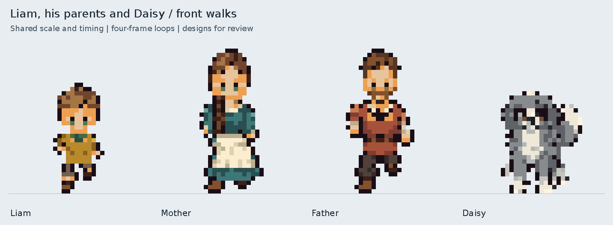

# Liam, his parents and Daisy — front walking review

All four front-facing walk loops are approved by the user and merged into
`main`. Approved idles and palettes remain unchanged. The preview images
retain their original review labels as a record of the approved animations.



- [Liam — enlarged looping preview](liam.gif) · [four frames](liam_frames.png)
- [Mother — enlarged looping preview](liam_mother.gif) · [four frames](liam_mother_frames.png)
- [Father — enlarged looping preview](liam_father.gif) · [four frames](liam_father_frames.png)
- [Daisy — enlarged looping preview](daisy.gif) · [four frames](daisy_frames.png)

Each cycle has **four frames at 140 ms each**, totaling **560 ms**. The family
preview uses the same 10× scale for all four characters. Individual loops use
20× and frame boards 12×. GIFs have opaque light backgrounds, one exact shared
palette per loop, full-frame disposal and infinite looping. The thin floor
guide lies below the sprite pixels on transparent padding row 35.

## Human walks

Liam, mother and father use the existing humanoid contact/passing sequence.
Heads, necklines, shoulders and the mother's braid rise together by one native
pixel on passing phases. Liam retains his 26-pixel resting height, green collar,
short breeches and small boots. His arm masks and legs are registered to his
smaller proportions. His parents retain their 34-pixel resting height.

Sleeve lengths and cuffs follow each approved outfit: ochre sleeves for Liam,
blue-green sleeves with cream cuffs for mother, and clay-red upper sleeves with
ivory undersleeves for father. The mother's apron follows a restrained skirt
sway; the passing hem lifts one pixel, and both brown boots remain visible in
every phase. Source stride legs are adapted to the clothing and scale; the
clean first contact/passing pair is mirrored for the opposite step so the
source costume's asymmetric center hem cannot become a false foot.

## Daisy's walk

Daisy uses a new quadruped pose template, not the humanoid leg cycle. Her four
beats are **hind left → fore left → hind right → fore right**, with one paw
lifted and three supporting in every pose. Hind paws rest on the perspective
plane at row 32 and forepaws at row 34. Swinging paws lift two pixels. There is
always a supporting forepaw at the ground baseline.

Approved shaggy leg and white-paw pixels are reposed to those joints rather
than replacing her legs with straight bars. Supporting paw tips retain their
shape; the upper leg changes projection as the body rises. Her face and chest
markings follow the body unchanged. Ear tips have a small lag, and the fluffy
tail moves around a connected root. Her resting visible height is 24 pixels,
two below Liam's; that difference remains during the bob. Daisy uses her
approved 32×36 frame while the humans retain 24×36 frames.

## Assets and checks

Native frames, sheets, animation metadata and recipes are in each character's
`assets/characters/CHARACTER/walk_front/` directory. Retained per-phase source
layers reconstruct every frame under the family's or Daisy's source folder.
`assets/templates/quadruped_32x36/walk_front/poses.json` records Daisy's gait.

```sh
python tools/build_liam_family_front_walks.py
python -m unittest discover -s tests -p test_liam_family_front_walks.py -v
```

Seven focused checks verify native palette/alpha/height/timing, translated
faces/necks/shoulders, apron and boot visibility, Daisy's paw support and fixed
markings, source-layer and sheet reconstruction, and exact decoded GIF colors
and timing. Building also checks that approved idle PNGs and palettes are
byte-for-byte unchanged. The builder preserves each walk's recorded approval
status on later rebuilds.

These animation packs are approved. No family members or pet routines have
been placed in the playable world by this change.
