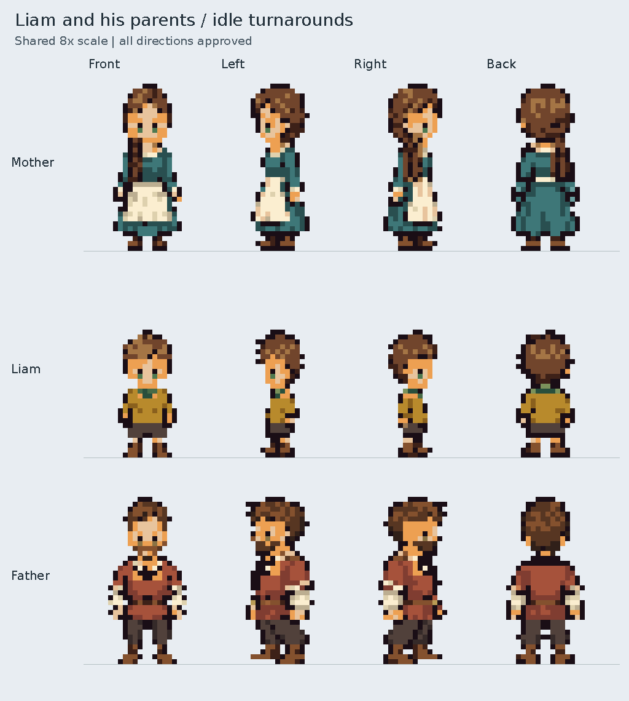

# Liam's family — left, right and back idle review

All nine left, right and back 24×36 idle designs are approved by the user and
merged into `main`. Their approved fronts are included for comparison.



- [Liam — full turnaround](liam_turnaround.png)
- [Mother — full turnaround](liam_mother_turnaround.png)
- [Father — full turnaround](liam_father_turnaround.png)
- [Liam — new left/right/back at 20×](liam_new_views.png)
- [Mother — new left/right/back at 20×](liam_mother_new_views.png)
- [Father — new left/right/back at 20×](liam_father_new_views.png)
- [Native transparent family sheet](../../../assets/characters/liam_family/idle_directions.png)

The family grid uses a shared **8×** scale, full turnarounds **12×**, and the
new-view boards **20×**. All review images are opaque PNGs with nearest-neighbor
enlargement. Game sprites retain hard transparency and share foot anchor `[12,34]`.

| Character | Visible height | Profile details | Back details |
| --- | --- | --- | --- |
| Liam, 8 | 26 px | Green eye, chestnut hair, green collar, ochre tunic, brown breeches and boots | Green back collar, no visible eyes |
| Mother, mid-30s | 34 px | Green eye; braid on her right shoulder, mostly obscured in left profile; blue-green dress and cream apron | Gathered hair/braid toward her right shoulder, plain cream waistband, blue-green skirt |
| Father, mid-30s | 34 px | Hazel eye, short beard, clay-red tunic, ivory sleeves, belt and dark trousers | Simple back collar and belt, no buckle or visible eyes |

The mother's and Liam's chin windows retain skin colors rather than dark mouth
gaps. Profile eyes are explicitly registered: one green or hazel iris per side,
zero in back. Existing front PNGs, front metadata and palettes remain byte-for-byte
unchanged. The new views use those approved palettes.

Source concepts and export registration are retained under
`assets/source/characters/liam_family/`. Four layers reconstruct each new idle
exactly. Reproduce with:

```sh
python tools/build_liam_family_turnarounds.py
```

The builder checks frame/height/baseline registration, palette membership,
hard alpha, eye counts, closed chins, layer reconstruction and preservation of
the approved fronts and palettes. Native individual sheets are 96×36; the
family sheet is 96×108, with mother/Liam/father rows and front/left/right/back
columns. All directional metadata is marked `approved`.

This is idle artwork only. Walking cycles, routines, dialogue and world placement
remain future work for this family.
