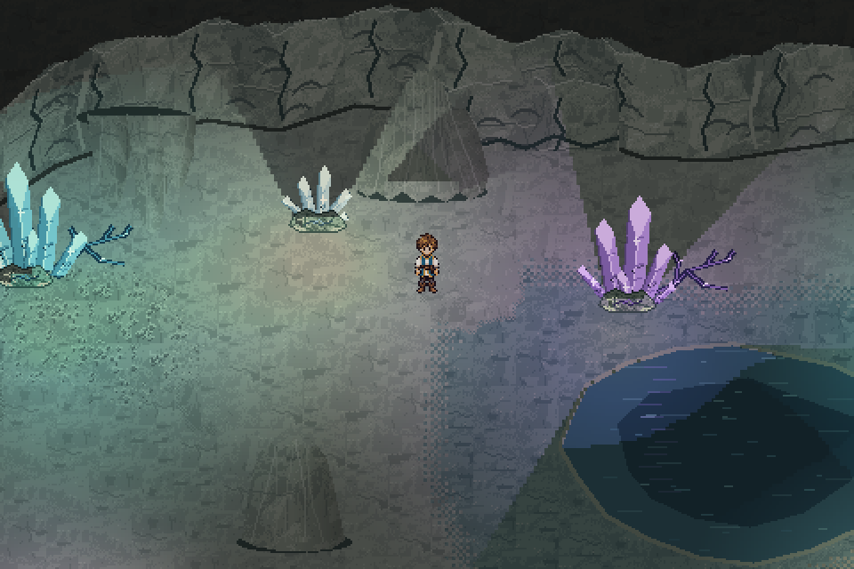

# Limestone cave chamber review

**Proposed asset pack and isolated review chamber; not merged into main.**

The screenshots use the production `Player` and `SanctuaryCaveWorld` renderer.
Caelan reaches each review station by ordinary collision-checked walking or
running. The viewer does not load a journey, quest or settings file.

- [Whole chamber](whole_chamber.png): stitched production world views at one
  shared light clock, enlarged with nearest-pixel scaling.
- [Material colors](chamber_material_colors.png) and
  [crystal lighting](chamber_lit.png): the same reached pose and camera with
  the environmental light pass toggled.
- [Pulse trough](pulse_trough.png) and [pulse crest](pulse_peak.png): the same
  standing position during one complete six-second pulse.
- [Animated crystal pulse](crystal_pulse.gif): native logical resolution.
- [Walkthrough](chamber_walkthrough.mp4): dry and wet surfaces, the tunnel,
  keeper ledge and formations, followed by a full pulse.
- [Reduced motion](reduced_motion.png): readable static crystal illumination.
- [Material board](../../../assets/terrain/limestone_cave/materials_review.png):
  unlit asset study, source stone and Caelan at a common native scale.
- [Regional comparison](../../../assets/terrain/limestone_cave/regional_comparison.png):
  the proposed rock alongside existing Sanctuary and Eldenmere materials.
- [Contact sheet](contact_sheet.png): labeled production views for comparison.

The view labeled material colors deliberately omits the light pass to show the
underlying stone palette. It is not a different drawing of the room. The
contact sheet and module board are labeled comparison layouts; other images
come directly from the playable renderer.

Play with `python tools/preview_limestone_cave.py`. WASD/arrows move, Shift runs,
Space holds the pulse, L toggles material colors, R toggles reduced motion,
H hides the guide and Escape closes the viewer. No normal game map is changed.

Reproduce with `python tools/capture_limestone_cave.py`; use `--check` to verify
the retained source and artifact fingerprints. `verification.json` records the
reached stations, movement modes, light brightness range, reduced-motion check
and unchanged production-file hashes. See the
[review guide](../../LIMESTONE_CAVE_REVIEW.md) for the asset rebuild commands.
