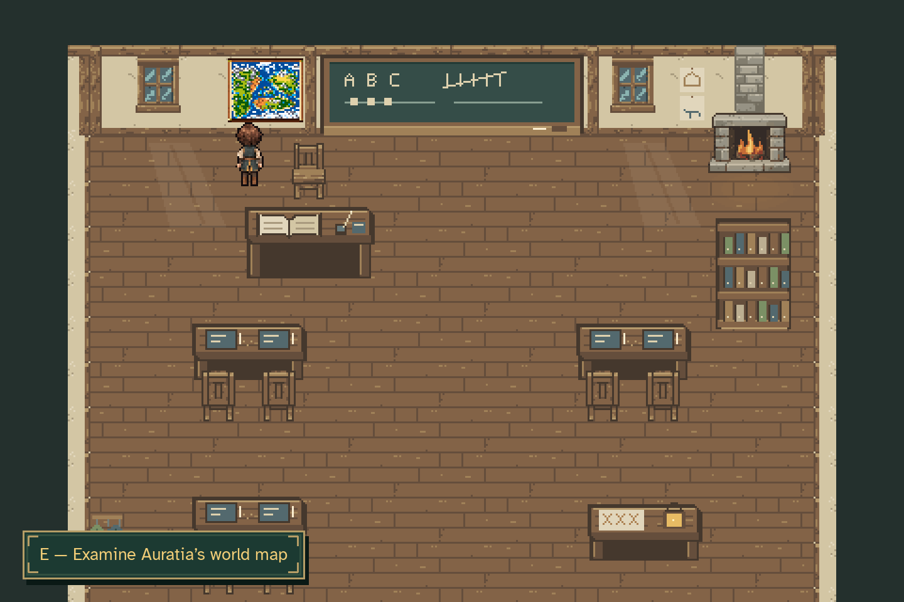
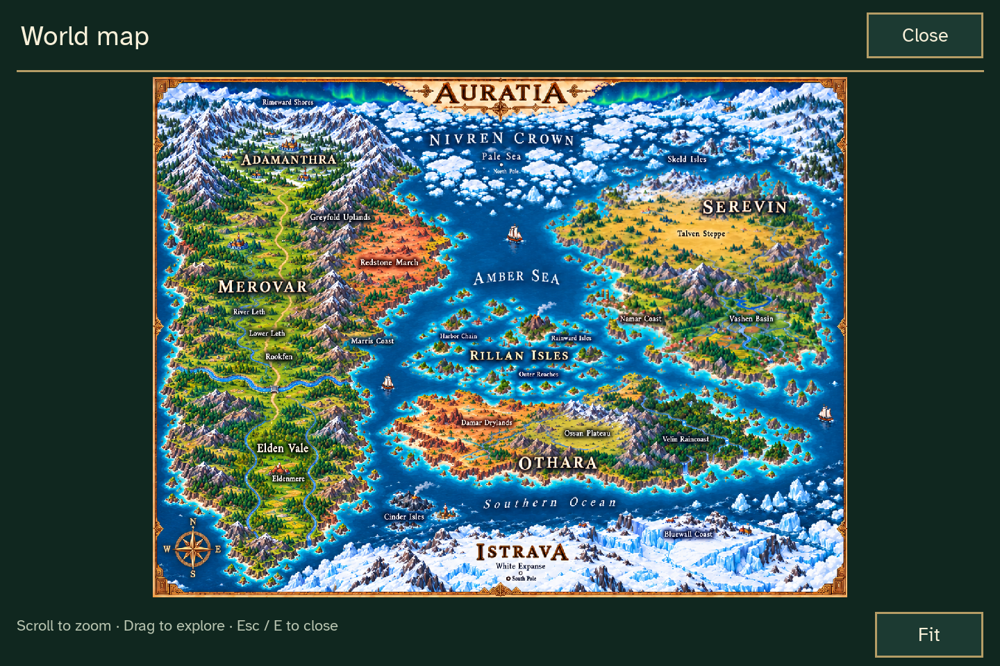
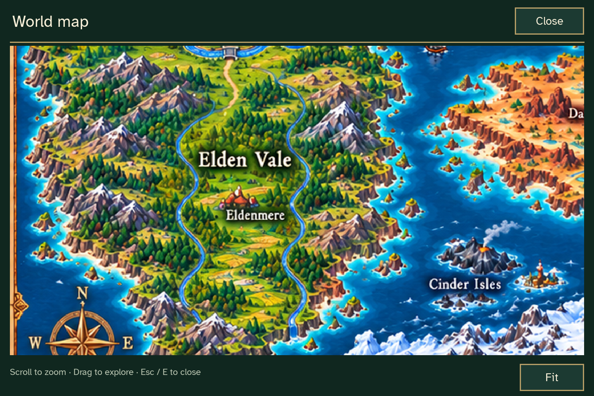
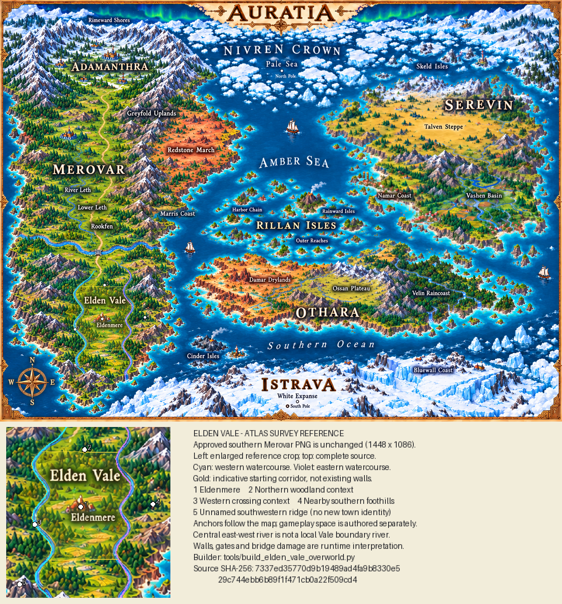
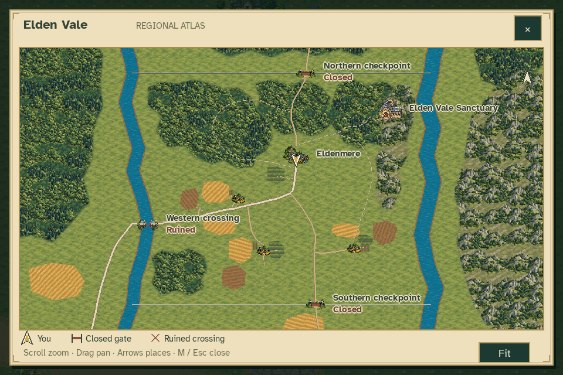
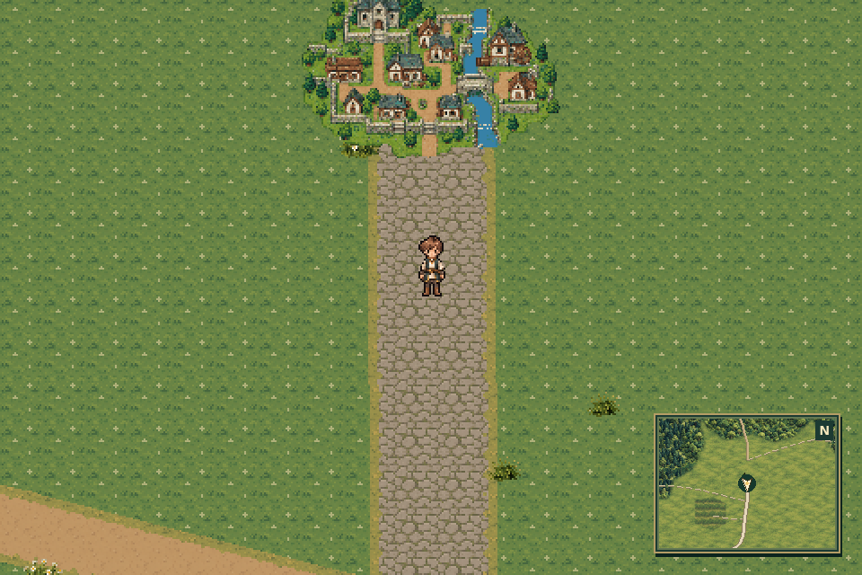

# Canonical southern Merovar world map

The user approved the revised geography on 2026-11-25. This review records its
asset integration and validation. The [World Atlas](../../narrative/world/WORLD_ATLAS.md#approved-world-map)
owns geography; this document is production evidence rather than a second lore
authority.

## Approved artwork and classroom adaptation

The [canonical map](../../../assets/world/auratia/world_map.png) is an exact
copy of `exec-5c97cbf9-8cbd-4ef8-b55b-2740b6581125.png`, at 1448×1086.
Its SHA-256 is
`7337ed35770d9b19489ad4fa9b8330e529c744ebb6b89f1f471cb0a22f509cd4`.
The detailed image is never resampled or repainted by the exporter.

The separate classroom prop was adapted with imagegen from the previous framed
source and the approved geography. Its generated master is
`exec-40ea2af5-0c36-4d94-8cb7-d05989c9661a.png`. The
[source approval record](../../../assets/source/world/auratia/approval.json)
pins both input hashes and binds the prop to this detailed map revision.
The native export remains 42×40 with binary alpha, the same furnishing ID,
wall position, floor approach and room collision.

| Actual classroom | Fitted world-map viewer |
| --- | --- |
|  |  |



The capture opens the production viewer with **E**, zooms around the surveyed
Eldenmere anchor `[263,821]`, and closes with **Esc**. Its
[verification record](school/verification.json) includes the loaded image hash,
dimensions, reachable approach and detail location.

## Regional resurvey



The recipe retraces the southern Vale's two north–south watercourses and moves
its five illustrative world-map anchors and corridor polygon. The central
east–west river is a separate continental feature. The inset uses the new
recipe-owned crop and preserves its aspect ratio. The source hash, normalized
coordinates and generated regional provenance agree with the approved image.

This moves the region's continental reference, not its local signed tile
coordinates. All regional fields outside geography/build provenance are equal
to the base. Existing tile positions for the five reference anchors remain
equal as well. The 46.05-second bridge approach and 43,616 reachable opening
tiles retain their existing validation results. The fifth reference identifies
an unnamed landscape illustration rather than a new settlement.

| Production regional atlas | Production minimap |
| --- | --- |
|  |  |

Additional views: [close atlas](regional/atlas_close.png),
[large text](regional/atlas_large_text.png), and
[capture report](regional/early_capture_report.json). These are focused still
captures, not a claim of a new full played walkthrough.

## Validation and preserved evidence

- The approved world PNG is byte-identical to the user's accepted image.
- All 43 existing local cartography tile PNGs are byte-identical. The manifest
  refreshes its source-region provenance; painted terrain does not change.
- The source and live school room metadata are byte-identical; the map sprite
  and assembled school previews reflect the updated art.
- All 2,385 pre-existing historical review artifacts are byte-identical. Fresh
  captures use the directory above rather than overwriting older reviews.
- The map-only school rebuild passes without changing town metadata or playable
  PNGs. Documentation validation checks 2,283 links across 548 documents, with
  no new broken links (nine existing failures remain).
- Three exporters pass `--check`. New tests cover approval integrity, read-only
  checking, stale export detection and invalid atlas survey bounds.
- The focused suites ran 61 cases: 60 passed. The same one error was reproduced
  before this change among the 53 baseline cases: the synthetic `Game` in
  `RegionalMapTests.test_real_game_update_freezes_regional_world_until_map_closes`
  lacks `elemental_bosses`. That fixture predates current game services. No
  production behavior is changed to accommodate it. Other actual-game school
  modal and minimap checks pass.

See [the validation record](validation.json) for counts and preservation checks.
Current map-viewer, school and cartography captures were visually checked for
the southern settlement, readable labels, correct prop silhouette and clipping.

## Reproduce

```sh
python tools/build_auratia_world_map.py --check
python tools/build_elden_vale_overworld.py --check
python tools/build_elden_vale_cartography.py --check
python -m unittest discover -s tests -p 'test_*world_map*.py' -v
PYTHONPATH=.:tests python -m unittest tests.test_world_map_assets tests.test_overworld_atlas_survey tests.test_regional_cartography tests.test_overworld_region_contract tests.test_overworld_map tests.test_overworld_minimap -v
python tools/capture_school_world_map.py --output-dir docs/reviews/merovar_world_map/school
python tools/capture_elden_vale_atlas.py --early --output-dir docs/reviews/merovar_world_map/regional
```

For asset rebuilds, run the exporters without `--check`; refresh the classroom
and compile its layers with `python tools/build_eldenmere_school.py --map-only`.
This scoped mode validates the existing room geometry without rerunning town
paths, yard or exterior generation. Use the explicit capture output
directories above to preserve historical evidence. The approved artwork is an
input, never a generated export to be recreated from scratch.

This integration does not author the central crossing, northern travel zones,
new towns, encounter bosses, capital names, political borders or distances.
