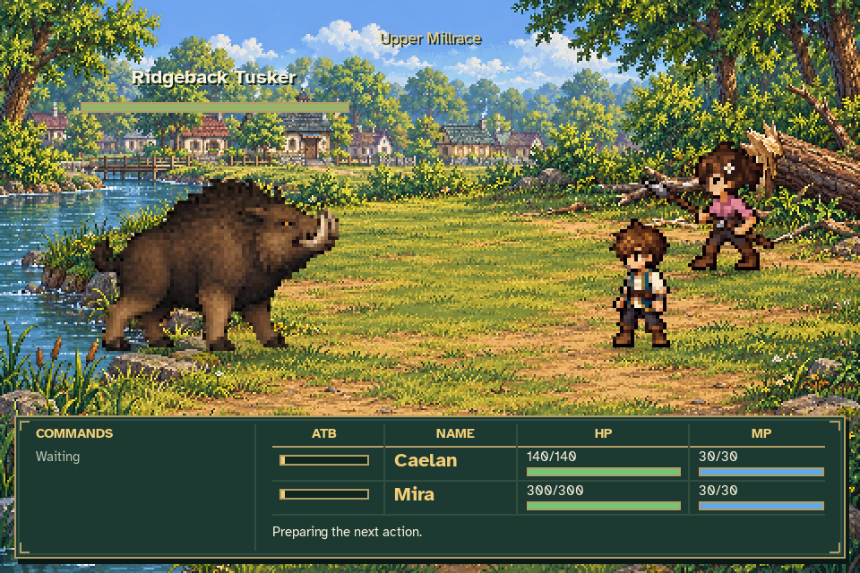
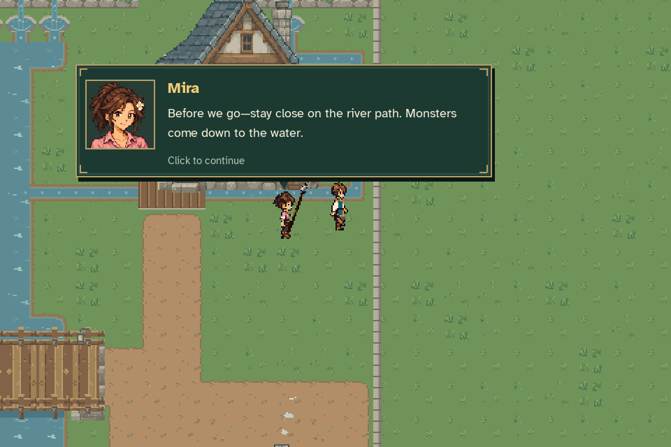
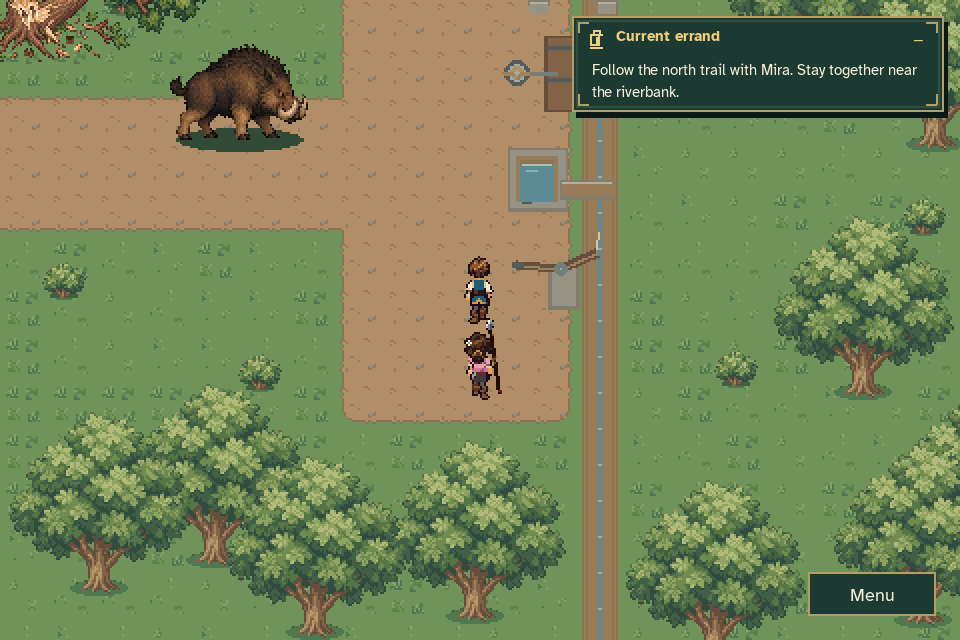
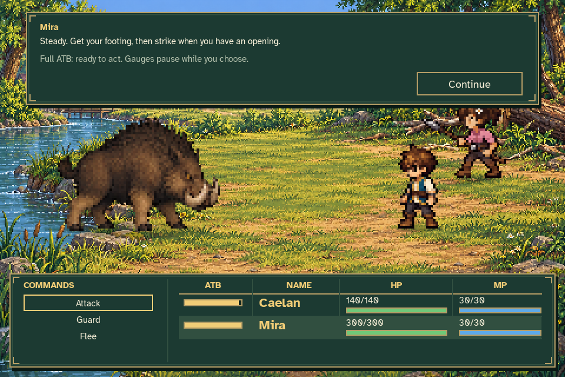
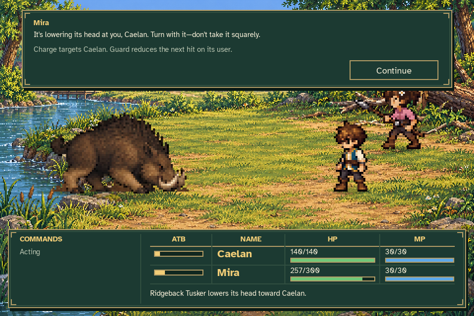
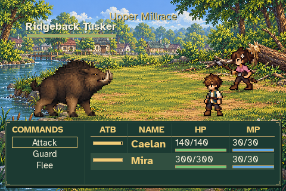
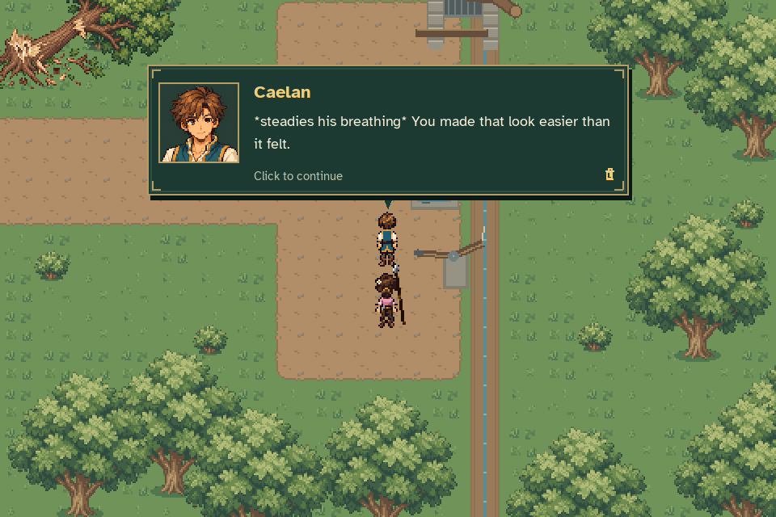
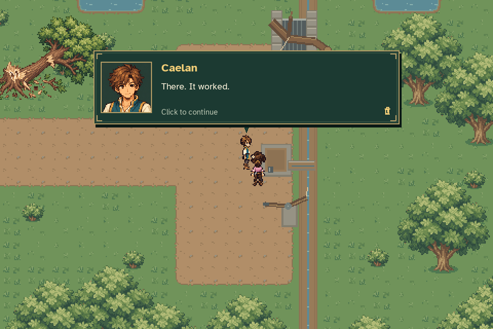
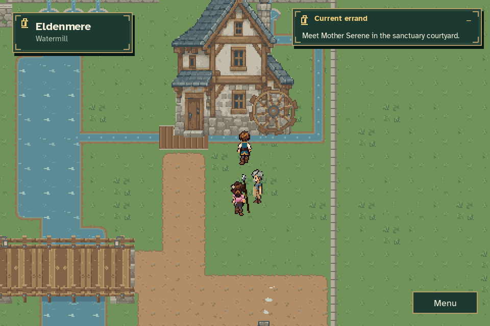

# MQ02: the riverbank encounter

These are captures of the implemented game, played from an unseeded New Game
through breakfast, the household visits (including the failed Venn spell), and
the completed mill quest. No character stats, abilities, inventory, positions or
quest progress are injected. Journey and settings files are temporary.



[Watch the combat animation](mill_combat.gif).

Mira warns Caelan before they leave Eldenmere and brings her short spear. A
visible Ridgeback Tusker and freshly broken tree establish the danger on the
actual upstream approach. The same Mira becomes a player-controlled guest in
a separate riverbank battle, with Eldenmere visible across the background.




Both characters have their own commands, resources and ATB. All gauges pause
when either is ready. Event-driven Mira guidance explains openings and the
creature's lowered-head charge; acknowledgement freezes time and cannot also
commit a command. Preparation and charge take separate enemy turns, leaving
an actual opportunity to Guard.





The captured fight records Caelan's unarmed attacks at 16 damage and Mira's
spear strikes at 96–106. Caelan Guards the telegraphed charge for 35 damage.
There is no artificial enemy health floor or requirement to select one action.
Victory grants 30 Resonance Points and one Aether Emerald exactly once.

Mira checks Caelan in a linear aftermath; there is no rest/continue choice.
The defeated monster does not repair the intake. The existing bypass, Caelan's
small and useful spell, conditional encouragement, cooperative tool work and
Halden's festival-flour conclusion still play in order. The wheel visibly runs
only after the physical repair.





The [capture verification](verification.json) records the real actions,
player-paced guidance, frozen world and gauges, reward, completed quest and
valid saved journey. The capture passes through 293 dialogue pages and renders
149 animation frames, encoded as 139 distinct GIF frames.

The [full regression run](tests.json) passed **976 tests**, with no failures,
errors or skips. All tested source files remained unchanged during the run.

## Reproduce

```sh
python tools/capture_mill_combat.py --output work/mill-combat
python tools/build_mill_combat_assets.py
python tools/build_mill_battlefield.py
python tools/capture_combat.py --output work/later-bat
```

The mill capture uses production New Game, walking, dialogue, battle commands
and quest actions. The later Bat fixture uses a legitimate completed legacy
mill journey to exercise the post-tutorial test encounter without altering
starting attributes or awarding progression.

Regression coverage includes both approach routes, warning acknowledgement,
party readiness, charge/Guard timing, reward refusal and duplicate settlement,
Flee, whole-party defeat, Mira winning while Caelan is incapacitated, unread
aftermath reload and quitting mid-battle. Interrupted fights reload at the safe
approach with pre-battle resources. Older journeys that already reached the
intake preserve their progress through a legacy bypass without inventing a
battle or reward.

Generated source sheets and their provenance remain in
[`assets/source/combat`](../../../assets/source/combat). The exporters only
extract and register the generated frames, with no runtime limb stretching.
