# Mill quest interaction audit

MQ02 now places travel prompts at the actual road ends and object prompts beside the visible mechanisms. Interaction reach follows Caelan’s ground footprint and physical object bounds, rather than an invisible circle around an animation station.

| Event | Corrected location |
| --- | --- |
| Leave Eldenmere | Northern road boundary, beyond the terrace stairs |
| Return to Eldenmere | Southern end of the upper millrace road |
| Mechanism inspection | Beside the visible waterwheel |
| Millrace inspection | Beside the channel leaving the wheel |
| Intake inspection | Beside the blocked screen and limb |
| Bypass | Beside its visible handle, including approaches from below |
| Small spell | Beside the water recess, including a route around its southern corner |
| Encouragement | With the actual Mira, including after leaving the recess |
| Repair | Beside the visible lever and haul rope |
| Working-mill check | Beside the same wheel that was inspected earlier |
| Recruitment and closing exchange | With the existing Mira and Halden actors at their actual positions |

Caelan walks into the original work stations after acknowledged dialogue. Collision-aware alignment preserves the existing spell, rope and Mira hand contacts. The corrected builder reproduces both links and all layout metadata; approved terrain, collision and sprite pixels are unchanged.

## Actual route verification

`python tools/verify_mill_triggers.py` walks the production game from MQ02 available, seeds only completed MQ01 prerequisites, and presses the normal **E** key. All eleven main scenes and 44 dialogue pages complete through two boundary transitions with the same Mira. Actions are checked for valid ground throughout alignment. Legacy standing spots at the old town trigger and old intake station still load without changing quest progress. Completed Continue remains quiet for ten seconds.

[verification.json](verification.json) records the route, inputs, object bounds, actors and save continuations. The separate [approach audit](natural-approaches.json) found valid routes from 767 reachable samples; [action runs](action-alignment.json) completed fourteen varied approaches at the original contact stations. One sample inside solid terrain was excluded.

Ten regression cases in `tests/test_mill_trigger_geometry.py` derive approaches from visible art and road boundaries, exercise real input, reject empty-ground hotspots, preserve cancellation, and check the pool detour and actor identity. Existing MQ02 save, action and anatomy regressions remain in `tests/test_mill_quest.py`.

## Travel boundaries

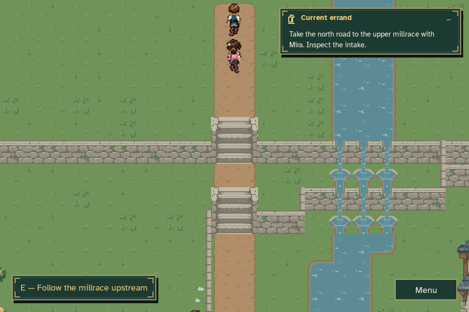

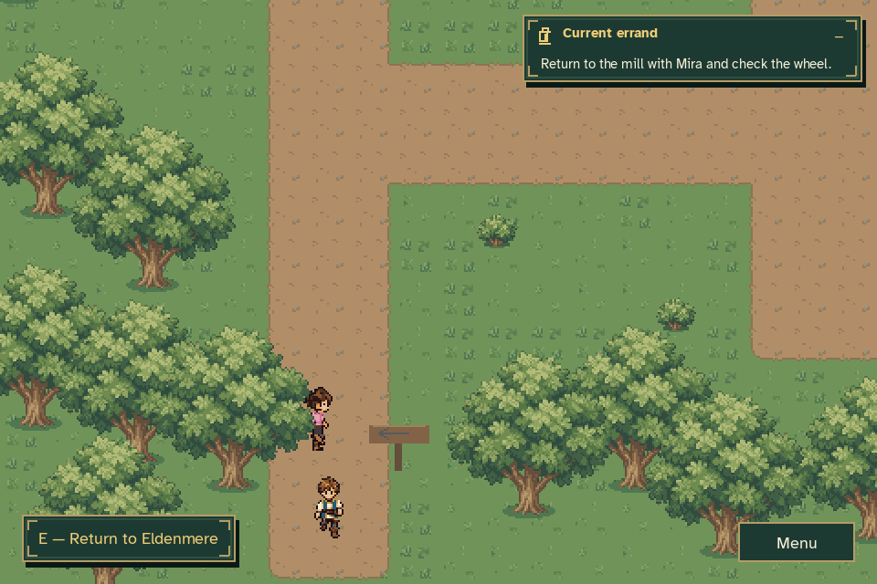

## Inspections and controls

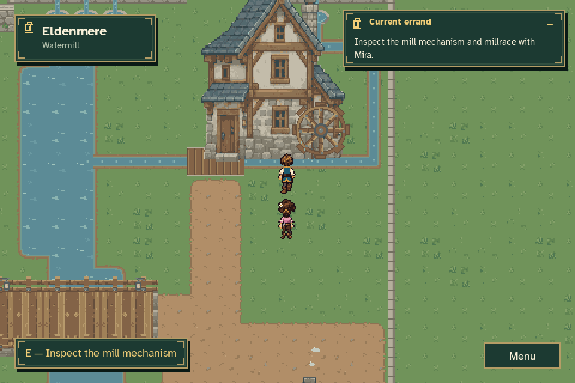

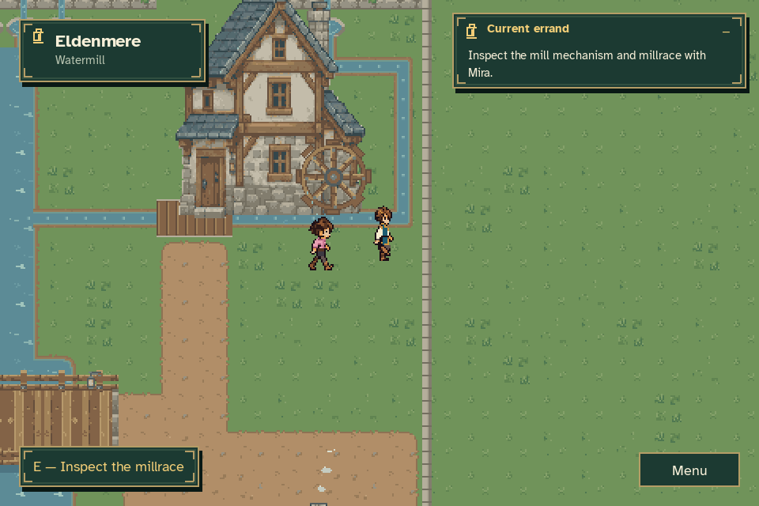

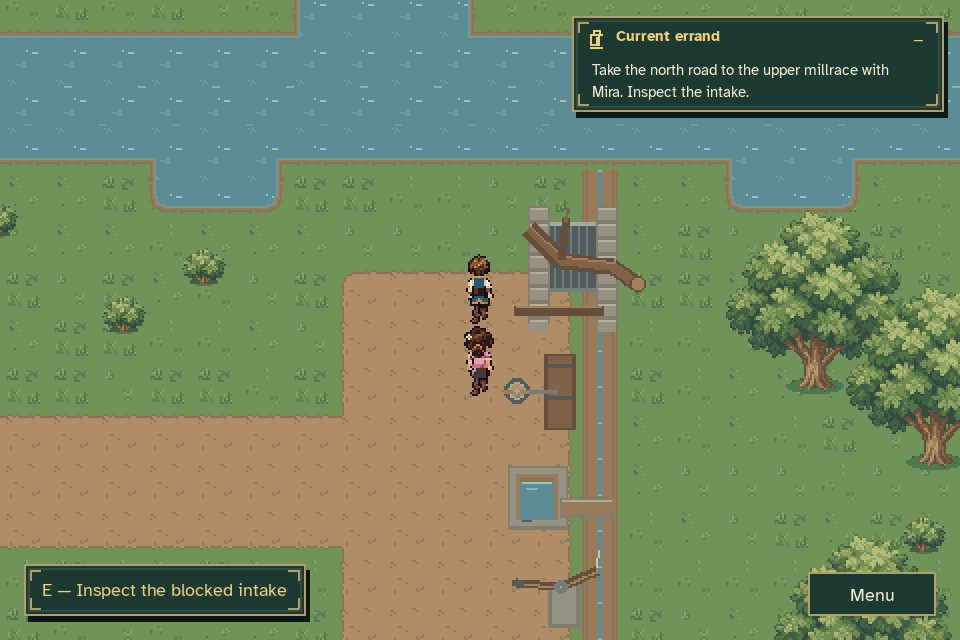

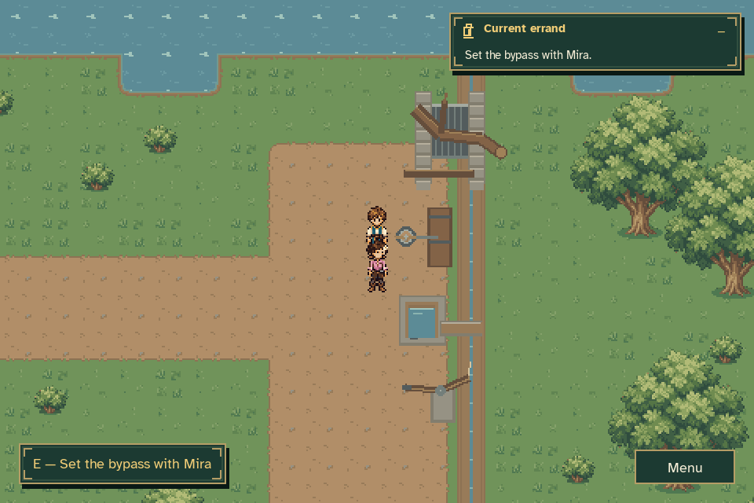

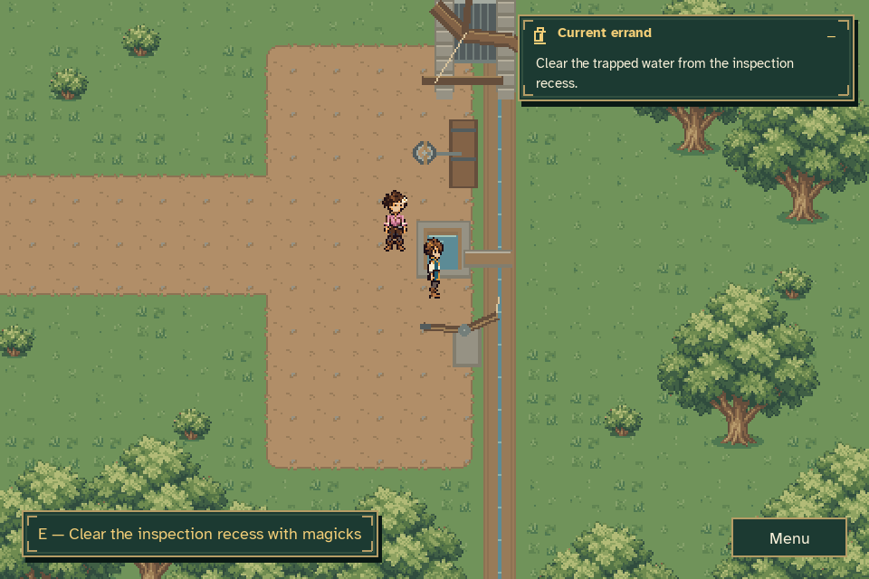

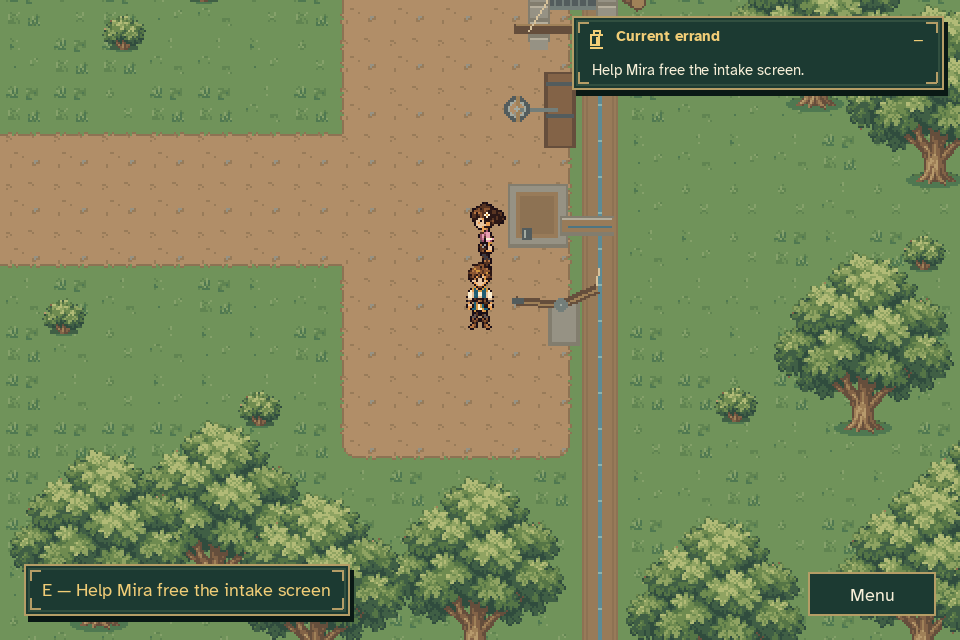

## Return and completion

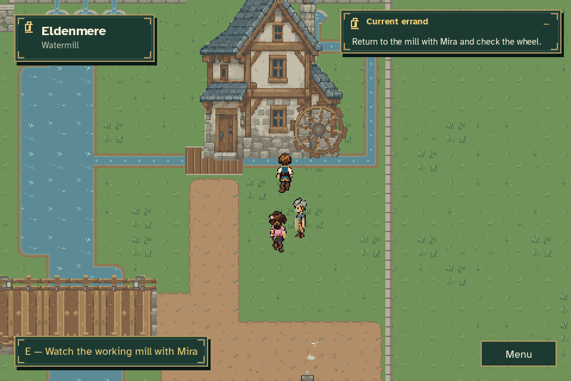

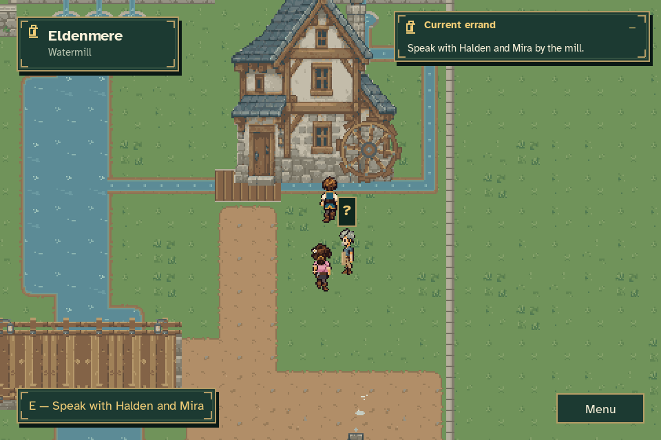

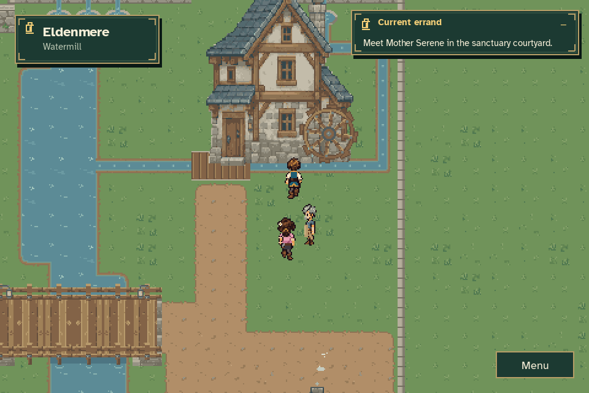
