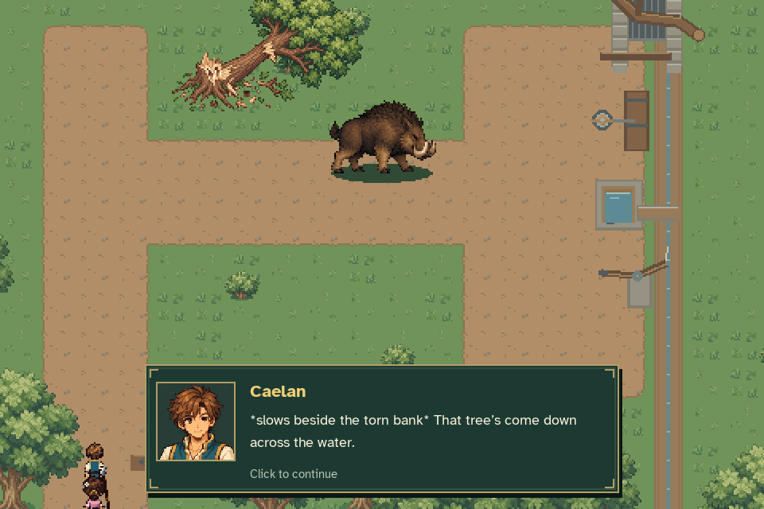
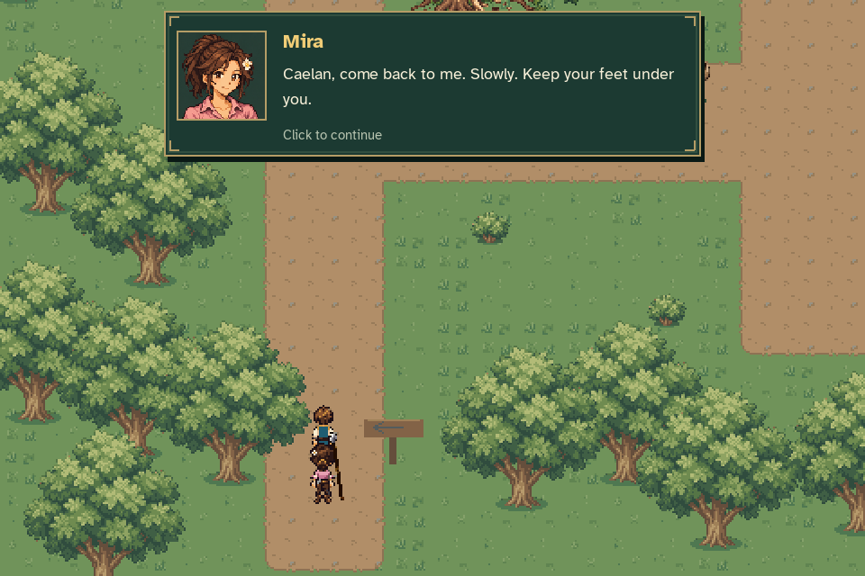
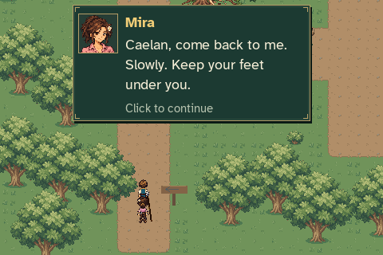

# Millrace arrival cutscene review

[Watch the arrival, boar camera shot and battle handoff](millrace_cutscene.mp4).

The recording starts at Eldenmere's northern exit. Entering the millrace uses
the real world link and companion transfer. Caelan stops, Mira joins and notices
the threat, and the camera pans to the boar. The camera holds there while the
player-paced conversation plays in a readable portrait panel.

Mira's final “Caelan, come back to me” warning starts the return pan. The party
shot settles before the warning is acknowledged. Only then do Kindled Courage
and the existing world-to-battle transition begin. The actors retain their
standing positions and normal proportions throughout the camera movement.





The disposable journey uses legitimate completed MQ01 progress and existing
station fixtures for the earlier MQ02 interactions. No ordinary save/settings
files are used. After entry, all actor movement, camera work, prose advancement
and battle entry are production behavior.

Video frames are captured from the actual 960×640 game at 30 FPS. The soundtrack
is reconstructed offline from the exact runtime OGGs and observed mixer commands
because SDL's dummy device has no audio loopback; effects are muted for review.
The [verification record](verification.json) includes camera/actor checks,
dialogue timing, one battle-track playback and its delayed start after the pan.

Reproduce:

```sh
python tools/capture_millrace_cutscene.py --output work/millrace-cutscene
```
