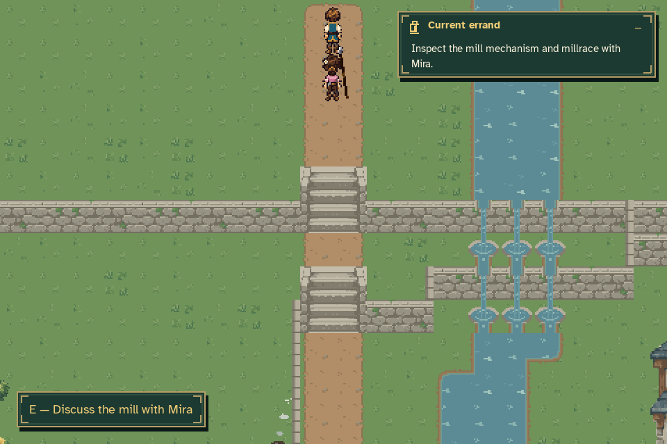
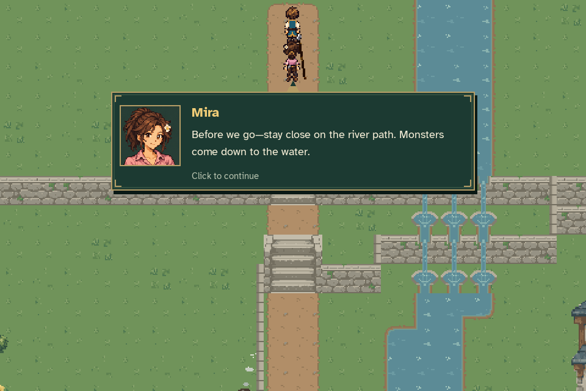
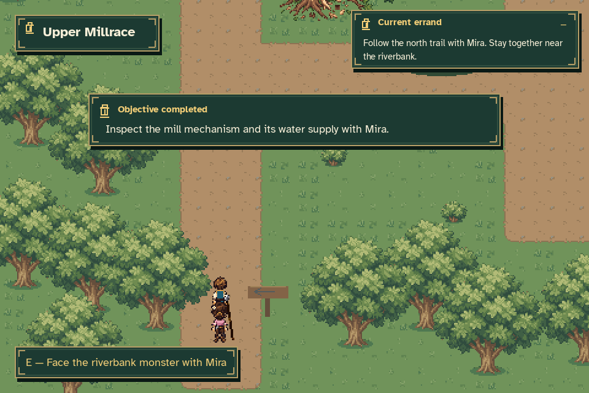

# Millrace north-departure recovery

[Watch the actual-game recovery and upstream arrival](millrace_departure.mp4).

The recording first shows the diagnosis directions before their final
acknowledgement. Walking away cancels that unfinished dialogue. After one cut
that omits the middle of the walk, Caelan walks the final approach to the north
exit. The prompt offers to discuss the mill with Mira. A real title-menu Continue
preserves that pending diagnosis. E resumes the diagnosis; the complete diagnosis
and practical warning play at approximately three words per second. Once the
warning is acknowledged, E transfers to the upper millrace and the existing
arrival camera pans to the encounter.





All video frames and screenshots come from production `Game.draw()` at 960×640.
The 20 FPS video is silent. The disposable fixture completes only MQ01 through
public quest APIs; MQ02 progress comes from real interactions and callbacks.
No regular player save or settings files are used. The video stops before combat,
with the intake still uninspected and the encounter still uncleared.

The [verification record](verification.json) includes observed quest states,
dialogue timing, Continue results, source hashes and the source base commit.

Reproduce from the repository root with the project Python environment:

```sh
python tools/capture_millrace_departure.py --output docs/reviews/millrace_departure
```
