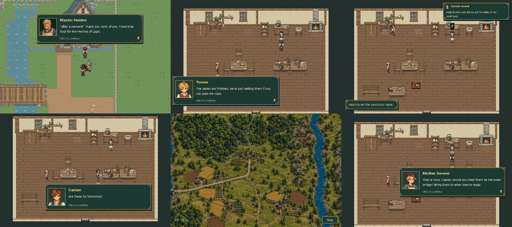

# MQ02 sanctuary homecoming and MQ03 handoff

[Watch the complete ending](sanctuary_handoff.mp4) · [Cup action](cup_action.gif)

Recorded from an unseeded disposable New Game through MQ01, Mira’s gift, the boar encounter and the repaired mill. The ending uses the ordinary sanctuary doors, the exact approved Tomas/Serene/Caelan exchange, a visible cup collection and carry, the destination dialogue, and physical placement. MQ02 finishes only after the cups are set down. Aldric’s aerial cinematic then begins; using its Skip button returns to the same dining-room position. A separate conversation accepts MQ03.

The review movie is silent, 960×640 at 20 fps, and lasts 137.70 seconds, with readable dialogue. The arrival is shown only through its aerial opening because the rest of that cinematic is unchanged. No player save or settings file is included.

Reproduce with `python tools/capture_mq02_sanctuary_handoff.py`. [Verification metadata](verification.json) records the actual observed states, dialogue, actor uniqueness and retained player position.
