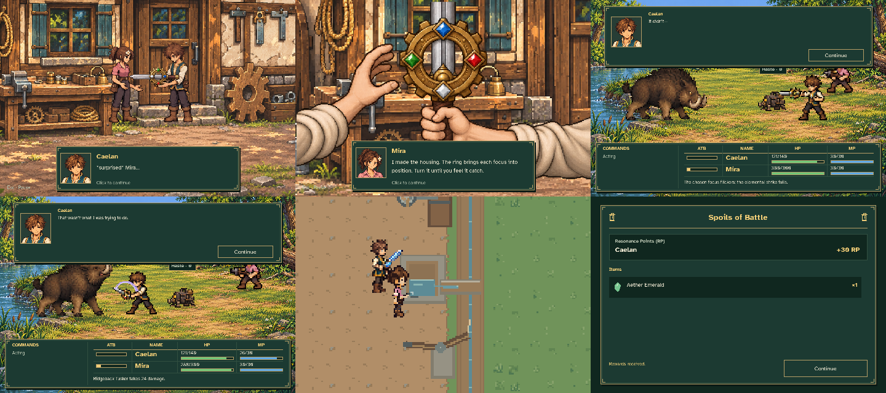
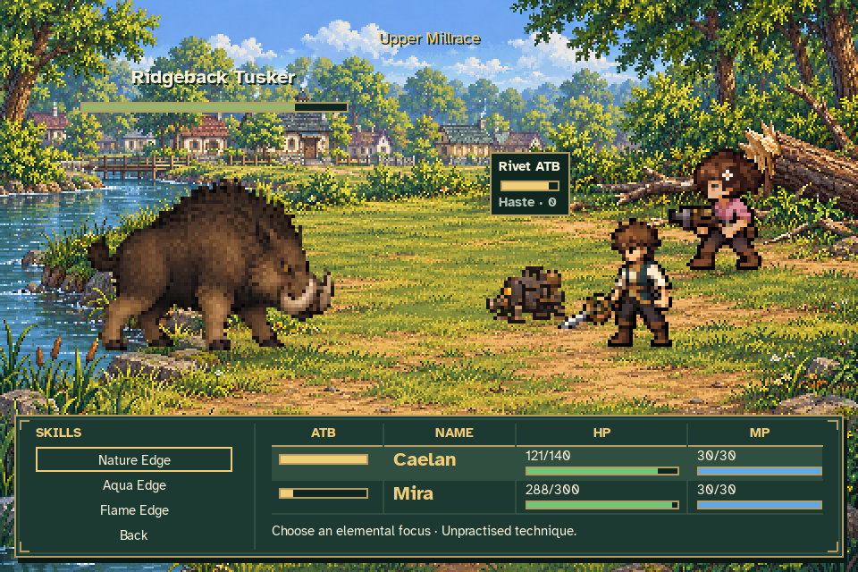
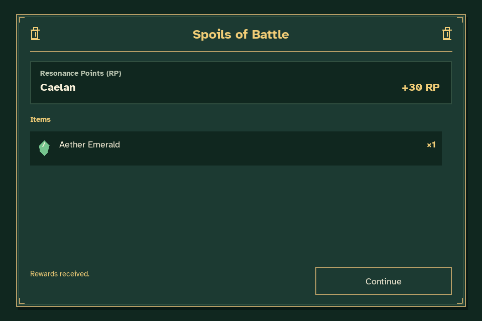
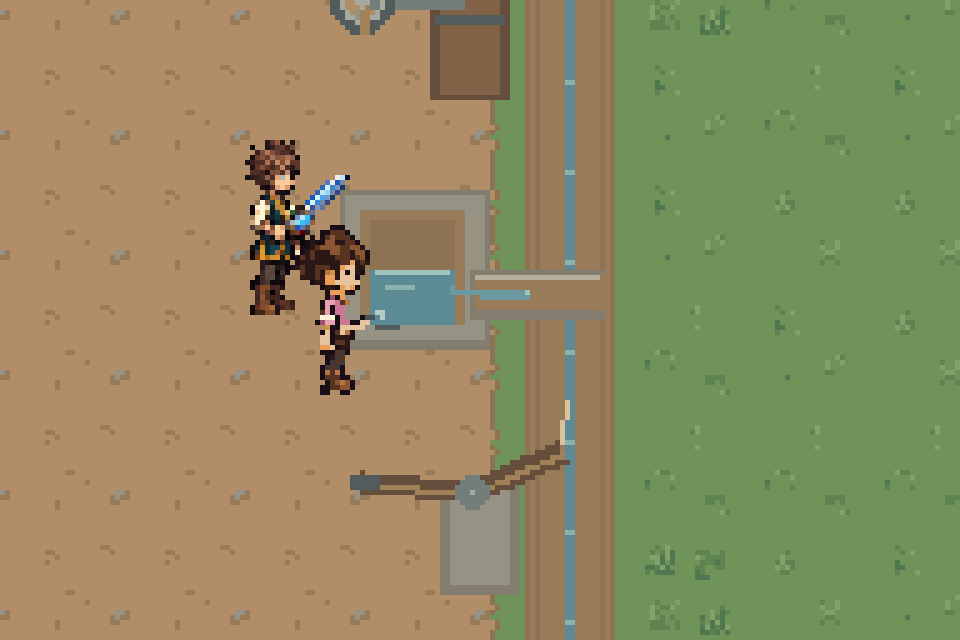

# MQ02: Mira's gift and Caelan's first Spellblade technique

This review uses an actual disposable New Game from the opening quests through
the mill repair and Aldric's arrival handoff. Equipment, abilities, attributes
and quest progress are never seeded by the capture.

- [Mira's early birthday gift](gift.mp4): the complete exchange, readable dialogue,
  grounded handoff, rotating focus ring and its metallic click.
- [Combat lesson](combat_lesson.mp4): Guard, the failed Nature attempt, the next
  Caelan turn's accidental Aether Edge, and normal party controls. The excerpt
  omits most charging intervals while retaining the player-paced guidance.
- [Water-focus cast close-up](water_focus.mp4): actual rendered actors and intake,
  cropped and enlarged to review the blue focus and small water movement.



The gift equips one **Mira's Blade** before leaving town. Aether Edge remains
pending until the second attempted elemental technique succeeds. The failed
attempt deals no damage; the discovered Aether Edge deals an immediate mixed
physical/magical strike and spends 4 MP. Nature Edge, Aqua Edge and Flame Edge
are temporary lesson choices and never become permanent learned abilities.



After discovery, normal party controls resume and Aether Edge becomes a
repeatable direct-strike skill. The battle continues through the actual
victory transition and Spoils of Battle before returning to the investigation.



The repaired bypass isolates the same shallow inspection pocket. Caelan's blue
Water focus clears it, then he and Mira finish the existing physical repair.
The capture waits for normal transient notices to expire before the cast; it
does not disable the HUD or alter the water state.



[Animated water preview](water_focus.gif) · [Animated gift preview](gift_preview.gif)

The gift film keeps at least 1.5 seconds per spoken page, with extra time based
on word count. Its audio uses the actual authored gear-click asset at the cue
observed in the runtime, at the same gain. The other clips are silent.
All movies are 960×640 at 20 fps. Pillow only assembles rendered frames or crops
the water close-up; FFmpeg encodes those frames and mixes the recorded cue.

Validation includes an interrupted-gift reload without duplicate equipment,
deferred learning across saves, the consecutive focus attempts, a discovery
checkpoint retaining the 4 MP cost, Flee/retry without relearning, depleted
resource and unequipped-weapon recovery, and both unseeded Venn histories through
the completed mill and Aldric handoff.

Reproduce with:

```sh
PYTHONPATH=tests python -m unittest test_mq02_spellblade_gameplay test_mira_machinist_story
python tools/capture_mq02_spellblade.py --output docs/reviews/mq02_spellblade
```

[Verification metadata](verification.json) records the resolved actions,
guidance, focus choice, one-time reward result, source dialogue count, movie
durations and valid final journey. The original journey and settings stay in a
temporary directory and are removed when the capture finishes.
