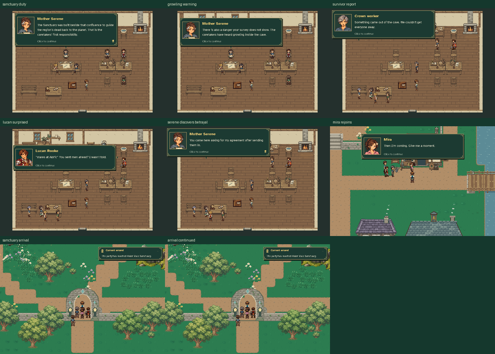

# MQ03 — The Sanctuary emergency

[Watch the emergency and journey excerpts](emergency_journey.mp4)

This production Game review starts from an explicitly initialized legacy journey
with completed MQ01/MQ02 and a previously seen arrival. No MQ03 objective, stage,
current-quest actor position or recruitment is seeded. The separate welcome,
meal, revised discussion, survivor report, betrayal, Mira's rejoining exchange
and Sanctuary journey are earned through acknowledged dialogue and ordinary
movement. Long transit and some reading are omitted from the focused silent
movie; all observed dialogue is retained in the verification record.

The survivor enters physically, Lucan learns of the secret deployment, and
Serene remains with the injured worker. Mira retains her previous resources.
Aldric, Lucan, the page, Caelan and Mira gather at the actual reserve entrance.
Save/Continue is exercised after the report and at arrival. MQ03 remains active,
MQ04 remains locked, and the arrival cutscene and miniboss are deliberately left
for subsequent story work. The cave rail remains closed.

[Verification](verification.json) records actual stages, source lines, transfers,
survivor positions, party identity, resources and source/artifact fingerprints.
All save/settings files are temporary and leave player journeys untouched.
Regenerate with `python tools/capture_mq03_emergency.py`; verify with
`python tools/capture_mq03_emergency.py --check`.

Validation covered 25 affected test modules. The broader run passed **306 tests
and 1,223 subtests**; its one obsolete four-visitor registry assertion was
updated to include the survivor. The final frozen recheck, including that
assertion, state migration and actual gameplay, passes **14 tests and 24
subtests**. The complete guard-asset module also passes all five tests.

Checks cover cancelled dialogue, paused entrance motion, occupied care stations,
legacy completed visits, Mira's existing growth and spent resources, and five
visible travelers immediately after Continue. The native asset builder and
source/artifact checks pass; stale source records and changed media are rejected.
The final silent walkthrough contains **960 frames over 48 seconds**, at
**960 × 640 / 20 fps**. Earlier grass and Sanctuary reviews were refreshed
against the final runtime.
