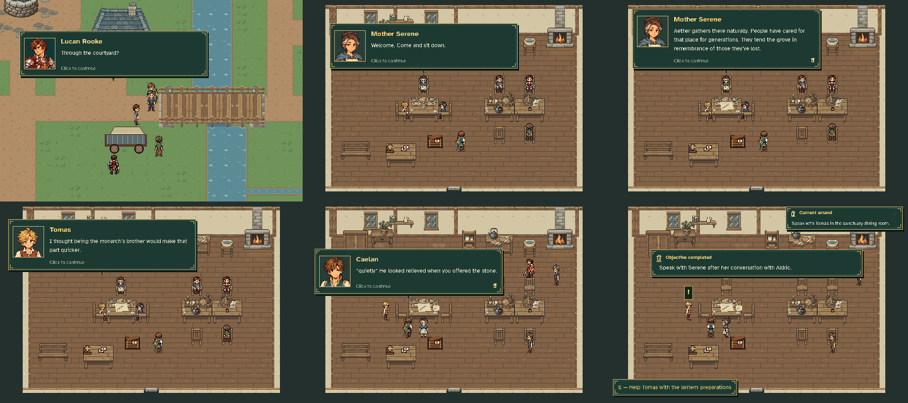

# MQ03 — The revised Regent’s Road

Historical review of the visit before the Sanctuary emergency revision.
See the [current emergency review](../mq03_emergency/README.md) for the survivor,
Lucan's surprise, Mira's rejoining and Sanctuary journey. The media below retain
their original story and source record.

[Watch the complete visit](revised_visit.mp4)

Recorded from a disposable, unseeded New Game through MQ01 and the revised MQ02 gift, boar encounter, water repair and sanctuary ending. The arrival is advanced to its gate greeting to verify Lucan is traveling with Aldric; Skip then returns to the same sanctuary position. The movie records the separate MQ03 invitation, Lucan’s introduction, normal door navigation directly back to the sanctuary, the meal, ridge discussion and private aftermath.

The silent movie is 960×640 at 20 fps, 309.80 seconds long. Every main dialogue page is retained with reading time. No quest, equipment, resource or actor position is seeded, and no player save/settings file is included.

[Verification metadata](verification.json) records the five scenes, actual room transfers, Lucan’s presence, completed objectives, absence of cart props, valid final save and MQ04 availability. Reproduce with `python tools/capture_mq03_revised_visit.py`.
