# Opening dialogue pass through the mill quest

The breakfast, household visits and mill quest now introduce the village through the main scenario. Serene names Halden, Elira and the Venns, their needs and the landmarks that lead to them. Festival of Light preparations connect Halden’s flour, the village kitchens, Elira’s lantern and Mira’s repair work. Their spoken reminders repeat useful directions. Selective expressions and gestures use literal asterisk-wrapped emotes.

The [captured dialogue](dialogue.md), [opening script](../../narrative/game_01/CH01_MQ01.md) and [mill script](../../narrative/game_01/CH01_MQ02.md) give the attributed lines. Existing art and quest actions are retained. Bypass and repair follow-up lines appear after the physical work; Caelan holds the approved rope grip until Mira’s first release line is acknowledged, and moving or canceling releases it safely.

## Actual game verification

Run `python tools/verify_opening_dialogue_pass.py` to start an actual New Game and walk through both quests. No quest progress, household receipts or actor stations are seeded. The capture uses normal doors, trail links, proximity conversations, E/Space and explicit choices. [verification.json](verification.json) records 32 main scenes, 277 dialogue pages, 19 real scene transfers and 169 actual-speaker identity checks. Native stills show normal and large text; the scale comparisons do not advance story.

Eight focused regressions also cover both complete unseeded routes: Elira→Venn with the failed magick attempt, and Venn→Elira using tools. They verify briefing before explicit acceptance, supplied items, literal emotes and wrapping, no unseen failed-spell dialogue, the Tomas-absent legacy briefing, and acknowledgment/cancellation/Continue during the repaired-intake follow-up. The full previous quest, animation and save suites remain applicable.

## Breakfast and the household briefing

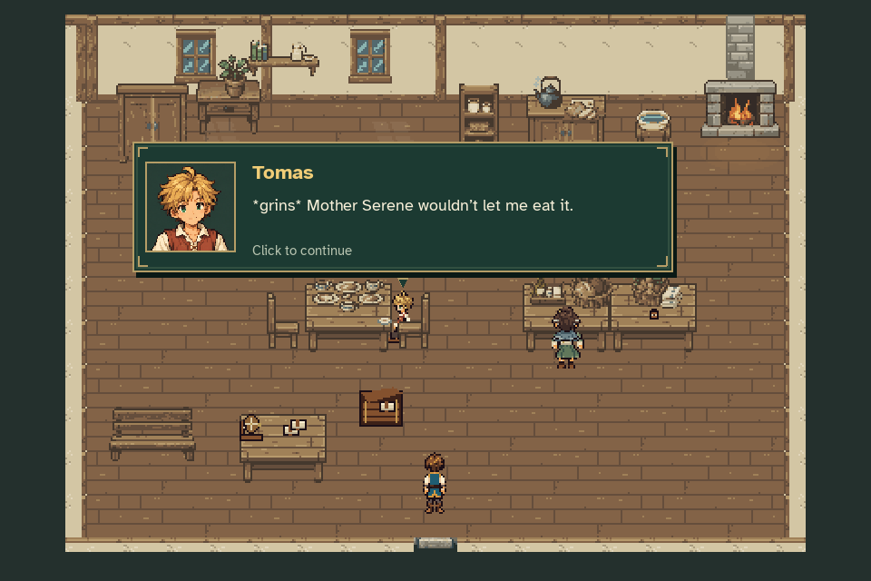

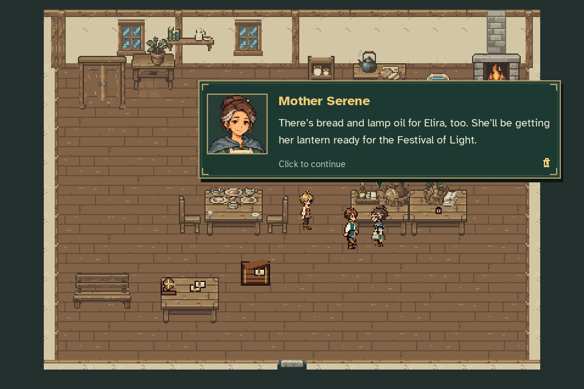

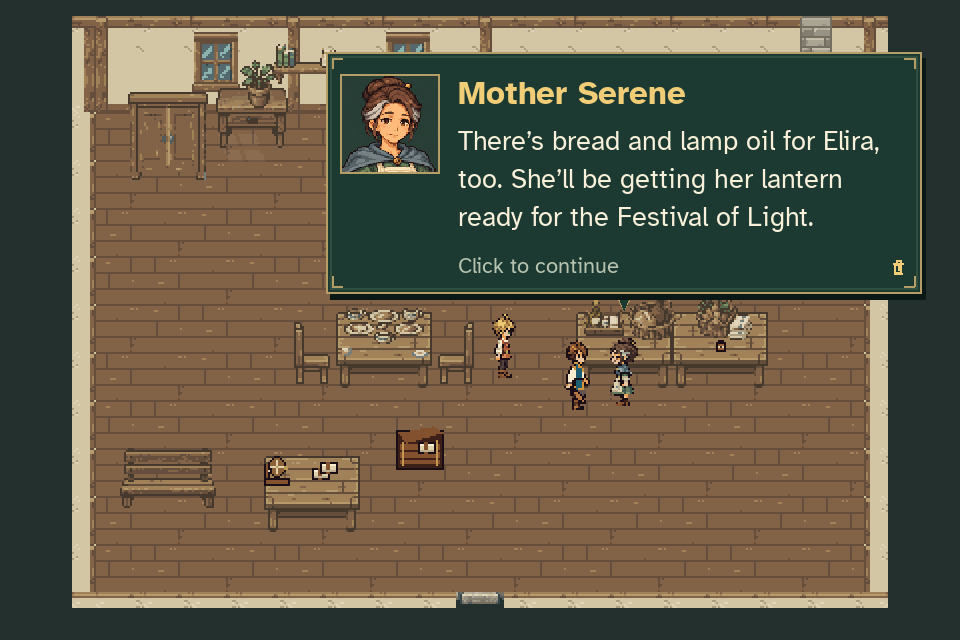

## The village households

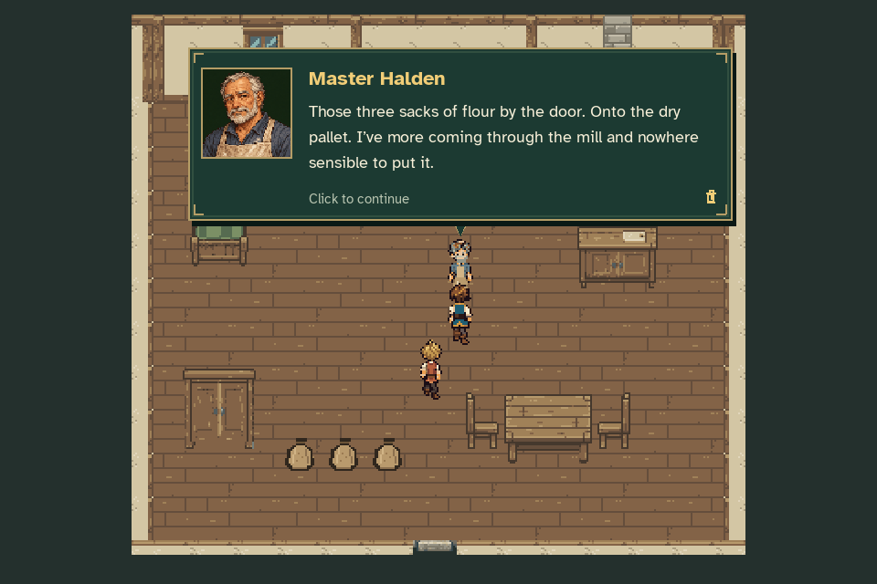

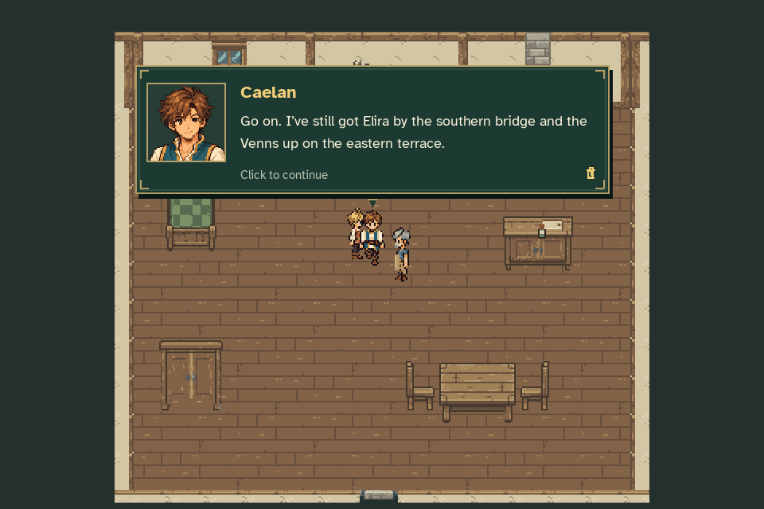

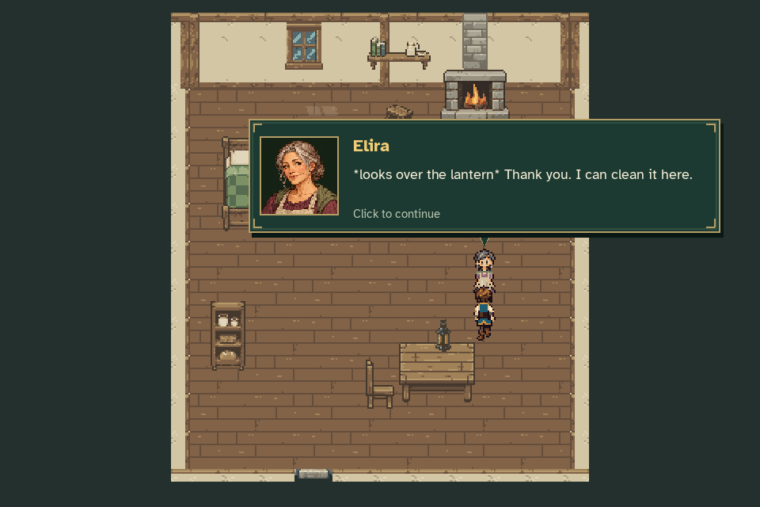

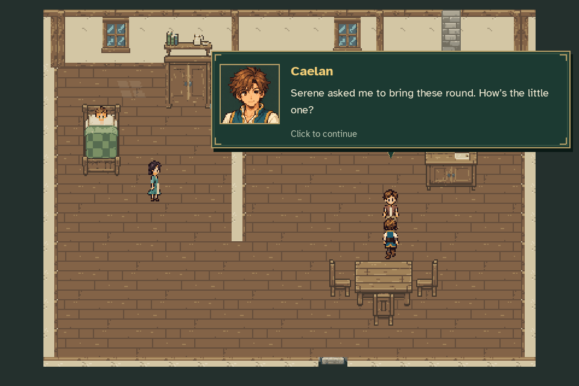

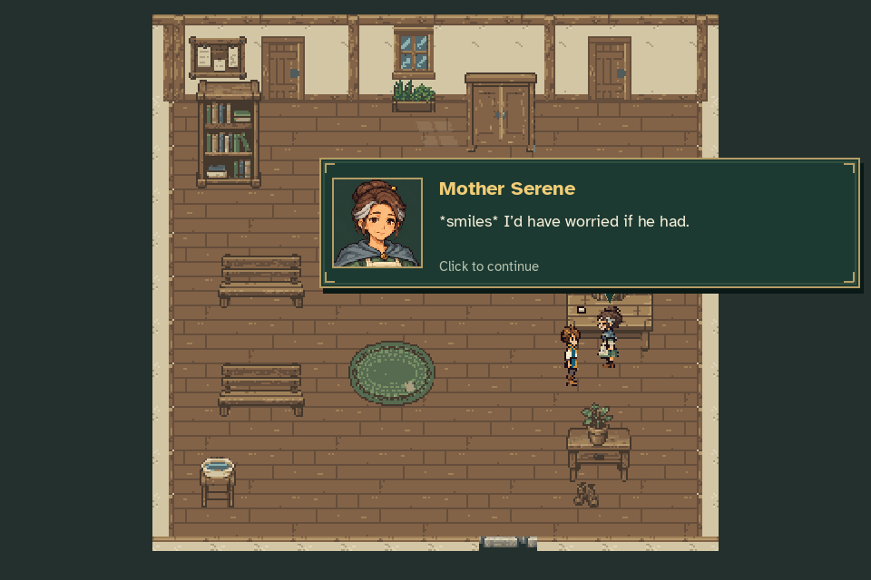

## Mira and the mill

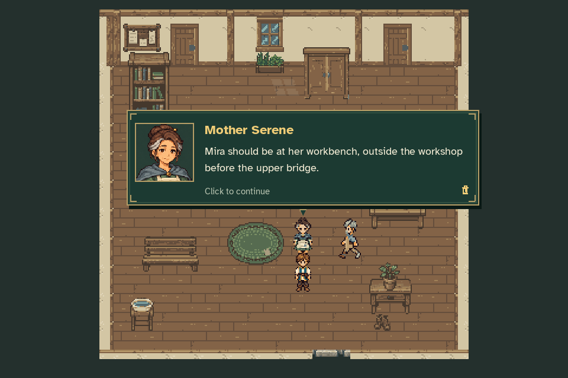

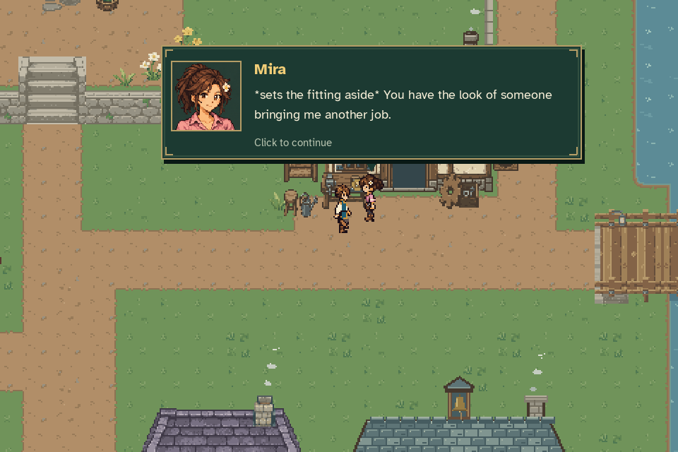

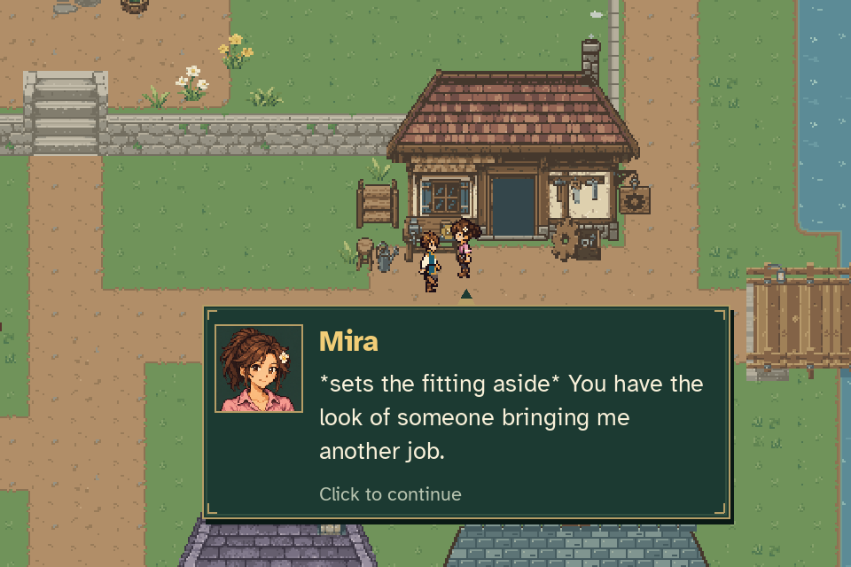

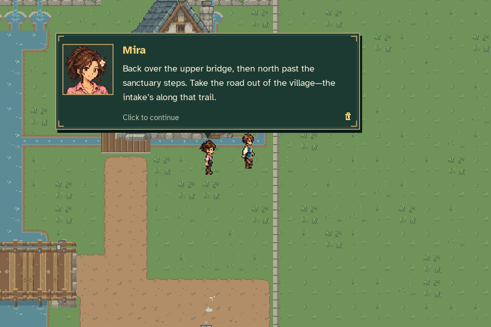

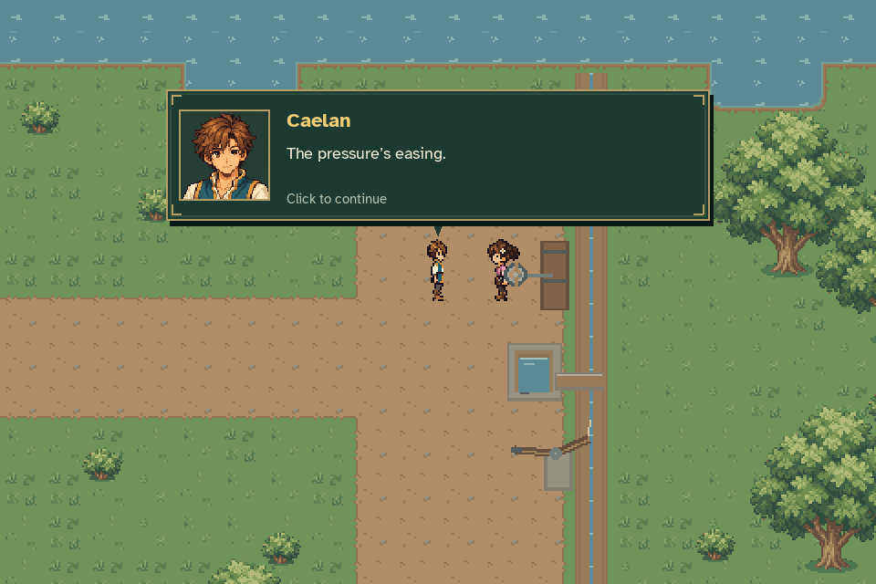

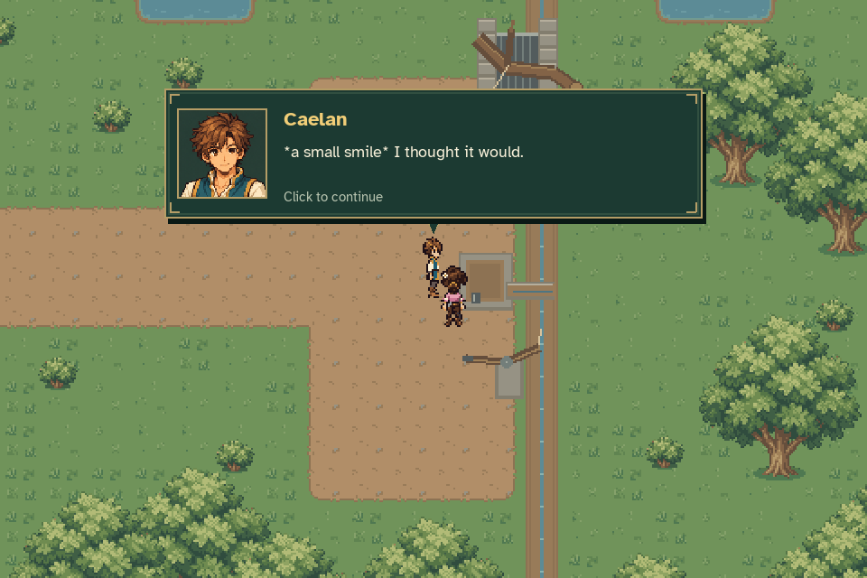

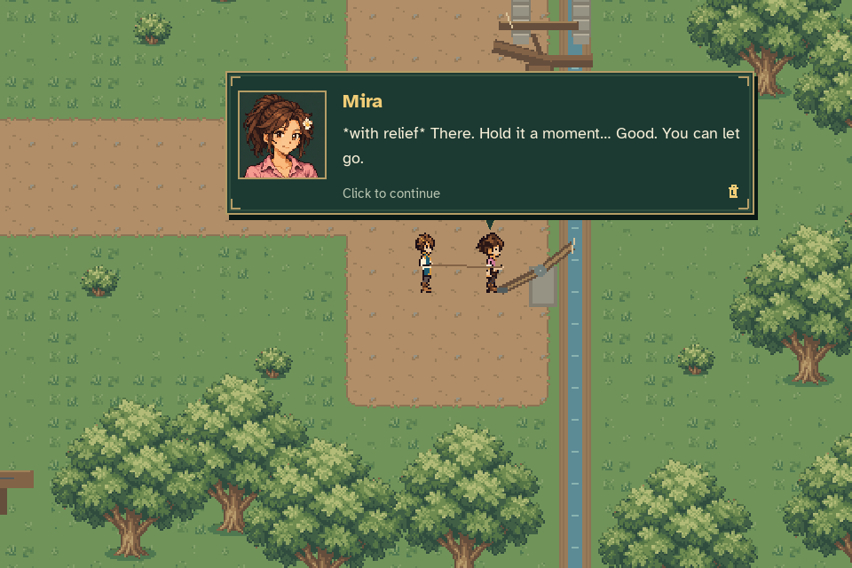

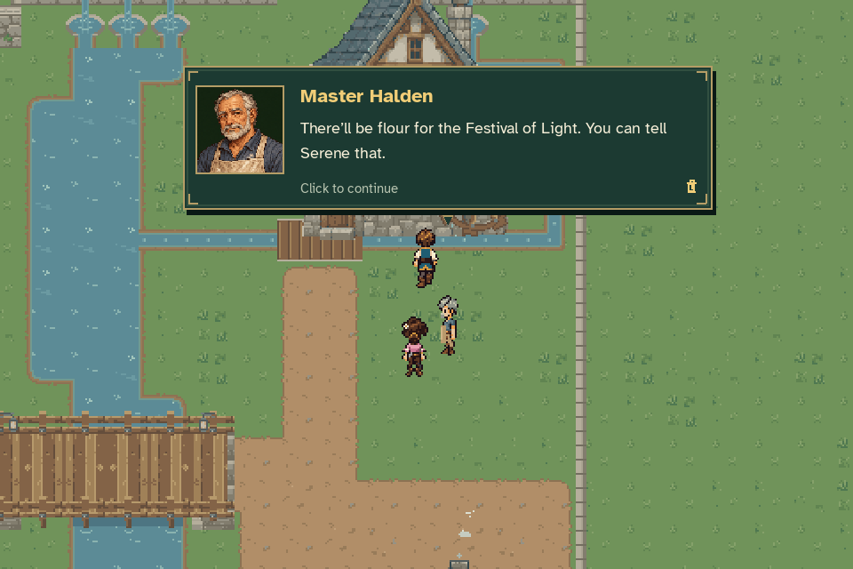
