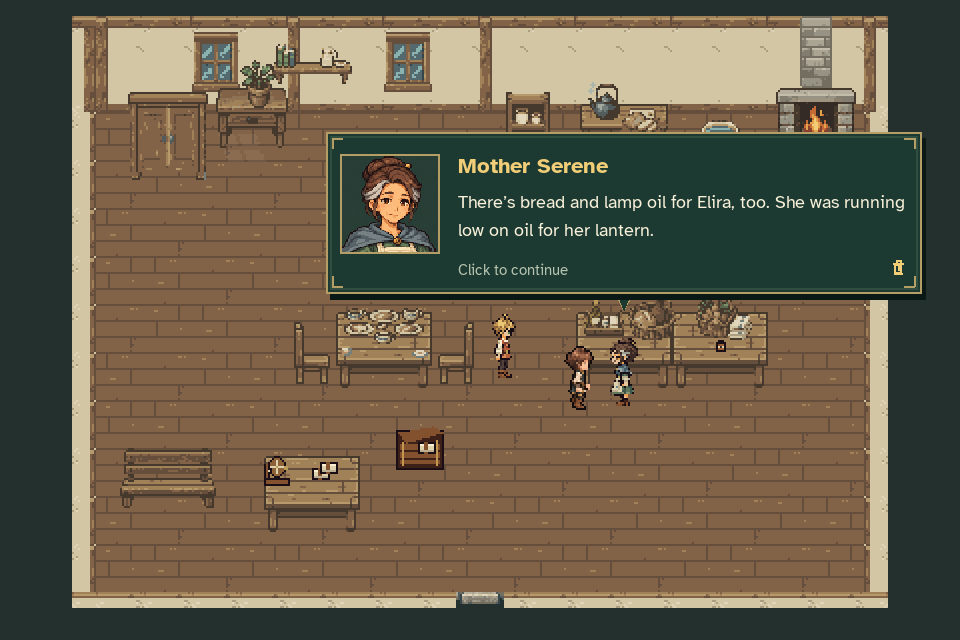
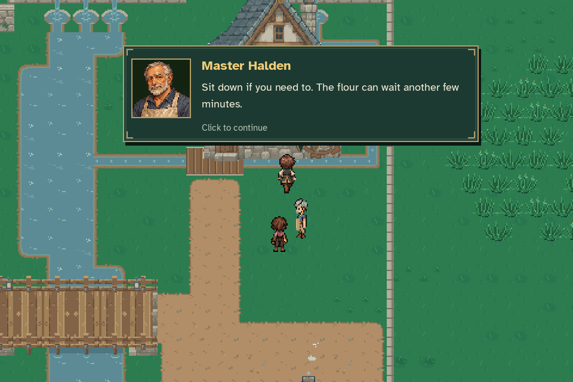

# Retired opening runtime — implementation review

This PR removes the retired flashforward, relief/quarry/worker-rescue sequence
and Festival of Light quest runtime. The [opening narrative owner](../../narrative/game_01/CHAPTER_01.md)
retains the replacement Fire Veinhold direction and its unresolved decisions.
This review is verification evidence, not another story authority.

## Current playable result

New Game enters Caelan's retained bedroom morning directly. MQ01 and MQ02 remain
playable through household visits, Mira's blade gift, the mill adventure and
return-home cup placement. Completed MQ02 releases the family to ordinary
routines and leaves a quiet journal and free exploration. No retired arrival,
mining rescue or lantern invitation is queued.

The new Fire Veinhold prologue, survivor arrival, assault and revised Sanctuary
mission are not implemented here. The retained cave encounters keep their
existing balance; the revised party mission remains future work. The regional
bridge still starts ruined;
intact/destroyed/restored phases and intact regional art are the next functional
migration. Its current description no longer invents the retired lightning
cause. General faith, Elira's remembrance, the school, physical cave, healing
pool, independent encounters and the Ice Reaper scene remain.

## Played morning and mill verification

[The complete report](played/verification.json) records actual title New Game,
walking, animated doors, proximity dialogue, E/Space input and explicit choices.
No MQ01/MQ02 progress, household receipts or actor stations are seeded. The run
uses the failed Venn-magicks route and completes both retained quests:

- 37 main dialogue scenes and 365 pages.
- 21 actual door/trail transfers and 217 single-actor speaker checks.
- 22 native and large-text stills, with checked dialogue layout bounds.
- [Captured dialogue](played/dialogue.md) and saved quest-owner snapshots.

| Household service | Ordinary mill conclusion |
| --- | --- |
|  |  |

Additional examples: [Elira's remembrance](played/elira_remembrance.png),
[small magical success](played/small_success.png) and
[large-text mill conclusion](played/mill_resolution_large.png).

Reproduce with:

```sh
PYTHONPATH=.:tests SDL_VIDEODRIVER=dummy SDL_AUDIODRIVER=dummy python tools/verify_opening_dialogue_pass.py --output-dir docs/reviews/opening_retirement/played
```

## Shared cinematic and Gallery preservation

The retired scene supplied code used by the retained Ice Reaper. Its shared
player is now an explicitly installed optional cinematic; ordinary startup does
not load a scene. The old lamp, helmet, flare and other scene-specific behavior
is removed. The retained production Ice Reaper's world pixels and portrait UI
match the baseline in all 20 sampled normal/reduced-motion frames
([frame hashes and reproduction script](ice_reaper_frames.json)).

The [fresh Gallery capture](gallery/capture.json) records 20 retained entries,
responsive layouts and actual input through Ice Reaper playback, pause,
restart, exit, a mill replay and Continue. Parent save bytes remain unchanged.
Watch the [26.967-second verification video](gallery/gallery_review.mp4).

## Legacy journeys

Story revision 2 uses a copy-only compatibility adapter. Eight real snapshots
were captured and validated against the pre-removal aa4b7ace runtime: active
MQ01, active/completed MQ02, assigned/travelling/completed MQ03, active MQ04 and
a pending boss-entry transaction. The seven settled snapshots validate and
continue in the current Game. Early retained quests keep progress and position;
affected retired outings resume at a safe post-mill home checkpoint. Temporary
guests return to ordinary availability without healing or losing earned stats.

The adapter preserves inventory, levels, HP/MP, abilities, focus/boss/treasure
receipts and the retained Aqua Edge transaction. It never marks a new Fire
mission or invasion complete. Unsupported unsettled legacy transactions receive
a compatibility error; migration never writes the source file. New revision-2
saves are not moved or stripped of current shared-system pending work.

## Removal and asset boundaries

Executable retired controllers, story registries, scenes, old playtest/Gallery
entries, exclusive exporters and assets are removed. Shared approved royal art
was moved to neutral character libraries; all 100 moved raster/source images
are byte-identical ([path/hash verification](art_relocations.json)). Original uploaded music compositions remain; the retired
opening's exclusive runtime export and registration are gone.

Historical captures and review data are preserved. Old guides that have incoming
references are short retirement notices with historical commit links. The few
remaining original-path fields in archived/provenance manifests are historical
origins, not active builder inputs.

## Regression scope and remaining failures

The final sweep executed all 2,636 test methods in
292 modules, using fresh processes to release rendered fixtures.
The earlier single-process attempts exceeded the environment's memory limit and
are not counted as completed runs.

There are 54 existing failure/error records across 33 methods.
Each exact case was reproduced in a fresh process at the baseline commit; its
normalized traceback and assertion match. No new failure/error records remain.
This is not a green suite; the existing failures are listed with reproduction
methods in [the complete regression comparison](regression.json).

The stale opening-music assertion was replaced with retirement and original-upload
preservation coverage; all 32 soundtrack tests pass. The six bedroom inspection
metadata lines also match the current script.

See [validation.json](validation.json) for final test and preservation results.
