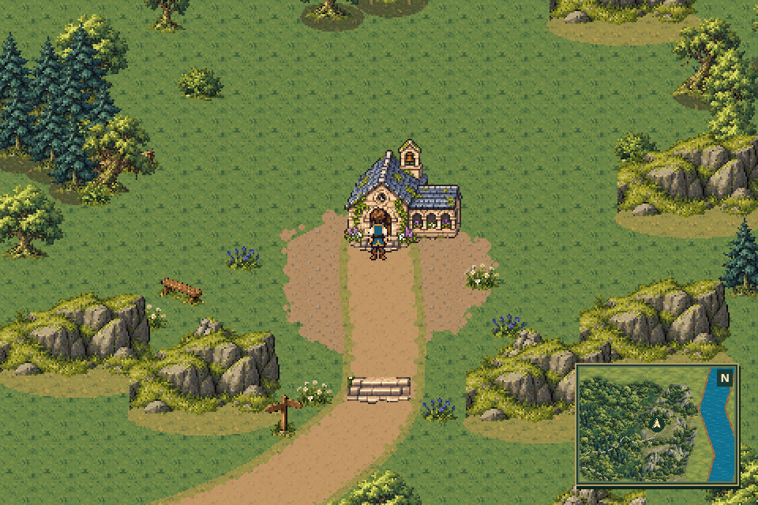
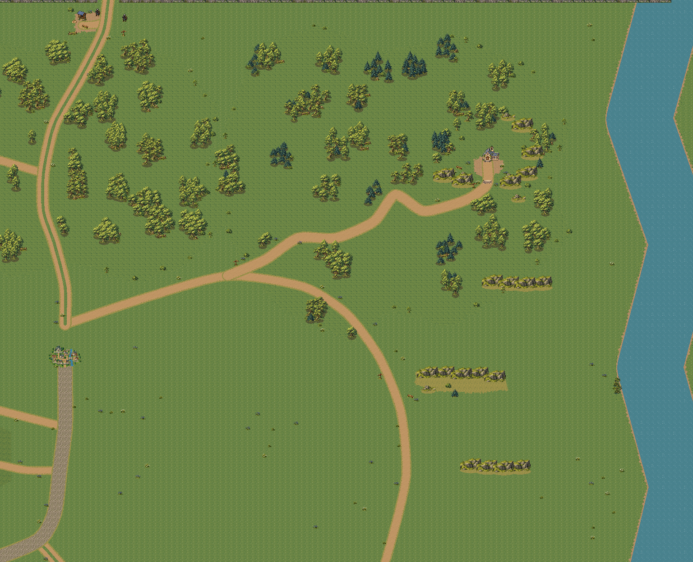

# Ridge Sanctuary — overworld geography

[Watch the approach and inert miniature crossing](sanctuary_walk.mp4)

The preview uses the actual game renderer and ordinary movement from Eldenmere’s
existing southern exit. The exploration fixture changes no quest, equipment or
story flags. The new approach, grove, ridge and miniature are streamed normally.
Walking across the miniature loads no scene and changes no quest, inventory,
music or dialogue state. The detailed reserve and cave are future work.

[Regional atlas](regional_atlas.png) · [Crossing animation](miniature_crossing.gif)

[Verification](verification.json) records the unchanged gameplay state, valid
disposable save, geometry hash and bounded context-render requests. Player save
and settings files are untouched. Reproduce with
`python tools/capture_overworld_sanctuary.py`.
