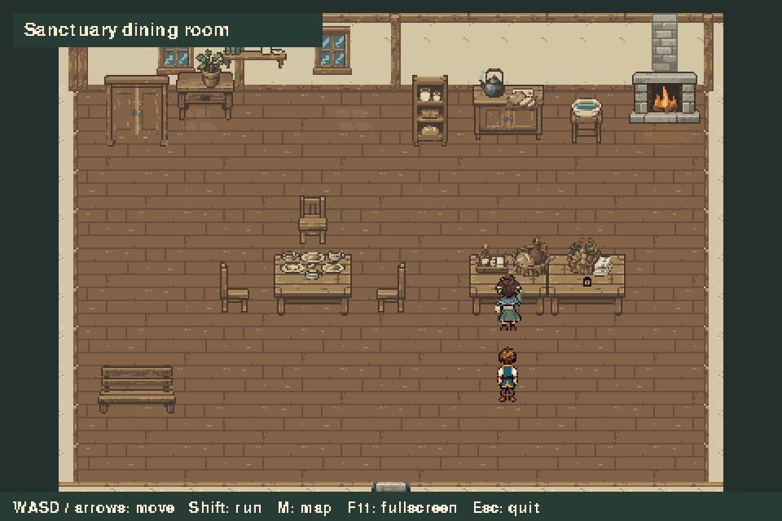

# Proximity dialogue review

Status: awaiting user review. This milestone enables automatic conversations
with Mother Serene, using her existing schedule and the approved portraits.



The 2× enlarged loop records `main.Game` at 10 fps. Caelan approaches while
Serene holds a jar; she returns it to the table, turns toward him and pauses.
The textbox shows the current speaker's portrait, name and dialogue. Real mouse
events at the upper-right window corner advance Serene → Caelan → Serene.
After closing, she resumes her exact routine position and clock. Caelan remains
nearby without reopening the box, then walks away and returns for repeat lines.

- [First conversation still](serene_dialogue.png)
- [Repeat conversation still](serene_repeat.png)
- [Captured input timeline](capture.json)

Run `python main.py`, enter the sanctuary and find Serene in the dining room or
hall. Walk close while facing her. Click anywhere in the window to advance one
page, or use Space/E. Dialogue pages display immediately. Movement, map toggling
and doorway transitions are held during the conversation. F11, resizing and
window closing remain available. Other NPCs and environmental animations keep
running. The camera frames both participants above the textbox.

The trigger uses a six-pixel gap between the foot collision rectangles, capped
at a 24-pixel center distance. This lets the player approach from any unobstructed
side. Static collision blocks line of sight; closest eligible speakers in the
player's facing direction take priority. The player must move beyond 36 pixels
from Serene to re-arm the trigger. Holding the mouse button never advances extra
pages. Only one page can advance per event batch.

The work routine can pause immediately while walking or with a prop already
on its surface. When holding a prop, Serene finishes the handoff before turning;
the hearth action finishes before she turns. Conversation time never advances
her schedule or causes catch-up afterward. Her original work pose, path and
room membership remain intact for resumption.

`assets/dialogue/eldenmere.json` contains speaker/portrait bindings, first and
repeat lines, and condition flags. Dialogue comes from the approved opening
script. This demonstration does not start the quest or stage the breakfast
scene; conversation flags currently persist for the running game session.
Mira and the gardener retain their existing ambient routines and will receive
conversation hooks after review of this Serene milestone.

Reproduce the capture:

```sh
python tools/capture_social.py
```

The GIF uses one 256-color palette and full replacement frames with disposal 2.
The still PNGs preserve the game's exact rendered colors.
