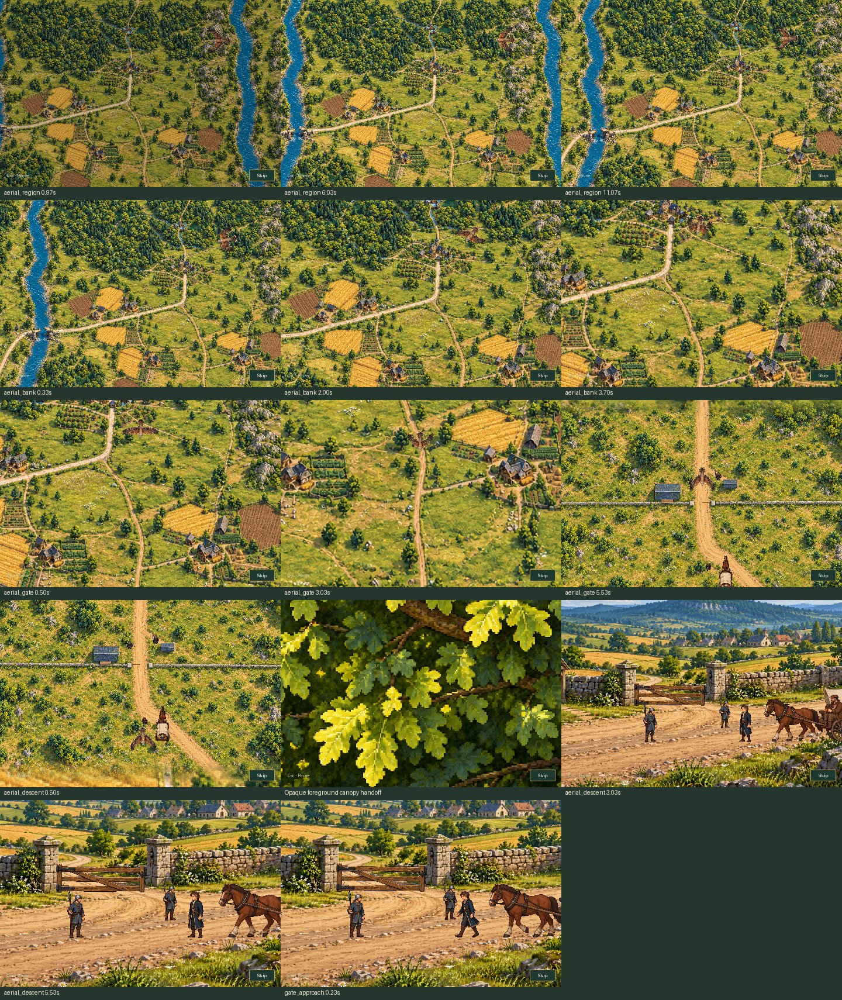

# Bird-led introduction to Elden Vale

[Continuous aerial introduction](aerial_intro.mp4) · [Animated preview](aerial_intro.gif)

These silent production Game recordings begin with the acknowledged MQ02 report and follow the new aerial view continuously into the caravan scene. Earlier mill work is the documented fixture; cinematic phases, camera, bird and convoy are never assigned during playback.

[Native descent and ground-scene handoff](descent_handoff.jpg)

[Ground camera settles on the caravan](ground_push_in.jpg)

The rest of the arrival completes through normal dialogue input. The [capture report](capture_report.json) records phase and aerial-camera samples, current source fingerprints, artifact hashes, GIF pixel/timing verification, world/wildlife freezing, and reload, pause, focus, skip and isolated Gallery save-preservation checks. The preview is silent because SDL dummy has no audio loopback.

The video and individual stills preserve the game's native 480×320 view; the GIF is a smaller navigation preview. Contact sheets use JPEG to keep the review lightweight.

Replay in-game from **Title → Gallery → Aldric’s Relief Caravan**.

Reproduce with `SDL_VIDEODRIVER=dummy SDL_AUDIODRIVER=dummy python tools/capture_regent_aerial.py`.

## Verification

All **194 regression tests** pass (205.818s), covering aerial motion, the arrival and mill quests, Gallery, saved journeys, music and regional integration. All four asset exporters, Python compile and whitespace checks pass.

Independent review verified **147 current render inputs** and **12 media hashes**. The full scene completed through 17 phases with **4,376 world/wildlife freeze checks**. The canopy hides the single view handoff completely; all seven playback/accessibility/save checks pass.

The [geographic audit](geography_audit.json) checks the painted landmarks against the unchanged regional manifest; their maximum observed error is **1.73 tiles**. See [validation.json](validation.json) and the [test log](tests.txt) for the final evidence.
