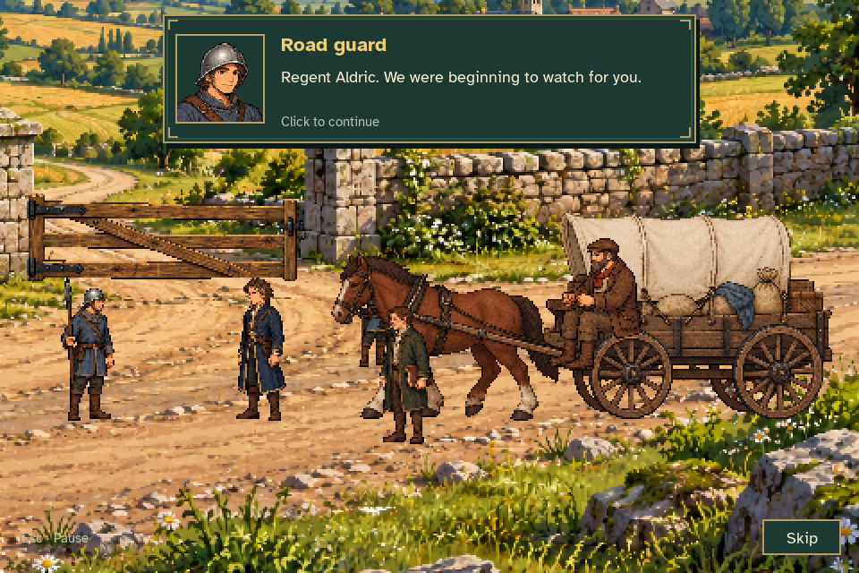
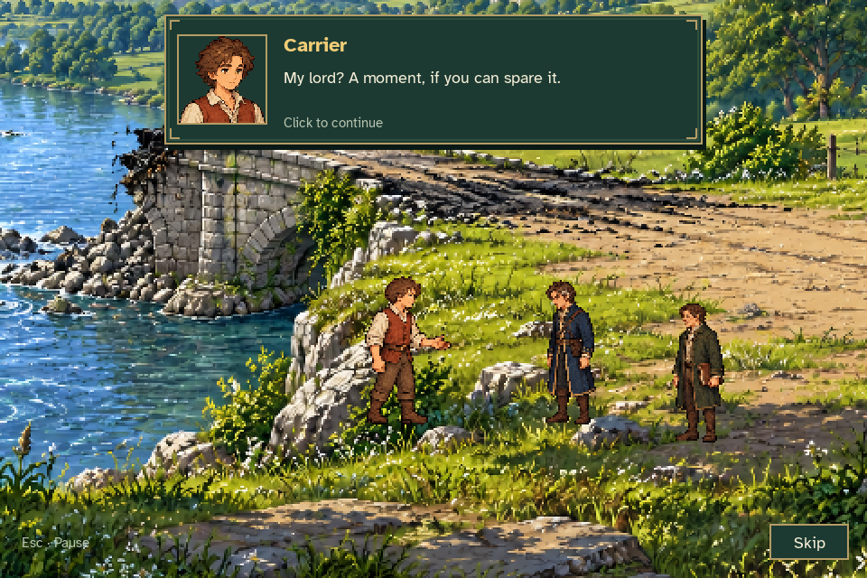
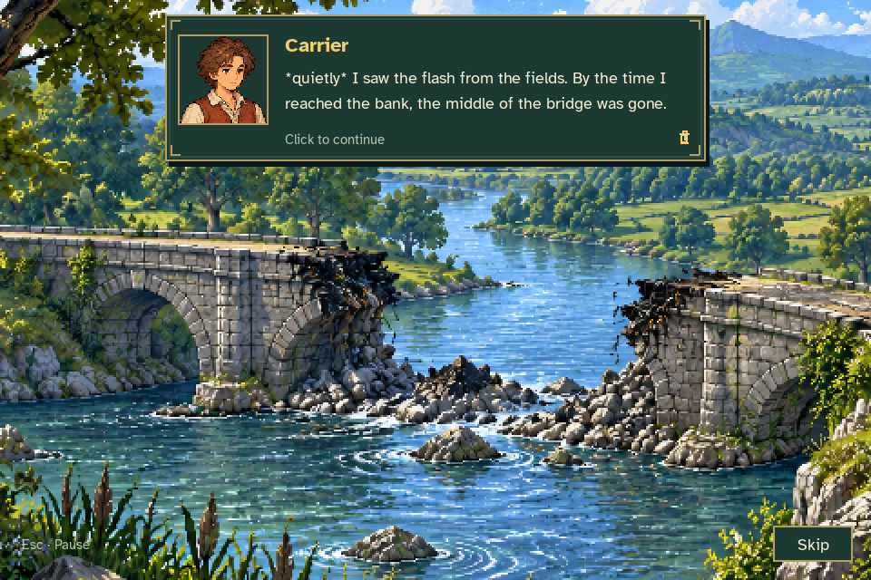
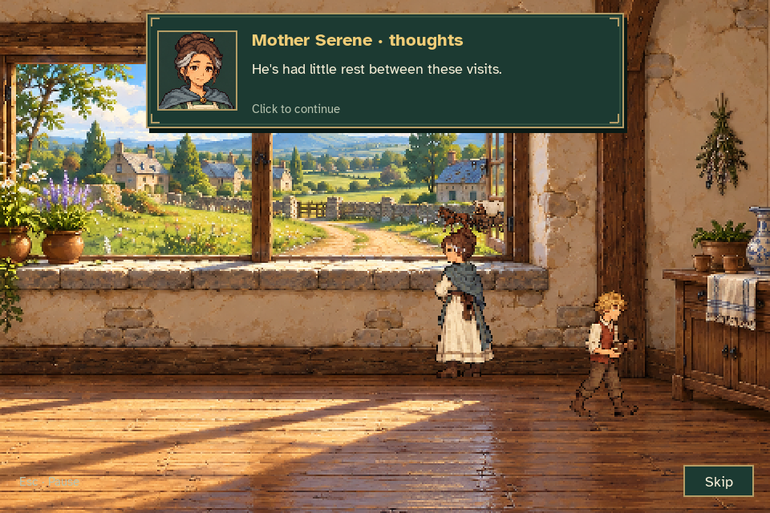
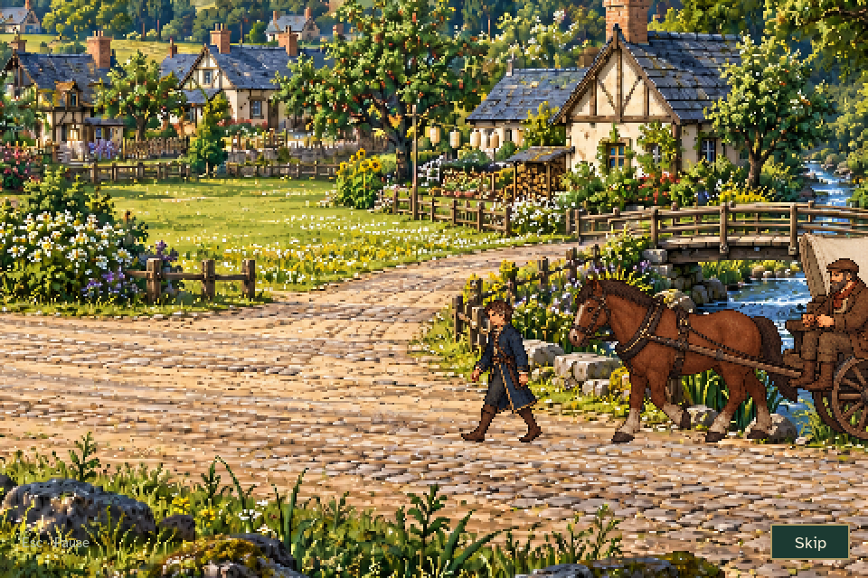
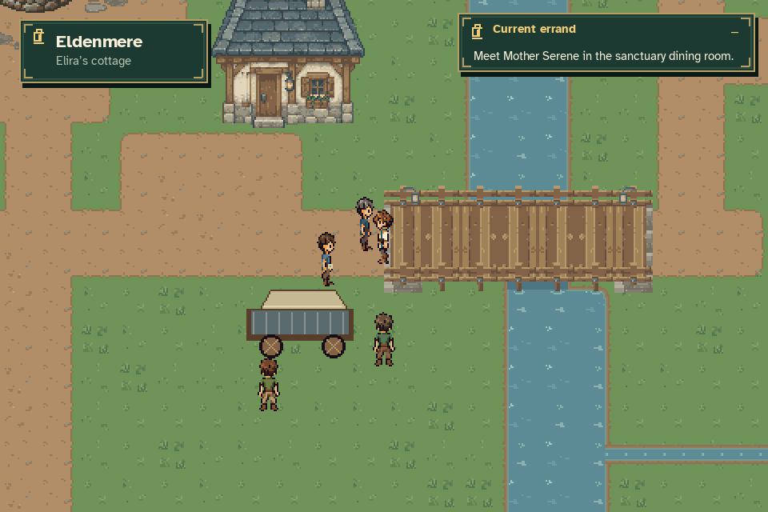

# Aldric's arrival and revised MQ03

[Watch the arrival cinematic with music](regent_arrival.mp4) · [Animated preview](regent_arrival.gif)

These are production Game renders and ordinary event-driven quest/cinematic input.
A temporary fixture completes MQ01 and MQ02's earlier mill repair/verification,
leaving the report unread. It uses a legitimate legacy repair bypass, without
inventing battle victory or rewards. The final mill report, arrival, all six
revised MQ03 scenes, NPC movement, cart release and door transfers are played.
No cinematic clock or progression checkpoint is assigned during capture.

| Arrival at the southern land gate | Aldric listens to locals |
| --- | --- |
|  |  |

| Ruined western bridge | Serene inside the sanctuary |
| --- | --- |
|  |  |

| Caravan approaching Eldenmere | Correct town waiting station |
| --- | --- |
|  |  |

[150% local dialogue](locals_large_text.png) · [150% Serene dialogue](serene_window_large_text.png) · [Letterboxed view](letterboxed.png) · [Paused](paused.png)

[Gate admission motion](gate_admission.gif) · [All six revised MQ03 conversations](mq03.gif) · [Actual cart release](cart_release.gif)

The arrival freezes exploration and preserves Caelan's mill station. MQ03 stays
available until Serene's dining preparations are acknowledged. Separate saved
journey probes verify pending playback recovery, skip, queued-input isolation,
no duplicate resources and no replay for already-seen or legacy completed saves.
The bridge remains ruined and no excavation is authorized. The preserved town
music in the MP4 is reconstructed from exact runtime OGGs and observed mixer
commands because SDL dummy provides no loopback; effects are muted.

[Capture measurements and source hashes](capture_report.json).

Final verification: the full suite passed **1,286 tests**; the final current-code
focused suite passed **79 tests**. Both art exporters passed byte checks. All
**82 capture input hashes**, **35 artifact hashes**, **10,582 original PNGs**
and the source region JSON match their verified inputs. Independent visual
review found no unresolved blocker. See [validation results](validation.json).
