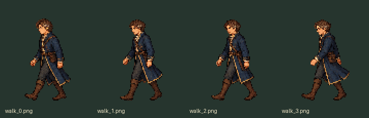
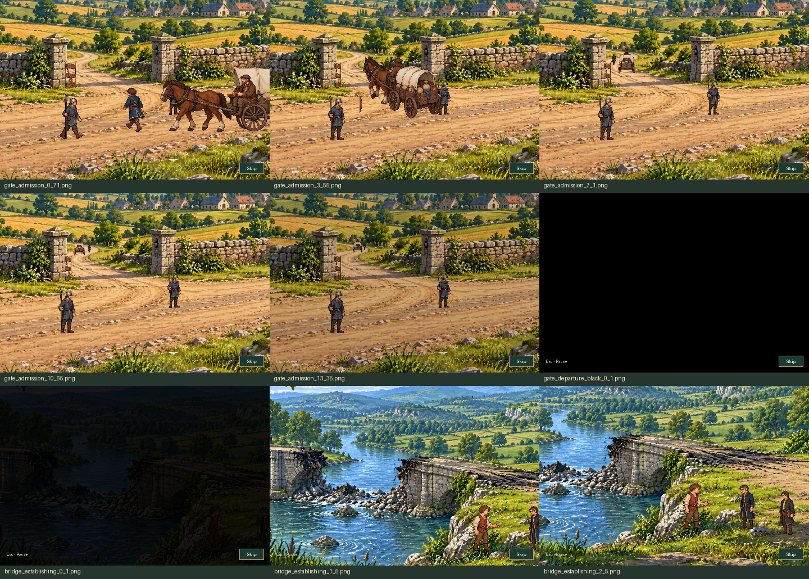

# Aldric arrival: movement and transition polish

[Gate passage and bridge transition](gate_to_bridge.mp4) · [Animated preview](gate_to_bridge.gif) · [Full arrival](arrival_polish.mp4)

These are silent, uninterrupted production Game recordings. The fixture completes earlier quest work only; the unread MQ02 report, arrival, dialogue and final MQ03 handoff use normal input/update/draw. No cinematic clock, phase or actor station is assigned during playback.

[Gate turn at five frames per second](gate_turn_sequence.png)

The gate-to-bridge recording includes the whole gate passage, departure fade, black hold, bridge establishing shot and start of the local conversation. The full video also includes Serene and the final town arrival. Sound is intentionally absent because SDL dummy has no hardware audio loopback.

The [capture report](capture_report.json) includes compact phase/actor samples, current render fingerprints, artifact hashes, GIF pixel/timing validation and pause, focus, reload, skip, world-freeze and isolated Gallery smoke checks.

To review in-game without repeating MQ02: **Title → Gallery → Aldric’s Relief Caravan**.

Reproduce with `SDL_VIDEODRIVER=dummy SDL_AUDIODRIVER=dummy python tools/capture_regent_arrival_polish.py`.

## Verification

The final regression run passed **183 tests** in **164.749s**, covering arrival staging, MQ02/MQ03, Gallery, saved journeys and music. The actor exporter verifies **70 files**; the scenery exporter and compile/whitespace checks pass. Independent visual review found no unresolved blocker.

All **119 current render inputs** and **18 recorded artifact hashes** match the final capture. See [validation.json](validation.json) and [test log](tests.txt).
