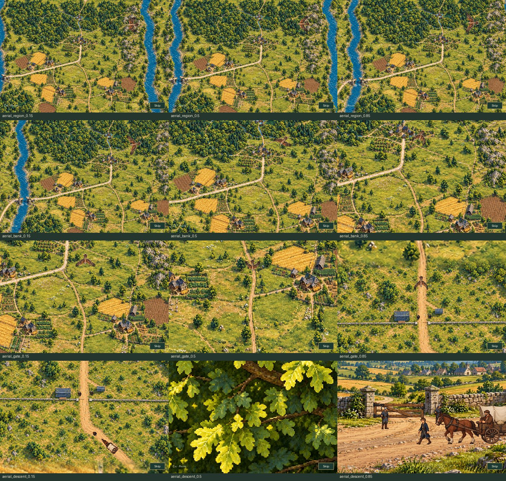

# Caravan road approach and bird audio

[Watch with runtime music and sound effects](caravan_revision.mp4) · [Animated preview](caravan_revision.gif)

This production Game recording follows the ordinary MQ02 report through the aerial approach, later foliage pass, moving ground-camera push and guard conversation. Earlier mill work is a fixture; no cinematic clocks, actor stations or phases are assigned during playback.

[Road approach](road_approach.jpg) · [Movement during ground push](moving_ground_push.jpg) · [Bird sound audition](bird_audition.wav)

The MP4 soundtrack is reconstructed from the exact runtime-decoded PCM and observed production music/Sound/Channel play, pause, volume and stop commands. SDL dummy has no hardware loopback; this is explicitly a command/PCM reconstruction. The bird audition contains only the observed hawk/wing voices, without music or travel effects. [Audio events and source hashes](audio_events.json) document the gains and schedule.

The [capture report](capture_report.json) records the actual camera/actor samples, full leaf coverage at the background handoff, GIF pixel/timing validation, source/media fingerprints and pause, focus, reload, skip, Reduced Motion and isolated Gallery checks.

Replay from **Title → Gallery → Aldric’s Relief Caravan**.

Reproduce with `SDL_VIDEODRIVER=dummy SDL_AUDIODRIVER=dummy python tools/capture_regent_caravan_revision.py`.
## Verification

All **216 focused regression tests pass** with SDL dummy video/audio; see the [command and results](validation.json) and [test log](tests.txt). The production capture also passes all seven pause, focus, quest handoff, reload, Gallery/save and Reduced Motion checks.

A separate final review checked the painted-road contacts, guard clearance, moving aerial/ground handoff and owned audio lifecycle. All 129 frozen render inputs and eight captured-media fingerprints match the source and files in this review.
