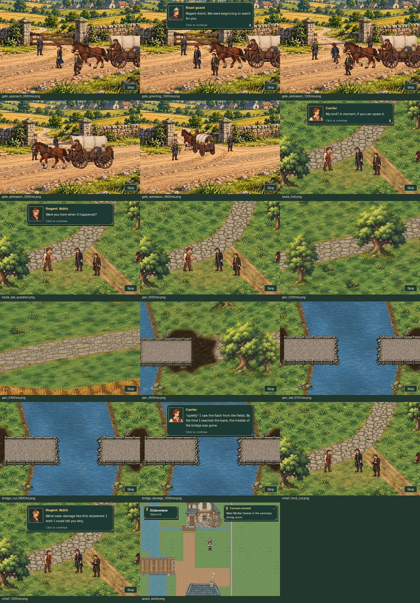
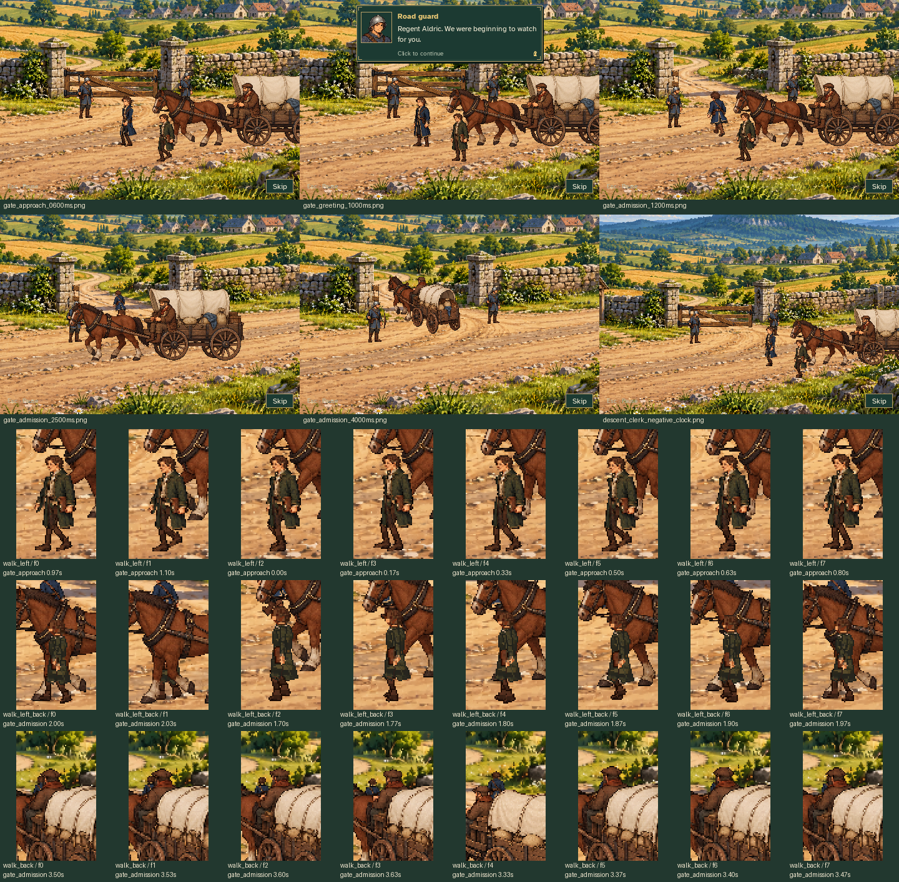
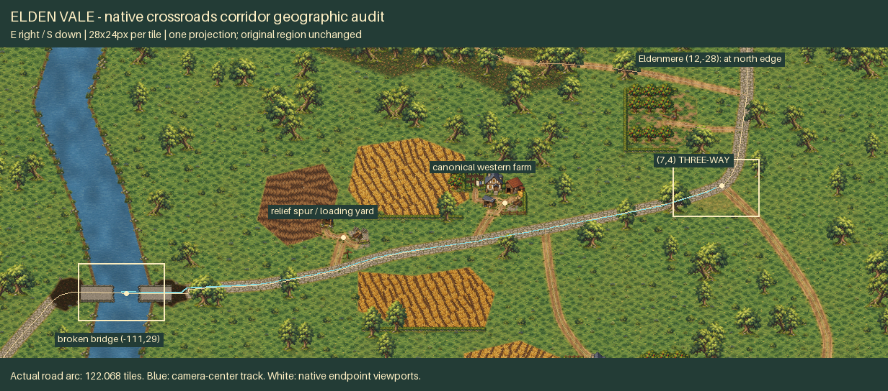
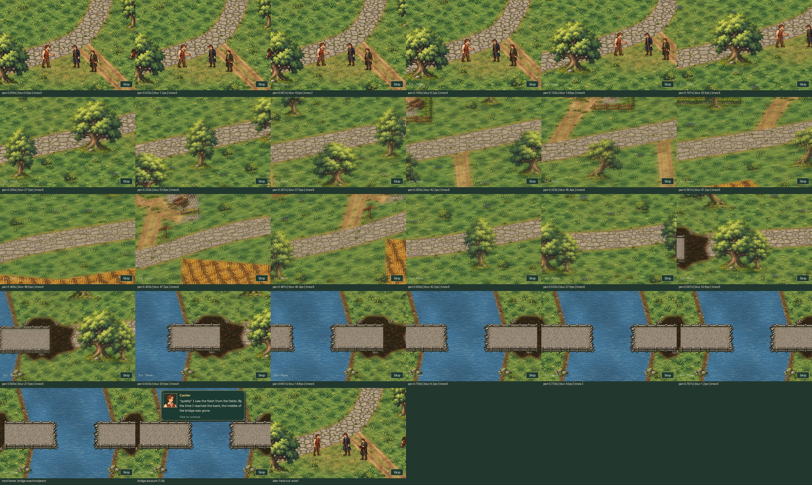

# Aldric's clerk, crossroads and western bridge reveal

[Full arrival with music](full_arrival.mp4) · [Crossroads sequence](crossroads_sequence.mp4)

The full recording is an **uninterrupted 191.17-second production Game capture**
at native 480×320, 30 fps. The focused 48.03-second clip contains the final
crossroads question, westward pan, Carrier account and return exchange.
Earlier completed quest work is the existing fixture; the report, all cinematic
beats and the final handoff use normal input/update/draw. No capture-driver
phase, actor position or cinematic-clock assignment is used.



## Continuous clerk staging

- The clerk accompanies the convoy in the aerial approach, ground push,
  gate approach/stop, admission and later town travel.
- Three independent eight-phase walks retain his own head, moss coat and
  ledger hand. The carrying arm stays restrained while the free arm swings.
- Fixed registration, modest foot clearance and distance-driven 30px full
  stride avoid sliding idle sprites and unrelated timer cadence. Gait starts
  offset from Aldric's, not as an identical palette swap.
- Perspective lets the nearer wagon occlude the clerk during rear gate passage.
  The review does not claim that every rear frame is visible through the wagon.
  There is one clerk, not a new actor created after the stop.

[Pose loop](clerk_walk.gif) · [Native phases](clerk_frames.png) ·
[Static turn/back](clerk_turns.png) · [Aerial art](clerk_aerial.png)



## Geographic scene

The new background is **offline retained-source composition**, not newly
image-generated art, an enlarged miniature map or a runtime repaint. Its
geographic source is the unchanged Elden Vale regional manifest.

- Junction **(7,4)** has exactly three branches: stone N/slightly E to
  Eldenmere, stone WSW to the western crossing, and rutted dirt SSE toward the
  checkpoint Aldric entered.
- One 28×24px-per-tile projection covers the 4928×1728 panorama. Fields,
  farm access, relief spur, river and scorched parcels follow canonical geometry.
- The camera follows **122.067905 tiles of actual road arc** to deck center
  **(-111,29)**. The bridge's distinct world/prop anchor is **(-111,30)**.
- Newly assembled retained masonry shows both broken faces and a 122px open
  collapse. Canonical 504px span, 72px clear deck depth and river remain intact.
  The native endpoint partly crops terminal approaches; the wider reference
  shows both complete bank-damage parcels. The entire crossing does not fit
  into 480px, and no local zoom or shortened geographic distance is claimed.



[Crossroads](crossroads_native.png) · [Bridge endpoint](bridge_native.png) ·
[Wide bridge](bridge_wide.png) · [Geographic audit](geography_bridge.png)

## Camera, dialogue and controls

After the final question is acknowledged, the 0.8-second traverse accelerates
west and settles on the correct destroyed stone bridge. Seven edge-clamped
blur taps and six sparse tapered streaks affect scenery only; strength falls
to zero at both endpoints. Dialogue, portraits, Skip and Pause draw later and
stay sharp. The Carrier's two explanation paragraphs begin after settling
and stay player-paced. Advancing the final paragraph cuts directly back to the
same crossroads camera and actor stations for Aldric's response and the clerk's
notes. The speakers do not travel to the bridge.



Reduced Motion substitutes an immediate endpoint cut without blur/streaks.
Pause and focus loss freeze the same scene/effect clock. Royalty continues
without a new load/play at the pan or return. Skip restores exploration music,
preserves the mill reward and makes MQ03 available—not accepted.

## Audio and capture honesty

SDL dummy does not provide hardware audio loopback. The videos reconstruct
**music only** from exact shipped OGG PCM and observed production mixer
load/play/volume/pause commands. Effects were muted, not invented or mixed in
afterward. See [audio events and hashes](audio_events.json).

[Capture report](capture_report.json) records 5,735 video frames, all 24 pan
samples, 1,441 focused-clip frames, 34 ordered readable dialogue paragraphs,
5,733 frozen-world checks, exact cutback and eight disposable playback smokes.
Its 2,464 input fingerprints and 24 capture artifact hashes pass read-only
verification. One panorama load uses 34,062,336 decoded bytes.

## Verification

**374 targeted tests passed in 122.884 seconds**, covering clerk art, crossroads
geometry, camera/effects, real scene input, Aldric's preserved walk, arrival/gate
staging, aerial visual/audio, MQ02/MQ03, Gallery, dialogue UI, music and saves.
All five author/export `--check` modes passed. Edited Python files are
diagnostic-clean and whitespace checks pass.

All pre-existing tracked PNGs, including Aldric's corrected artwork, original
clerk idle/read/portrait, existing scenery and regional bridge art remain
unchanged. Music, canonical region data and narrative text are unchanged.

```sh
python tools/build_aldric_side_walk.py --check
python tools/build_regent_clerk_walk.py --check
python tools/build_regent_arrival_actors.py --check
python tools/build_regent_aerial_actors.py --check
python tools/build_regent_crossroads.py --check
PYTHONPATH=tests python -m unittest test_regent_clerk_walk test_regent_crossroads_art test_regent_road_pan test_regent_crossroads_gameplay test_regent_arrival test_regent_arrival_staging test_aldric_side_walk test_regent_aerial
python tools/capture_regent_crossroads.py
python tools/capture_regent_crossroads.py --check
```

Replay from **Title → Gallery → Aldric's Relief Caravan**.