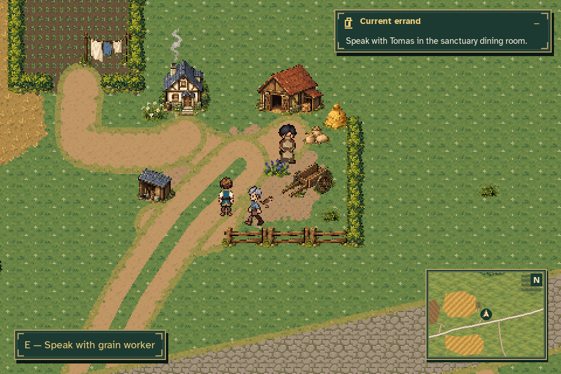
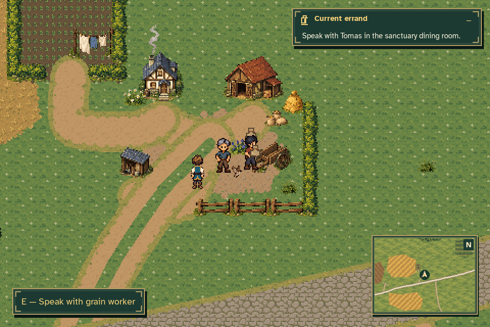
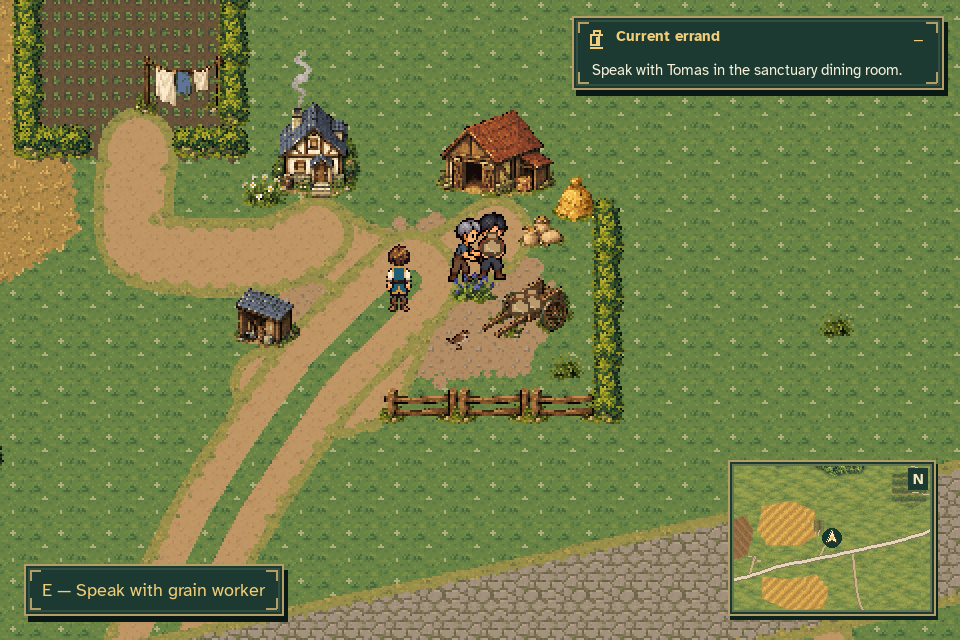
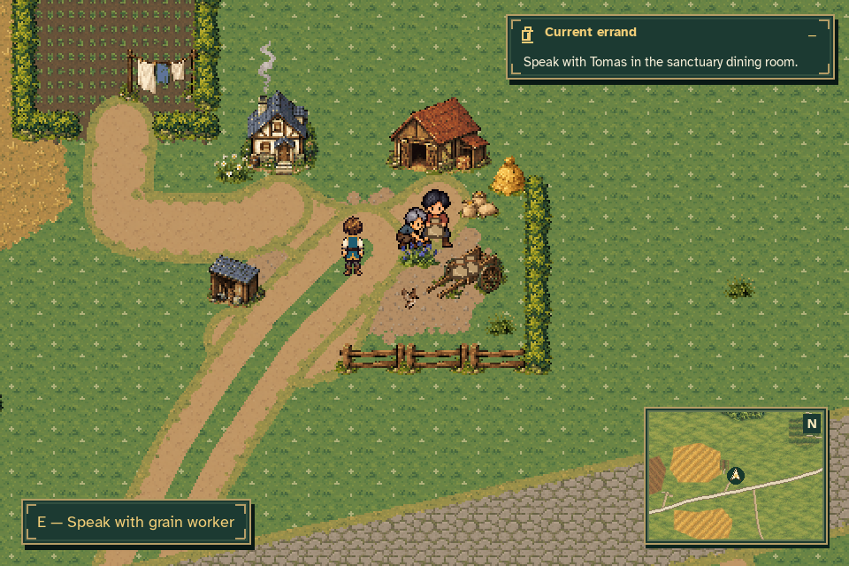
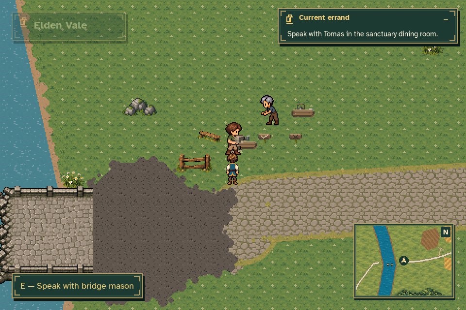
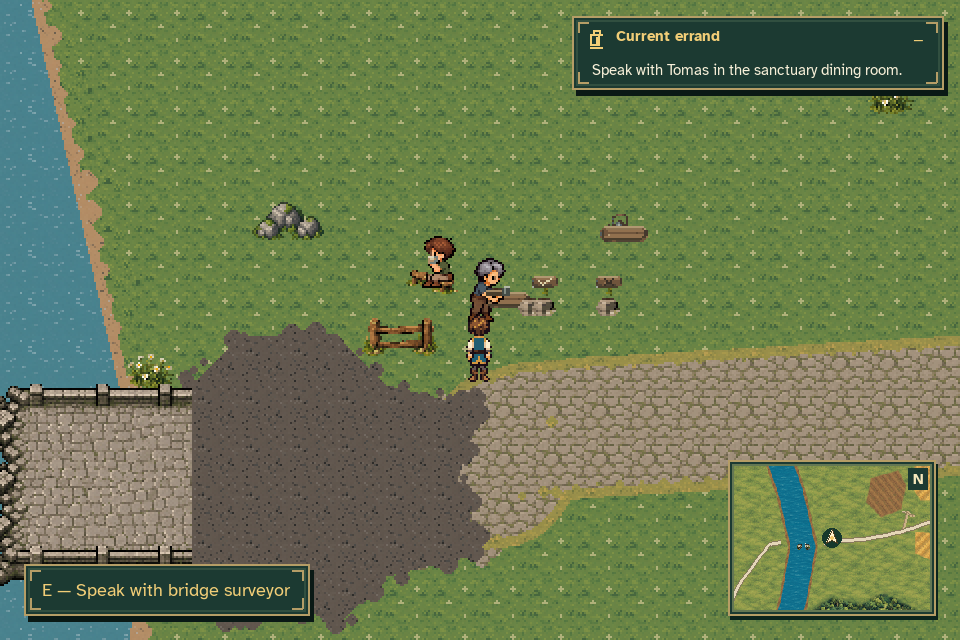
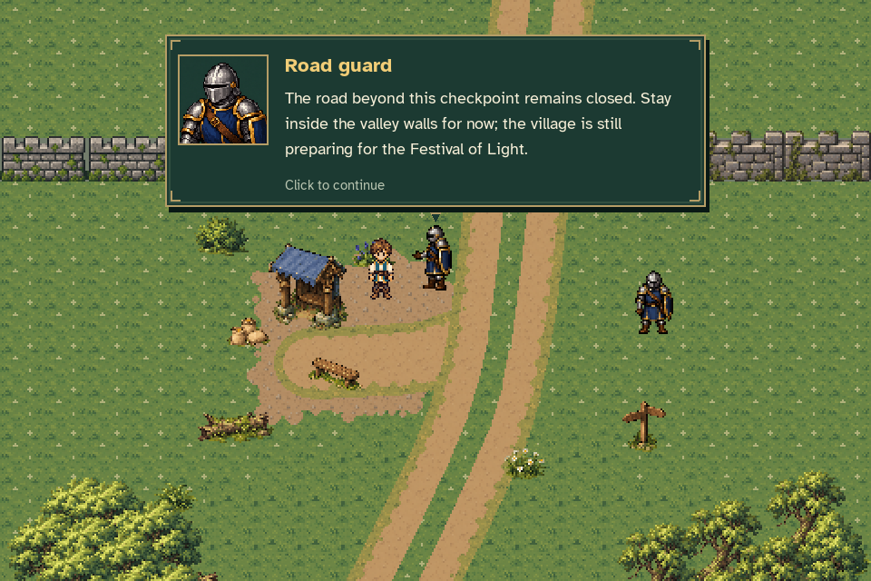
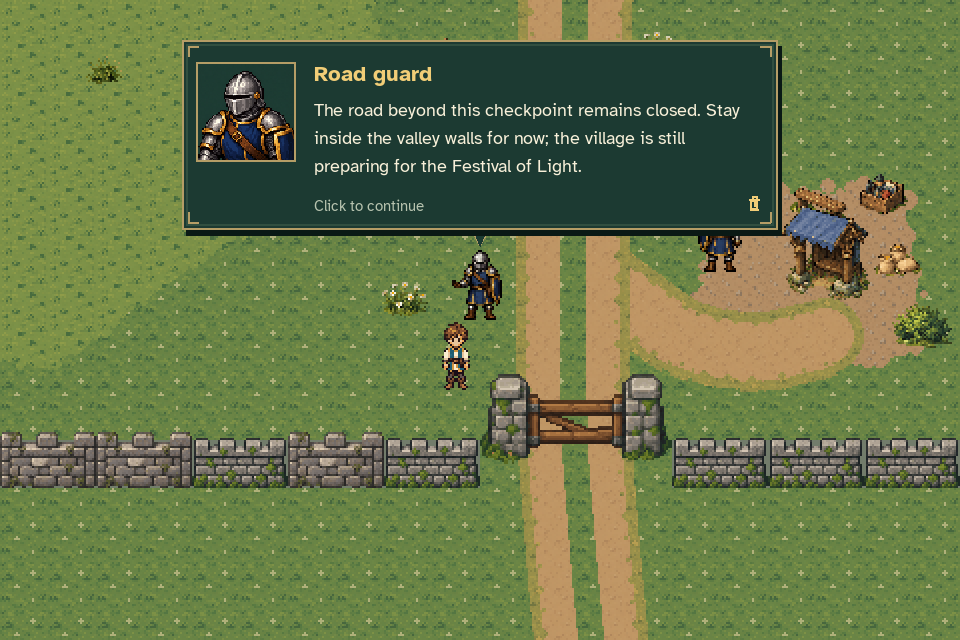

# Elden Vale NPC sprite and routine review

These previews use production `Game.handle_events`, `Game.update` and
`Game.draw`. The region has two grain workers, two bridge workers and four
checkpoint guards.
The recordings advance their ordinary routines and conversations; no NPC
position, animation clock or farm milestone is assigned during capture.

## Grain workers

[Full loading and shared-lift video](grain_loading_and_shared_lift.mp4) ·
[Native shared-lift animation](grain_loading_and_shared_lift_shared_lowering.gif)

The worker bodies use authored action frames with the orientation needed by
that task. Ordinary directional walks remain unchanged. Sacks stay separate
objects whose positions and depth follow the selected body's registered grips.

| Carrying toward the cart | Placing on the cart |
| --- | --- |
|  |  |

| Shared support | Lowering together |
| --- | --- |
|  |  |

[Shared lowering and empty-handed recovery](grain_loading_and_shared_lift_shared_lowering.gif) ·
[First placement](grain_loading_and_shared_lift_placing_1.gif) ·
[Second placement and supported push](grain_loading_and_shared_lift_placing_2.gif)

[Front carry](grain_loading_and_shared_lift_carry_front.gif) ·
[Back return](grain_loading_and_shared_lift_return_back.gif) ·
[Side-facing rope work](grain_loading_and_shared_lift_rope_work.gif)

[Before the mill is repaired](grain_before_repair.mp4) shows the inspection,
covering and ordinary coworker route. The repaired-case fixture lets that
ordinary cover loop settle with the repair prerequisite withheld, then enables
the physical repair fact before recording. This makes the uncovering and
pickup visible without setting a work phase or animation clock.

[Blocked carry and Continue](blocked_carry_and_continue.mp4) verifies that a
blocked worker holds the load without walking in place, then resumes when
Caelan clears the lane. Continue preserves the committed load and returns an
unplaced sack to storage. The same three sacks and two worker instances remain.
The map pauses routine movement and animation clocks.

## Bridge workers

[Stone sorting and the complete optional tea break](bridge_work_and_tea.mp4)

The mason lifts and carries three pieces to their appropriate piles. The
surveyor measures from the safe bank. After sorting, the optional conversation
leads through collecting tea, carrying it in the required directions, setting
it on a stable surface, passing the cup, sitting to drink and returning it.
The broken crossing and the story's repair facts remain unchanged.

| Stone carrying | Seated tea break |
| --- | --- |
|  |  |

[Stone placement](bridge_work_and_tea_stone_placement.gif) ·
[Cup handoff](bridge_work_and_tea_tea_handoff.gif) ·
[Seating and drinking](bridge_work_and_tea_seating_and_drinking.gif)

[Left cup carry](bridge_work_and_tea_cup_walk_left.gif) ·
[Front cup carry](bridge_work_and_tea_cup_walk_front.gif) ·
[Right cup carry](bridge_work_and_tea_cup_walk_right.gif) ·
[Back cup carry](bridge_work_and_tea_cup_walk_back.gif)

[Blocked stone carry and Continue](bridge_blocked_and_continue.mp4) and
[tea checkpoint recovery](bridge_tea_continue.mp4) preserve sorted pieces,
already-read dialogue and the one cup/tool. The tea recovery fixture earns its
sorting checkpoint through ordinary simulation; it does not assign a finished
crew record.

## Checkpoint guards

[All four guards and all four approach directions](checkpoint_guards.mp4)

The portrait matches the silver closed helmet, navy uniform, gold trim and
shield. Only the selected nearby guard turns toward Caelan. Finishing the
conversation or walking away returns the guard to the assigned watch stance.
The checkpoints keep their existing positions and travel restrictions.

| Northern guard, side view | Southern guard, front view |
| --- | --- |
|  |  |

[Back view](guard_0_back.png) · [Opposite side](guard_0_right.png) ·
[150% text and matching portrait](guard_large_text.png) ·
[Watch restored after walking away](guard_walkaway.png)

The larger-text inspection reframes the camera slightly lower to show the
helmet and portrait together. All sixteen normal-text approach captures use
the same ordinary guard-centered framing and genuine interaction input.

## Reproduction and evidence

Earlier quest prerequisites and the mill-restored fact are clearly identified
fixtures. Player/camera stations establish clear inspection and blocked-lane
cases. From those stations onward, worker stages, property ownership,
conversations and movement use the real game controllers. Music and effects
are muted for these sprite-focused recordings.

```sh
SDL_VIDEODRIVER=dummy SDL_AUDIODRIVER=dummy python tools/capture_region_npcs.py
```

The [capture report](capture_report.json) records stage and contact samples,
sack counts, pause/reload checks, guard approach results, source fingerprints
and artifact hashes.

Full routines are MP4s. The GIFs focus on the relevant work beats instead of
duplicating whole videos. Their fixed-palette encoding verifies decoded pixels
against the intended quantized capture frames and verifies exact playback
timing, including any combined identical frames.
