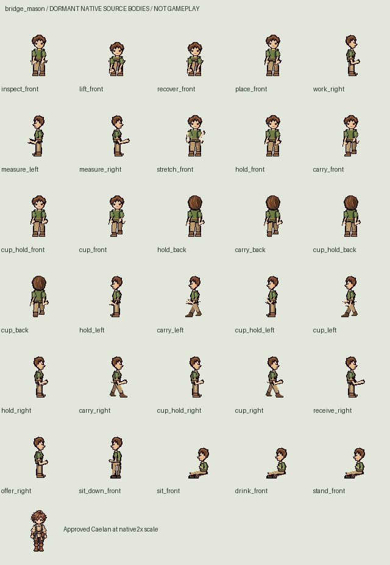

# bridge_mason: dormant native activity source

30 existing complete work clips / 85 frames
are sampled directly from retained high-resolution full-figure masters at2×
density. These are not enlarged legacy PNGs, articulated parts or body warps.
Source/exporter fingerprints and unchanged legacy logical metadata are verified.

All source frames, normal and half-speed body-only previews, logical attachment
metadata and hashes are in `assets/characters/regional_npc_hd/bridge_mason/activity_hd/`.
The four-source exporter preserves authored clip timing, looping, hands and
separately owned prop offsets. Legacy banks are never overwritten.

## Registration

Art-only transparent padding grows the action canvas40×44→48×52 logical, with
draw anchor20,38→24,46. The extra top/side margin retains complete source crowns
and reaches rather than clipping them. The body-to-ground transform and all
world-space hands/props stay unchanged. No collision or route changes are implied.

## Deliberately dormant

No runtime registry consumes this bank. Native scene action/prop registration,
rear/side depth, blocked holds, interruption, region ownership and Save/Continue
remain explicit activation gates. This source-art PR does not claim gameplay
activation or owner visual approval. The separate Sage Sanctuary gardener is
not touched.

Reproduce: `python tools/build_regional_worker_activity_hd.py bridge_mason --check`.
Four focused pure asset tests pass across installed role packages, including
exact source reproducibility, hard alpha/unclipped bodies and unchanged logical
clip metadata. Runtime tests belong to the later activation PR. No publication.
