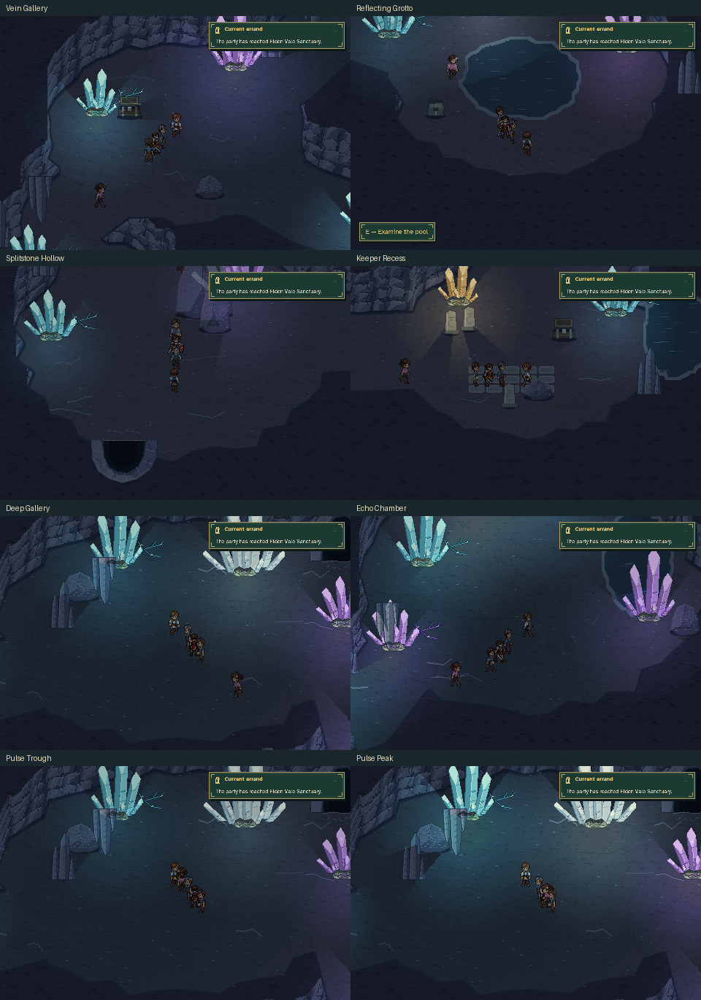

# Sanctuary cave production review

The screenshots and walkthrough use the production game renderer, ordinary
movement and **E** interactions. They show the crystal cave's entrance,
branching galleries, reflecting grotto, keeper recess and final Echo Chamber.
The six discoveries, three local maps and Save/Continue are exercised during
the same journey.



- [Walkthrough video](sanctuary_cave.mp4): movement is sampled at three times
  speed, with held landmark views and a complete real-time crystal pulse.
- [Light trough](pulse_trough.png) and [light crest](pulse_peak.png): the same
  standing position sampled during one complete cycle. Illumination changes on
  the cave walls, floor and party, while the menus and HUD remain clear.
- [Animated crystal pulse](crystal_pulse.gif): one sampled cycle at native
  logical resolution.
- [Reduced motion](reduced_motion.png): a readable static lighting state.
- [Entrance map](sanctuary_cave_entrance_map.png),
  [hollow map](sanctuary_cave_hollow_map.png) and
  [depths map](sanctuary_cave_depths_map.png): production section overviews,
  room names, passages and current player position. No treasure markers are added.
- [Returned to the reserve](returned_to_reserve.png): the ordinary return
  passage restores the same Sanctuary apron and pending MQ03 journey.
- [Vein Gallery passage](passage_entrance_to_hollow.png) and
  [depths passage](passage_hollow_to_depths.png): visible tunnel mouths and
  their ordinary **E** interaction before entering the next cave section.

The capture initializes a supported completed-MQ01/MQ02 fixture using disposable
save and settings files. MQ03's visit, survivor report, departure, Mira's return
and travel to the Sanctuary are completed through their production controllers
before the cave walkthrough begins. No cave room transfers are teleports, and
no cave treasure receipts are initialized by the fixture.

The journey verifies that every discovery grants once, opened containers remain
opened through Continue, the party and quest remain unchanged, and Kindled
Courage remains the requested score throughout the pending Sanctuary arrival.
The video is silent because review settings mute music and effects.

Enemies, the miniboss battle and the Sanctuary arrival cutscene are not staged
by this review. The final chamber is an authored environment ready for that
later work.

Reproduce from the repository with Pygame, NumPy, Pillow and ffmpeg installed:

```sh
python tools/build_sanctuary_cave.py --check
python tools/capture_sanctuary_cave.py
python tools/capture_sanctuary_cave.py --check
```

`verification.json` records the actual scene transitions, opened discoveries,
three Continue checks, measured pulse frames, visible cast pixels and source and
artifact SHA-256 fingerprints. `--check` validates that the retained review
matches the current production sources and generated assets.

The [cave guide](../../SANCTUARY_CAVE.md) describes the layout, assets, lighting,
controls and boundaries for future story and encounter work.
