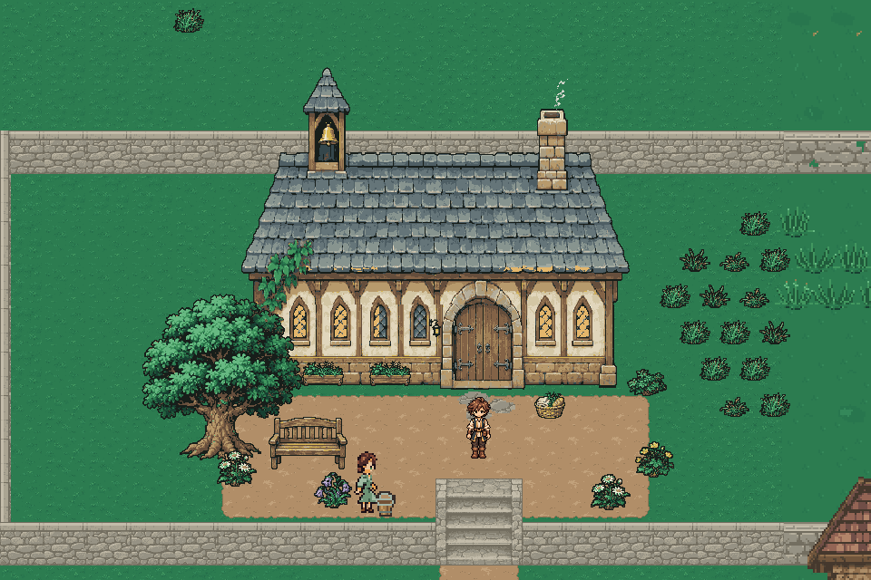

# Sanctuary courtyard integration review

This is the first live outdoor HD region: native-density Sanctuary frontage,
planters, bench, supply basket, grass/dirt, flagstones, walls/stairs and vegetation.
Logical positions, sizes, depth baselines, collision, navigation, door behavior,
quest stations and NPC routes retain the pre-migration contract.

These are captures of the actual Pygame world/game renderer, not offline asset
mockups. PNGs retain the native 960×640 composition. GIFs preview actual movement
at 30 updates/second; their indexed palettes are presentation copies.

- [Full gameplay view](gameplay_native.png)
- [Walking on stairs](walk_stairs.gif) and [running on stairs](run_stairs.gif)
- [Walking through grass](grass_walk.gif) and [running through grass](grass_run.gif)
- [Behind the tree](behind_tree.png) and [in front of it](in_front_of_tree.png)
- [Door open](door_open.png)
- [Reduced motion](reduced_motion.png) and [ambient presentation](ambient_light.png)

Visual inspection confirms native roof/stone/foliage detail, readable Caelan
movement, fixed prop supports, and correct canopy/character depth. The entry
portal stays aligned with its original threshold. Both herb planters remain at
the gardener's established work locations. Reduced motion removes bell/smoke/wind
movement while keeping doors functional. Existing NPC art and nearby regions
retain their earlier exports; their future HD migration is separate work.

`observations.json` records actual stair positions, tree clearance and grass
contact snapshots. `renderer_profile.json` records a 30-frame SDL dummy warm-draw
sample, excluding simulation; these timings are environment-specific evidence,
not a hardware guarantee.

Regenerate evidence with
`python tools/capture_sanctuary_courtyard_hd.py docs/reviews/sanctuary_courtyard_hd`.
It writes temporary saves/settings only. Reproducibility uses
`python tools/build_sanctuary_courtyard_hd.py --check` (173 products).
The source recipe retains new drawings, source hashes and the pre-migration
logical map/coverage evidence. Shared legacy banks remain for other consumers.

Construction guidance is centralized in the
[terrain standard](../../TERRAIN_ART_STANDARD.md#integrated-sanctuary-courtyard-and-approach)
and [visual standard](../../VISUAL_ART_STANDARD.md#integrated-sanctuary-exterior).

Validation: **101 tests passed** across courtyard contracts/gameplay, rendering,
interactive/world/town grass, every registered interior's exits, Sanctuary home
and dining migrations, gardener watering and garden/orchard routines. The two
older town tests now allow the explicit scoped HD art records and cover the
fifteen registered interiors, including the regional rooms added after their
original thirteen-room assertion. Collision/navigation hashes are unchanged.
