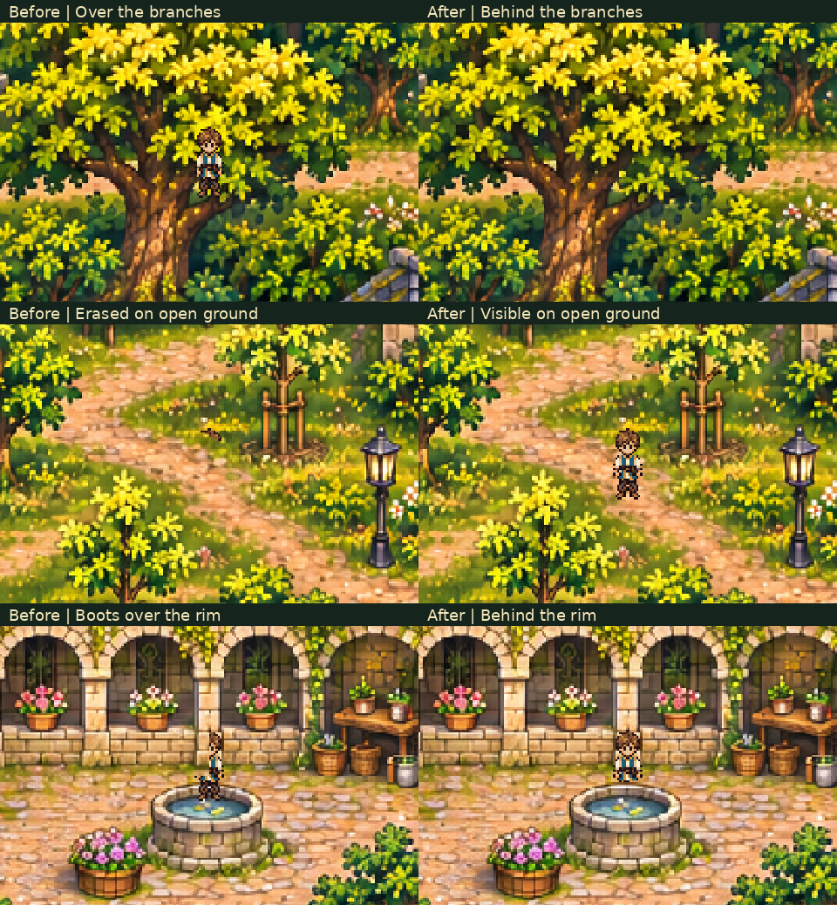

# Sanctuary scenery depth correction

[Focused gameplay review](depth_walk.mp4)

The movie follows normal production movement through the entrance arch, west
grove, northern oak, basin and flower planter, cloister and hall plant. Transit
between these areas is walked normally and omitted from the focused edit.
The player, camera, collision, contacts and door transitions are unchanged.

The before/after stills isolate actual Caelan at identical native feet and camera
positions in the production World renderer. Before stills retain the previous
implementation from main at `7cfb637914337706a94a14127a65a00a79f7f86f`.
They demonstrate the missing northern crown, the open-grass cutout that erased
Caelan, and the basin whose rim did not obscure his rear pose.

[Verification](verification.json) records the ordinary route, frame times,
unchanged progression and valid disposable save. No player save or settings
file is used. Reproduce current views with
`python tools/capture_sanctuary_depth.py`; historical before stills are retained.
