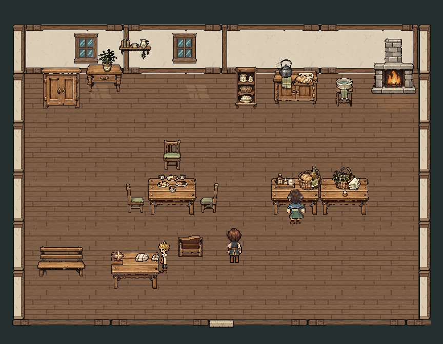

# Sanctuary dining room: 2× artwork and object cues

This is the first integrated higher-density environment bank. New retained
artwork replaces the room's architecture, furniture, food, dishes, supplies,
workstation props, fireplace and steam at explicit 2× density, preserving the
432×336 logical room, collision, doors, destinations and existing action timing.
The canonical object-construction and discoverability rules were added to the
existing [visual art standard](../../VISUAL_ART_STANDARD.md#object-creation-and-interaction-readability),
with lifecycle guidance in the existing
[interaction standard](../../OBJECT_INTERACTION_STANDARD.md#discovery-cues-and-action-availability).
This review records local implementation evidence, not another general guide.

## Actual runtime captures

[Room](room.png) · [Distant glint](glint.png) · [Nearby outline](near.png)



These are native 864×672 full-room compositions using the actual World renderer,
current actors and temporary save/settings files. Black contours, source alpha,
room proportions, seated-chair orientations, supports, depth, glint placement
and the yellow outline were inspected visually. Characters retain their existing
approved artwork and choreography; character/held-body pose banks are separate
migrations. Gallery and quest playback verify that those existing actors and
scenes continue to run with the new environment.

## Sources, registration and integration

- Retained generated sources and their hashes are in
  `assets/source/terrain/eldenmere/sanctuary_dining_hd/recipe.json`, alongside
  `props_atlas.png`, `architecture_atlas.png`, `chair_back.png` and
  `workprops_atlas.png`. The artwork was newly drawn against the old room/prop
  layout and Iselin's fidelity reference, not supplied by enlarging legacy art.
- `tools/build_sanctuary_dining_hd.py` performs explicit cell extraction,
  hard-alpha/matte cleanup, palette export, thin black contours and registration.
  Original logical canvases and support bounds are recorded per prop. Empty
  source margins cannot shrink the resulting silhouette. Source bytes are
  retained and checked before export. Repeated export is byte-identical.
- `assets/terrain/eldenmere/sanctuary_dining_hd/manifest.json` inventories 28
  registered prop drawings, including four hearth frames and the fourth chair
  direction used by visiting diners. Separate cup and steam exports complete
  the bank. Original shared cottage/character source PNGs remain unchanged.
- The playable dining map declares density 2 and points at its new `art_bank`.
  Room-only aliases supply later meal chairs, bread, cups and kettle. Persistent
  Serene/Tomas surface props use the same aliases only when attached to this
  room; other rooms retain their original art. Existing ownership/transfer logic
  and hand/body choreography are unchanged.
- Architecture is stored once. Compact daylight and firelight layers preserve
  5.4-second and 1.2-second rhythms, and six steam poses retain their 1.8-second
  rhythm. The steam canvas is cropped to 6×10 logical units and placed at
  (269,56), preserving its original world registration rather than retaining six
  mostly empty full-room surfaces. Masonry remains fixed across hearth poses.
  Reduced motion holds fire, steam and light layers on a static frame.
- Collision/navigation bytes, gameplay door metadata, spawn, destinations,
  furniture positions, sort baselines and actor probes remain unchanged. Added
  light layers are nonblocking. The stored collision SHA verifies this boundary.

## Special-object integration

The breakfast setting is the first actual eligible object. Its glint appears
while joining breakfast remains available in the opening's `explore` stage;
proximity uses the table's declared support boundary. The existing meal prompt
still uses the established seat approach, without extending the gameplay trigger.
Dialogue/cutscenes/menus suppress cues; entering breakfast removes eligibility.
Supplies handed over through dialogue are intentionally not advertised as
independent pickups. Ordinary furniture retains its existing behavior.

`ObjectCues` supplies deterministic staggered 3–5-second glints, a 10-unit enter /
12-unit exit threshold, a 0.12-second outline fade, one-native-pixel yellow
silhouettes outside black contours, collision-checked approaches and reduced-motion
static discovery marks. Cues draw with their owner before later depth occluders.
Clocks freeze without catchup, scene changes clear proximity, and quest/opening
state reconstructs availability rather than persisting presentation state.
The outline cache has an 8 MiB bound; this room's active outline uses 16,800 bytes.

## Verification

The broader regression batch passed **170 tests**, covering native rendering,
opening gameplay, sanctuary return, Serene/Tomas routines, crossroads gameplay,
autosaves, all registered Gallery scenes completing through rendered dialogue
and real input, and quest playtest sessions. After the final small-prop exports
and attachment integration, **58 focused checks** passed (overlapping coverage),
including all **19** new asset/cue checks and the affected opening/routine/return
checks. A final export assertion was also checked independently.

New checks cover exact gameplay geometry/collision preservation, hard alpha,
source hashes, density, support registration, genuine native detail, compact
animation storage, stable hearth structure, distance/corner thresholds, fades,
wall blocking, cue removal, normal depth, clock freezing, reduced motion and
room-only prop replacement. Python compilation, changed Markdown links and
`git diff --check` pass. Rebuilding the assets and map yields identical bytes.

A separate 83-test sweep found one existing failure:
`test_regent_quest.RegentQuestTests.test_active_visit_cannot_load_without_its_scene_checkpoint`
expects `has_saved_journey` to be false. The identical assertion fails with
unchanged baseline runtime **4d454fb081f73e639582aa6ab2e822bc79de61ea** and the original
dining map. It was not rewritten or changed as part of this art/cue PR;
full-suite success is not claimed.

## Performance

[benchmark.json](benchmark.json) retains before/after production draw measurements.
Runs used the same interpreter, SDL dummy 960×640 display, temporary save paths,
four warmup draws and 60 measured draws, sequentially without concurrent tests.
The baseline used the unchanged runtime and original dining map.

| Dining composition | Median draw ms | p95 draw ms |
| --- | ---: | ---: |
| Baseline legacy room | 2.482 | 3.256 |
| Rebuilt room | 1.702 | 1.829 |
| Rebuilt room with active nearby cue | 1.948 | 2.247 |

Sharing architecture and cropping the animated layers avoids multiplying
full-room frame storage at 2× density. These are draw-only host measurements,
not a guarantee of total frame time or target-hardware performance. Existing
Ice Reaper cinematic projection costs are outside this room migration.

Reproduce with:

```sh
python tools/build_sanctuary_dining_hd.py
python tools/capture_sanctuary_dining_hd.py /tmp/dining-review
python tools/profile_renderer.py --frames 60 --output /tmp/dining-profile.json
PYTHONPATH=.:tests SDL_VIDEODRIVER=dummy SDL_AUDIODRIVER=dummy python -m unittest \
  test_sanctuary_dining_hd test_object_cues test_sanctuary_return \
  test_opening_sequence test_serene_runtime test_tomas_routines
```

For the retained legacy full-interior generation pipeline, apply the original
base compilation and Tomas room additions before the density exporter. This
exporter updates the current dining map's art fields without replacing gameplay
metadata. It does not rebuild other interiors or approved character pose banks.
