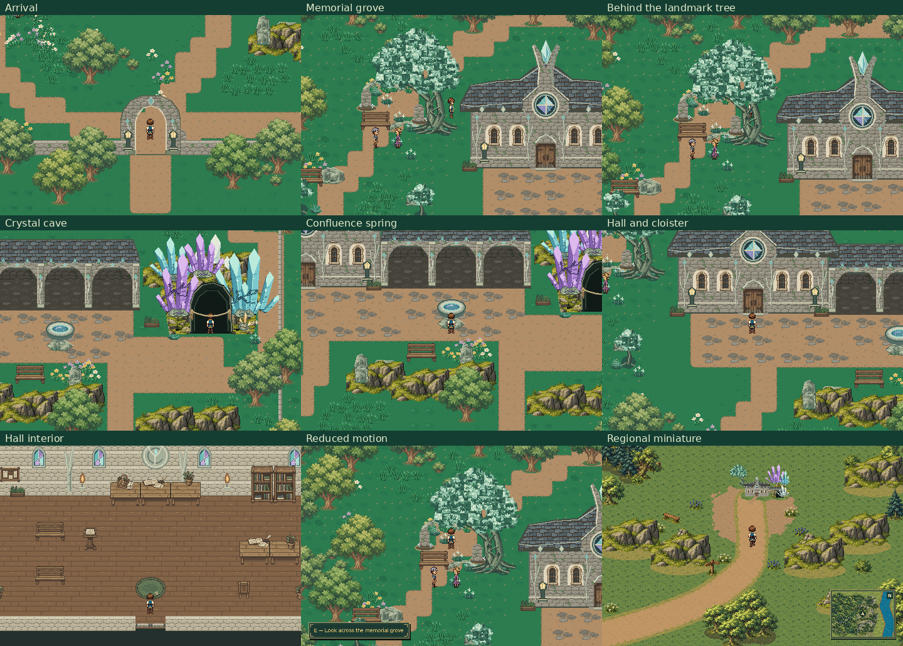

# Fantasy Sanctuary — actual-game review

[Walking, running and standing](sanctuary_fantasy.mp4) · [Full reserve](reserve_overview.png) · [Hall overview](hall_overview.png) · [Local map](local_map.png)

[Placement and access diagram](placement_sheet.png) is explicitly annotated;
the other scene photographs remain unpainted production gameplay views.

The screenshots and silent movie use the production Game, character sprites,
camera and renderer. An ordinary disposable exploration journey walks from
Eldenmere through the normal overworld and Sanctuary contacts, visits the grove,
crystal cave, spring, woodland circuit and open grass, then enters the hall and
returns through the ordinary doors and exits. Long transit between demonstrations
is walked normally and omitted from the focused recording. Standing segments
continue real simulation so shimmer, foliage and atmospheric motion remain live.

The review covers walking and running, front/behind landmark views, reduced
motion, the cave's closed keeper rail, optional hall inspections and Save/Continue
in both scenes. Quests, inventory, party, character attributes, dialogue flags,
abilities and desired music remain unchanged. Temporary save/settings files
leave player journeys untouched. The full reserve image stitches bounded
production World.draw views; no scenery or character pose is painted into it.

[Verification](verification.json) retains actual positions, sprite visibility
observations, complete foot-probe connectivity and source/artifact fingerprints.
Reproduce with `python tools/capture_sanctuary_fantasy.py`; verify retained
evidence with `python tools/capture_sanctuary_fantasy.py --check`.
