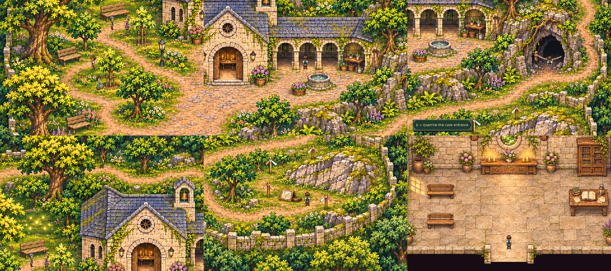
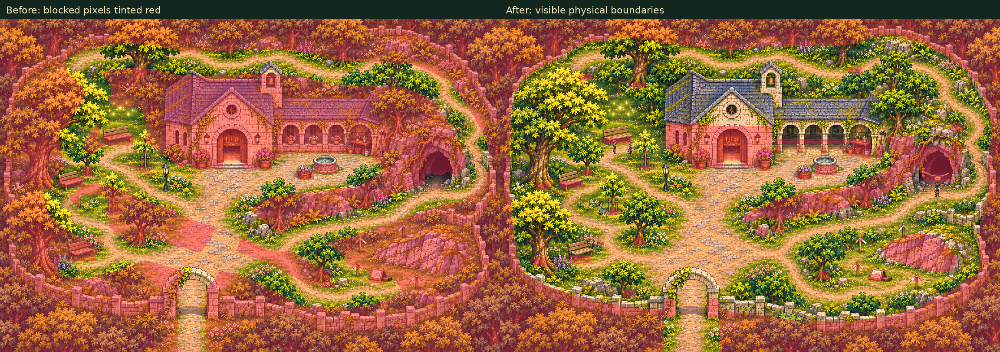

# Sanctuary free exploration review

[Focused ordinary gameplay, 35–50 seconds](free_roam_walk.mp4) · [Full reserve](reserve_overview.png)

The actual Game leaves Eldenmere through its southern contact, walks the regional
approach to the sanctuary miniature at tile **(90, −66)**, and enters the reserve.
All ten public approaches and all seven exterior conversations/observations are
reached with ordinary movement. The movie omits travel between demonstration
areas and directly steers across the former corridor edges on northern grass,
the shaded grove, southern lawn and survey margin. It enters the three open
cloister bays from the court. Their stone columns and back wall, and the eastern
garden workstation, remain solid.
Localized floor patches replace the three former low masonry panels, matching
the walkable openings to the visible paving.
The [newly accessible cloister floor](cloister_middle_west.png) keeps Caelan
visible in front, while [ground behind the projecting hall roof](behind_hall_roof.png)
correctly leaves him occluded by the building.

The cave's visible keeper rail stops forward movement at the front apron. Its
inspection remains available from outside. No dungeon entrance or reward is
created. The player enters and leaves the separate hall through its ordinary
door, reads all three hall observations, and returns through the southern
reserve contact to the overworld. Quest, inventory, flags, abilities and music
remain unchanged; no quest or equipment state is seeded.

Disposable Save/Continue resumes both in the hall and at **(309, 603)** on grass
blocked by the previous collision export. That location is preserved exactly
and the player can immediately walk away. Normal player saves/settings are
never opened. A separate regression also loads an existing version-one save
with that historical location and checks ordinary movement after Continue.

This comparison is a diagnostic overlay, not replacement scenery. The full-foot
flood samples the entire map with the production **24×12** player probe and
checks every pixel of each grid edge. Independent grass samples come from the
retained painting, including formerly blocked lawn and shoulders; cloister
samples use the reviewed floor patches. Negative movement checks retain the hall
walls, well/basin, roots, cliff faces, perimeter wall and cave rail as solids.
With the same full feet and a six-pixel grid, clear collision-export samples
increase from **4,985**
to **13,722**. NPC bodies
are omitted from both comparison counts.

[Verification and exact route positions](verification.json). Reproduce with
`python tools/capture_reserve_free_roam.py`; run regressions with
`PYTHONPATH=tests python -m unittest test_reserve_free_roam`.
