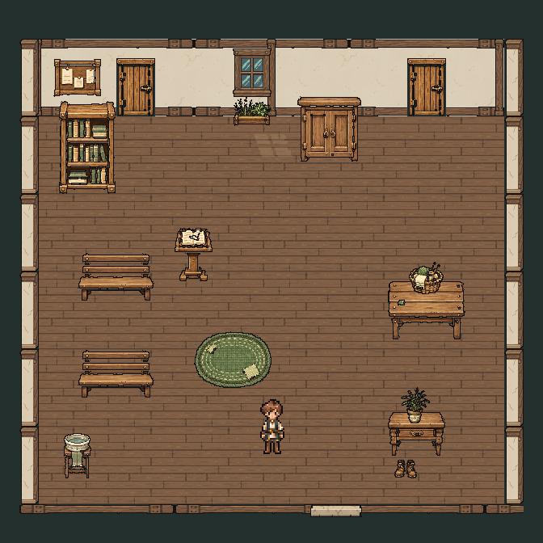
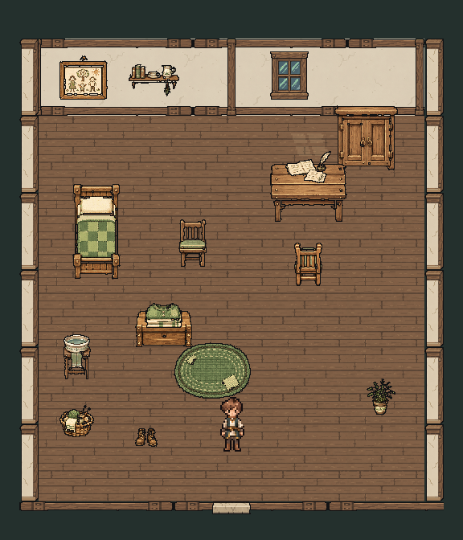

# Sanctuary hall and bedroom: integrated 2× environments

All three Sanctuary home interiors now use the higher-density renderer and
consistent dining-room materials. Hall and bedroom artwork retains its original
logical proportions, layout, navigation and actor registration. This review
records local implementation evidence; the
[visual art standard](../../VISUAL_ART_STANDARD.md) remains the construction guide.

## Runtime views

[Hall](hall.png) · [Bedroom](bedroom.png) · [Window outline](window_near.png) ·
[Open doors](hall_doors_open.png) · [Sleeping](sleeping.png) · [Wake pose](wake.png)

[Serene consulting her list](serene_consult_list.png) ·
[Serene arranging linen](serene_arrange_hall.png)





These are actual native-density World compositions with current actors and
nonpersistent, isolated shot selection. The sleeping head still rests on the
pillow; the existing wake controller draws the native quilt patch over its
registered body poses. Serene's list and linen work were inspected in the
actual furniture/depth arrangement. Character anatomy, poses, timings, carrying
and transfer behavior were not reconstructed by this environment PR. Completion
checks alone are not used as evidence of drawing or staging quality.

## Asset sources and registration

`assets/source/terrain/eldenmere/sanctuary_home_hd/` retains the newly drawn atlas,
its SHA, the original map/layout inventory and collision hashes. Fourteen local
prop exports cover notices, bookcase, herbs, bookstand, rug, mending basket,
boots, bed, desk notes, family drawing, chest, clothes, and the two small hall
workstation props. Their original logical canvases and support bounds determine
registration. Source extraction uses the existing dining exporter helpers for
hard alpha, matte cleanup, palette and thin black exterior contours.

Adequate existing 2× dining-bank sources supply matching floor, plaster, windows,
beams, cutaway walls, thresholds and shared furniture. Those integrated assets
are reused unchanged. The new runtime bank records this dependency explicitly.
One architecture frame per room plus compact nine-pose daylight layers preserves
the 5.4-second light cycle without duplicating full-room rasters. Reduced motion
holds those light layers on a static frame.

Hall portals have five new 48×72-artwork / 24×36-logical poses. A rigid door leaf
narrows about its left hinge while the jamb, cap and portal footprint stay fixed.
The existing opening/closing logic, timing, collision, triggers, destination and
arrival-facing data remain unchanged. Static door artwork is composed by the
normal depth pass rather than painted twice into the background.

The bedroom window is a separate background-depth entity so its existing
inspection can receive an outline. Its original story anchor already specified
(180,90) and the existing dialogue; the old compiled map omitted that destination.
The migration restores that one missing destination. Other destinations, all
original entity positions/sort baselines, floor envelopes, spawn points, probes,
collision bytes and original legacy PNGs remain unchanged.

Serene's room-owned list and linen use new room-only replacements. The existing
held/body action banks retain their approved artwork and lifecycle; unrelated
rooms and character banks are not silently migrated. Rebuilding all three home
banks does not certify other environments as rebuilt.

## Bedroom inspection cues

All five existing subjects now use explicit availability resolvers:
books, desk notes, family drawing, wardrobe and window. Cues follow the existing
`explore`, `assignment` and `done` inspection stages. Wake/breakfast and UI/scene
locks suppress them; loading or returning to the bedroom reconstructs them from
opening state. Normal prompts and interaction reach remain with the original
handler. No inspection awards quest progress or alters the save schema.

These are repeatable inspections: after dialogue closes they remain available,
so their cues can return. No one-time discovery receipts were invented. Glint
spacing, proximity thresholds, steady yellow outlines, depth, pause and reduced
motion reuse the dining-room cue system. Hall decoration is not given invented
inspection prompts or glints. Central documentation now explicitly distinguishes
repeatable inspections from exhausted actions.

## Verification

The seven new checks cover source hashes, native detail, black contours, hard
alpha, geometry/collision preservation, fixed door registration, all five actual
inspection prompts and original dialogue, cue availability/restoration, real
bidirectional room/courtyard transfers, and rendering the existing wake quilt
against the native bed. The initial 56 affected checks also passed before the
final hall-prop integration (overlapping coverage).

Final combined results and sequential draw benchmarks are recorded below.
All exports and both maps rebuild byte-identically. Changed Python files compile,
changed documentation links resolve and `git diff --check` passes. Only the two
scoped playable maps and new banks are migrated; historical source/review assets
remain intact. Broad-suite success beyond the recorded commands is not claimed.

Reproduce with:

```sh
python tools/build_sanctuary_home_hd.py
python tools/capture_sanctuary_home_hd.py /tmp/home-review
python tools/profile_renderer.py --frames 60 --output /tmp/home-profile.json
PYTHONPATH=.:tests SDL_VIDEODRIVER=dummy SDL_AUDIODRIVER=dummy python -m unittest \
  test_sanctuary_home_hd test_sanctuary_dining_hd test_object_cues \
  test_opening_sequence test_opening_gameplay test_bed_rest test_serene_runtime \
  test_tomas_routines test_sanctuary_return test_regent_crossroads_gameplay \
  test_save_system_gameplay test_rendering test_gallery_session test_quest_playtest_session
```

For the retained legacy full-interior generation pipeline, apply base compilation
and Tomas's additions, then the dining exporter, then this exporter. The home
exporter updates art registration without replacing unrelated gameplay edits.

## Final results

**187 tests passed** with the combined command above, including every registered
Gallery scene completing through rendered dialogue and real input, quest
playtest sessions, opening/rest gameplay, routines, autosaves and native rendering.
No failure was reported by this scoped run; it is not a claim about unrun suites.

[benchmark.json](benchmark.json) records sequential baseline/current production
runs with the same interpreter, SDL dummy 960×640 display, four warmup draws and
60 measured draws. The baseline is main commit
`4bacfad9b61c8667060e172dec2f65dcf186233d`, with its original hall/bedroom maps and
runtime. Temporary saves isolate progress; simulation update is excluded.
The active-bedroom sample stands at the window with inspection stage `explore`;
it advances cue presentation, without changing quest state. The baseline has
no bedroom discovery cues.

| Scene | Baseline median ms | Rebuilt median ms | Rebuilt p95 ms |
| --- | ---: | ---: | ---: |
| hall | 1.622 | 1.518 | 1.633 |
| bedroom | 1.517 | 1.417 | 1.553 |
| bedroom_cues | 1.760 | 1.827 | 2.026 |
| dining | 1.683 | 1.720 | 1.908 |

Shared architecture and compact light layers avoid enlarging every full-room
animation frame. These draw-only measurements are host/driver-specific and do
not guarantee total FPS on target hardware. Process peak RSS across the entire
multi-game/Gallery profiler was 1138.2 MiB baseline and 1135.3 MiB rebuilt; that
high-water mark includes unrelated assets/audio and is not renderer-only memory.
The existing bounded caches remain in use. New character and exterior artwork,
and the previously documented cinematic projection bottleneck, remain separate work.
