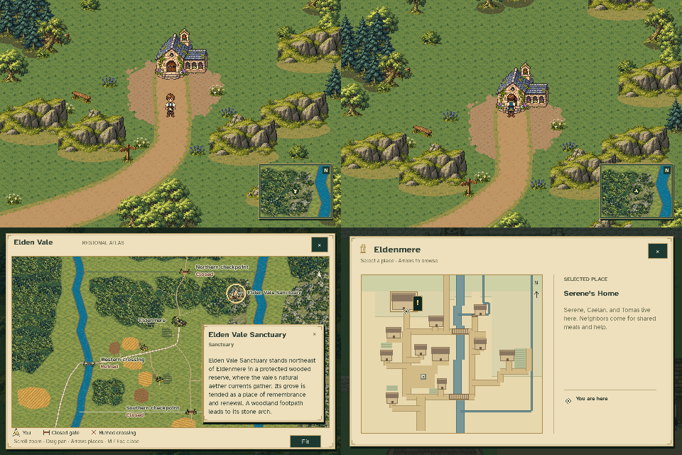

# Sanctuary naming and approach review

- [Clear sanctuary approach](sanctuary_approach.png): the overworld stairs are removed.
- [Sanctuary miniature](sanctuary_miniature.png): the building and wooded terrace remain.
- [Regional atlas](sanctuary_regional_atlas.png): the regional site is **Elden Vale Sanctuary**.
- [Town map](serenes_home_town_map.png): the village building is **Serene’s Home**.

These stills use the production game renderer with ordinary movement from
Eldenmere’s southern exit. Disposable save/settings files leave player files
untouched; no quest or equipment state is seeded. Visiting the miniature
does not load a scene or alter quests, inventory, story flags or music.
The [verification record](verification.json) includes the frozen geometry hash.
The previous overworld sanctuary review is preserved unchanged.
